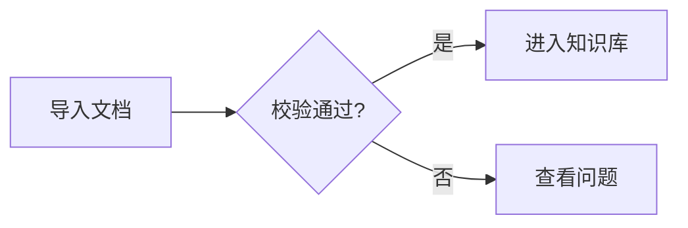
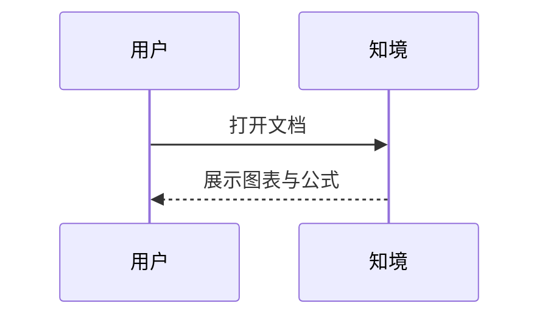
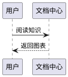

# 文档中心：图表与数学公式

阅读模式支持 Mermaid、PlantUML 和 KaTeX 数学公式。编辑/对比仍使用原始Markdown；阅读时本地生成图形，不改原文件，不将文档发送给第三方画图服务。

## Mermaid

使用 `mermaid` 代码块。已在浏览器和生产构建中验证流程图、时序图：

````markdown



````

使用Mermaid内置图表语法；自定义初始化指令、YAML配置与嵌入图片不在当前策略内，出现时保留源码并提示原因。

## PlantUML

支持 `plantuml`、`puml`、`uml` 代码块。采用官方原生JavaScript引擎和Smetana布局，不要求安装Java、Graphviz或配置在线服务。已验证时序图与类图：

````markdown

````

省略 `@startuml` / `@enduml` 时会补齐。支持独立代码块；`!include`、`!includeurl`、主题/标准库加载、预处理指令和函数保留源码展示，不读取磁盘或远程资料。

## 数学公式

使用KaTeX支持的LaTeX数学语法：

````markdown
行内公式：$E = mc^2$

$$
\sum_{i=1}^{n} i = \frac{n(n+1)}{2}
$$

```math
\begin{bmatrix} 1 & 2 \\ 3 & 4 \end{bmatrix}
```
````

独立公式也可用 `latex` 或 `tex` 代码块。公式错误时显示源表达式；普通行内代码与其他语言代码块保留原意。本功能展示数学表达式，不编译完整TeX文档。

## 阅读操作与边界

- 图表支持缩放、重置、横向滚动、SVG下载和展开源码；失败后可重新渲染。
- 进入视口附近才渲染，同屏最多两个任务。切换文档会取消旧任务，清理iframe及临时图片URL，不显示上一份文档的图形。
- 图表最多24,000字符/500行，SVG最多2Mi字符及8192像素；PlantUML引擎另限4096像素。15秒超时后可重试。
- 公式最多8,000字符，限制宏展开与尺寸。无效/过大的内容显示源码，正文与导航继续可用。
- 图表在无同源权限的sandbox iframe内生成，禁止外部请求及读取工作台Cookie/存储。父页面核验消息来源、清理SVG后作为图片展示，图中链接不执行业务操作。

SVG下载针对当前图表；原始Markdown导入/保存/导出仍保留源码。现有PDF导出路径不调用浏览器图表引擎，本次图形展示范围为Web阅读层。

在工作台打开“文档图表与公式示例”项目，或使用[验收样例](../fixtures/markdown-visuals.md)。样例末尾包含明确标注的错误语法，用于展示降级。

## 实现与验证

固定Mermaid12.2.0、PlantUML JS1.2026.9、KaTeX0.19.1和DOMPurify3.4.17。数学插件依赖中的旧KaTeX范围通过统一override升级，单测验证兼容，当前npm审计0漏洞。许可随构建保存于 `diagram-licenses.txt`。

单测覆盖数学/别名/错误及资源策略；真实Chromium覆盖四个正常图表、两类错误、矩阵、缩放/下载、超时重试、隔离与导航取消。生产构建另经临时Nginx验证。单测和浏览器测试使用独立Vite缓存，不影响当前开发服务的依赖摘要。

实现参考：[PlantUML JS API](https://github.com/plantuml/plantuml/blob/master/src/main/teavm/web/GITHUB_INTEGRATION.md)、[Mermaid配置](https://mermaid.js.org/config/schema-docs/config-properties-secure.html)、[KaTeX选项](https://katex.org/docs/options)。实际结果见[验证记录](VERIFICATION.md)。
