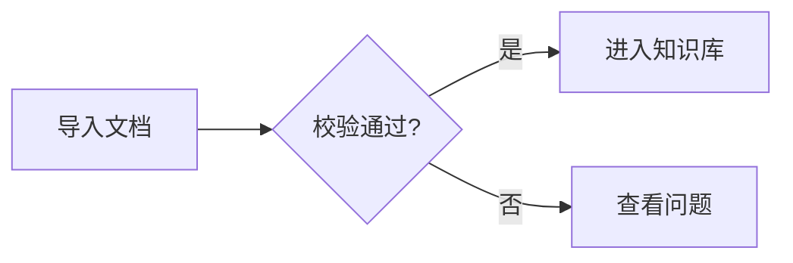
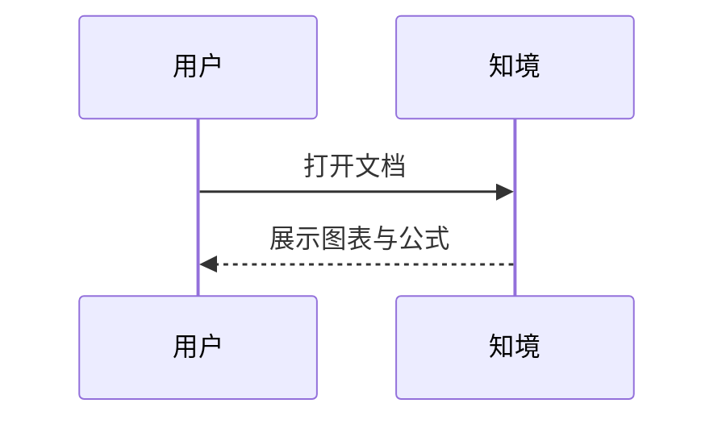
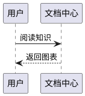

# 文档中心：图表与数学公式

阅读模式支持 Mermaid、PlantUML 和 KaTeX 数学公式。编辑/对比仍使用原始Markdown；阅读时本地生成图形，不改原文件，不将文档发送给第三方画图服务。

2026-11-13：Studio 文档、知识小窗和 AI 说明使用同一套完整 Markdown 阅读组件，支持 GFM 表格、嵌套列表、任务列表、脚注、跨章节引用、中文标点相邻加粗、代码高亮、公式和图表。全文一次解析，章节身份、定位和业务关联仍保留；目录默认折叠。原 HTML 手册保留独立的原样阅读入口。

单文件只读成品也内嵌 Markdown 解析器、字体和 Mermaid 引擎，离线无需 CDN。其 PlantUML 暂保留源码；Studio / Web 的 PlantUML 本地绘图能力继续保留。不能加载的图片、无效公式或图表明确显示原因和原文，不删除正文。

文档 ZIP 图片按当前草稿或准确快照读取；正文未变、仅图片更新时也使用所选图片版本。普通 HTML 转为平台文档时保留加粗、图片、链接、表格、代码及列表，同时保存原始字节和原阅读页面。安全的格式标签可以显示，脚本、事件处理器及任意样式不在主工作台执行。AI 回答中的图片仅自动加载准确引用原文中已有的图片地址。

## Mermaid

使用 `mermaid` 代码块。已在浏览器和生产构建中验证流程图、时序图：

````markdown



````

使用Mermaid内置图表语法；自定义初始化指令、YAML配置与嵌入图片不在当前策略内，出现时保留源码并提示原因。

## PlantUML

支持 `plantuml`、`puml`、`uml` 代码块。采用官方原生JavaScript引擎和Smetana布局，不要求安装Java、Graphviz或配置在线服务。已验证时序图与类图：

````markdown

````

省略 `@startuml` / `@enduml` 时会补齐。支持独立代码块；`!include`、`!includeurl`、主题/标准库加载、预处理指令和函数保留源码展示，不读取磁盘或远程资料。

## 数学公式

使用KaTeX支持的LaTeX数学语法：

````markdown
行内公式：$E = mc^2$

$$
\sum_{i=1}^{n} i = \frac{n(n+1)}{2}
$$

```math
\begin{bmatrix} 1 & 2 \\ 3 & 4 \end{bmatrix}
```
````

独立公式也可用 `latex` 或 `tex` 代码块。公式错误时显示源表达式；普通行内代码与其他语言代码块保留原意。本功能展示数学表达式，不编译完整TeX文档。

## 阅读操作与边界

- 正文按手册方式显示完整缩略图，限制宽度与高度，小图不主动放大；普通图片和图表均可点击或按 Enter / 空格打开大图，提供适应窗口、按宽度、缩放、100% 重置、拖动与滚轮操作。图表仍支持 SVG 下载和展开源码，失败后可重新渲染。
- Mermaid 明确采用无默认投影的 `classic` 外观，避免放大时节点边缘呈现偏移灰影。缩放移至大图窗口，百分比按图像自然尺寸计算；切换适应窗口或按宽度时重新计算比例。Studio、知识小窗、引用预览、独立窗口和新导出的离线阅读器复用 [Markdown 共享模块](../packages/markdown-runtime/README.md)，原始 Markdown 不变。
- 进入视口附近才渲染，同屏最多两个任务。切换文档会取消旧任务，清理iframe及临时图片URL，不显示上一份文档的图形。
- 原样 HTML 手册使用来源自带的 SVG 查看器。其图表弹窗固定预留双轴滚动条空间，避免特定缩放比例下自动适配与滚动条反复触发尺寸重算；工作台、新模板和新导出同步，原始字节及 SVG 保留。详见[修复记录](upgrades/v3/ASSISTANT_TOOLS_AND_DIAGRAM_2026-11-15.md)。
- 图表最多24,000字符/500行，SVG最多2Mi字符及8192像素；PlantUML引擎另限4096像素。15秒超时后可重试。
- 公式最多8,000字符，限制宏展开与尺寸。无效/过大的内容显示源码，正文与导航继续可用。
- 图表在无同源权限的sandbox iframe内生成，禁止外部请求及读取工作台Cookie/存储。父页面核验消息来源、清理SVG后作为图片展示，图中链接不执行业务操作。

SVG下载针对当前图表；原始Markdown导入/保存/导出仍保留源码。现有PDF导出路径不调用浏览器图表引擎，本次图形展示范围为Web阅读层。

在工作台打开“文档图表与公式示例”项目，或使用[验收样例](../fixtures/markdown-visuals.md)。样例末尾包含明确标注的错误语法，用于展示降级。

## 实现与验证

固定Mermaid12.2.0、PlantUML JS1.2026.9、KaTeX0.19.1和DOMPurify3.4.17。数学插件依赖中的旧KaTeX范围通过统一override升级，单测验证兼容，当前npm审计0漏洞。许可随构建保存于 `diagram-licenses.txt`。

单测覆盖数学/别名/错误及资源策略；真实Chromium覆盖四个正常图表、两类错误、矩阵、缩放/下载、超时重试、隔离与导航取消。生产构建另经临时Nginx验证。单测和浏览器测试使用独立Vite缓存，不影响当前开发服务的依赖摘要。

实现参考：[PlantUML JS API](https://github.com/plantuml/plantuml/blob/master/src/main/teavm/web/GITHUB_INTEGRATION.md)、[Mermaid配置](https://mermaid.js.org/config/schema-docs/config-properties-secure.html)、[KaTeX选项](https://katex.org/docs/options)。实际结果见[验证记录](VERIFICATION.md)。
