# 知境 VKS 1.0 完整开发设计方案

> 以业务操作为入口，以源码和运行证据为依据，通过 MCP 建立、查询和维护软件项目知识。

| 项目 | 内容 |
| --- | --- |
| 产品工作名称 | 知境 / Visual Knowledge Studio，简称 VKS；名称可在立项时调整 |
| 方案版本 | 1.0 设计基线 |
| 编制日期 | 2026-10-25 |
| 交付用途 | 产品评审、技术评审、UI 交接、任务拆分和后续 Codex 分阶段实施 |
| 首批对象 | Java 8 / Spring MVC / MyBatis 项目，已有 Web 页面、Markdown、OpenAPI 和历史原型 |
| 部署方式 | 企业内网私有化，支持本地采集器；不要求将公司源码发往公网 |
| 文件格式 | UTF-8 Markdown；UI 为 PNG；技术图同时提供 Mermaid、SVG 和 PNG |
| 实施状态 | 本文是开发设计，不代表平台已开发或用户实际项目已完成接入 |

## 方案摘要

VKS 1.0 的交付目标不是普通文档站，也不是通用前端逆向生成器，而是一套可以用于真实项目交接的业务交互式知识库：用户从业务页面选中一个操作，查看其业务说明、接口、代码、SQL 和文档章节；AI 通过 MCP 导入同一套材料、提出关联并读取经审核的知识。

核心闭环为：资料接入 → 固定多来源版本 → 解析事实 → 形成场景 → 建立候选关联 → 人工审核 → 发布知识版本 → 双向查询 → 检测新版本影响。

第一版必须同时交付业务工作台与 MCP。确定性解析产生事实索引，语义匹配产生候选；人工审核状态与证据有效性分开。讲解模式只读，不执行开票、退款、删除等真实业务操作。

推荐采用 React + TypeScript 前端、Python 3.12 + FastAPI 模块化单体、PostgreSQL、Celery + RabbitMQ、Playwright 本地 Runner。代码分析器、模型和文件存储均通过适配器接入，避免被单一开源项目绑定。

本方案以“缴费记录开票”作为贯穿演示，页面、金额、客户、版本号和接口链路均为合成设计示例；图中的业务基线 v1.22 不等于本平台版本号。平台接入实际源码后，必须重新核验对应关系。

### 交付物导航

- 本文：完整产品与技术设计，含功能清单、页面规格、流程图、时序图、实现边界和验收矩阵。
- [UI 设计图目录](ui/)：8 个核心页面的高保真概念图，字段与状态的实现以本文规格为准。
- [技术图目录](diagrams/)：6 张流程／时序／架构／状态图，可编辑 Mermaid 与矢量文件。
- [契约目录](contracts/README.md)：OpenAPI、MCP 工具目录、导入包、场景和绑定清单 Schema。
- [阅读说明](README.md)：解压、查看和使用方法。

仅下载本 MD 时，正文和 Mermaid 源码完整保留；如需本地显示所有 UI 图片，请下载并解压完整 ZIP，保持相对目录不变。

### 目录

1. 产品定位与版本边界
2. 用户角色与权限
3. 开源调研与复用策略
4. 功能清单与验收条件
5. 页面设计和高保真 UI
6. 设计系统与交互规范
7. 关键业务流程
8. 状态模型
9. 技术架构与选型
10. 身份版本与证据
11. 关系型数据模型
12. 导入与异步任务
13. 智能关联与 AI 工作流
14. HTTP API 契约
15. MCP 设计与导入时序
16. 版本漂移与发布
17. 安全设计
18. 测试与质量目标
19. 部署运维与恢复
20. 实施阶段与交付节奏
21. 风险和成本控制
22. 功能到实现的交接映射
23. 完整验收测试矩阵
24. 参考资料


## 1. 产品定位与版本边界

Visual Knowledge Studio（简称 VKS，工作名称）是面向软件研发团队的可交互项目知识平台。以业务场景和页面操作为入口，将 Markdown 章节、API、代码符号、数据库对象和运行证据关联起来，帮助开发、测试和交接人员理解系统。

1.0 的承诺是：针对一个已接入项目，从有证据的页面操作进入相应技术知识，并能反向从技术知识找到业务场景；通过 MCP 完成受控导入、检索、关联提案和版本复核。1.0 不承诺只读一遍任意前后端源码，就自动重建所有页面和业务状态。

### 1.1 实现目标与可验证价值

| 目标 | 产品能力 | 拟定验证方法 | 业务价值 |
| --- | --- | --- | --- |
| 降低接手成本 | 业务场景导览、操作解释、源码证据 | 让未参与开发的人员完成 5 个定位任务，对比传统文档方式耗时 | 新人交接不必在原型、文档和 IDE 之间反复寻找 |
| 降低技术知识检索成本 | UI → API → 代码 → 文档，双向导航 | 对 30 个标注动作测量找到正确接口与说明的耗时和准确率 | 日常排查更快获得相关上下文 |
| 降低错误知识风险 | 来源、版本、证据类别、审核状态 | 任取一条已发布技术关系均可追溯到原始材料 | AI 结论能够被检查，而不是只能相信 |
| 改善文档维护 | 按版本检测变更、标记可能过期的章节 | 在样例项目注入 API 改名、方法移动、规则变化等变更 | 避免旧文档看起来仍然可信 |
| 支撑 AI 工具调用 | 面向任务的 MCP 工具与结构化结果 | MCP 客户端从导入到关联提案的端到端测试 | AI 在明确业务上下文内工作，减少重复扫描 |
| 保留既有资产 | 原始 MD、Axure HTML、OpenAPI、源码快照导入 | 原始文件哈希不变；导出后内容可恢复 | 不强制团队迁移所有文档格式 |

价值指标必须建立试点基线后才报告改善幅度。不能把“节省 50% 时间”等假设写成已经实现的结果。

### 1.2 首批支持矩阵

| 输入/能力 | 1.0 支持等级 | 交付边界 |
| --- | --- | --- |
| 本地目录、ZIP 源码快照 | 核心支持 | 白名单目录、压缩包安全检查、只读导入；不执行仓库脚本 |
| Git 源码快照 | 标准适配 | 读取用户授权仓库的指定 ref，固定 commit；不自动 push、提交或修改源码 |
| SVN 源码快照 | 标准适配 | 通过本地 Runner 或受控适配器读取指定 revision；不强制转 Git |
| Markdown | 核心支持 | 标题、段落、表格、代码围栏、相对附件、章节锚点；HTML 安全清洗；不执行 MDX |
| OpenAPI 3.x / 常见 Swagger 2.0 | 标准适配 | 导入、解析、规范化与来源保留；不自动调用文档中的任意服务地址 |
| Java 8、Spring MVC、MyBatis | 首批深度解析 | 路由、类/方法、调用、Mapper namespace/id、XML SQL；无法确定的动态关系显式标记未解析 |
| 前端 React / Vue 运行页面 | 通用采集支持 | 记录路由、可访问名称、DOM、交互和 HTTP；不保证所有版本都能精确回溯源码 |
| 前端源码位置 | 有条件支持 | 显式 build manifest、测试属性、source map 或兼容适配器；不兼容时降级为页面/API 关系 |
| Axure 导出的 HTML | 兼容支持 | 隔离渲染、页面及热点导入；业务跳转优先保留原导出能力，复杂脚本按安全策略降级 |
| 单张 UI 图片 | 降级支持 | 人工热点和章节关联；OCR 仅提供候选，不能宣称真实交互或接口行为 |
| 后端调用追踪 | 导入式支持 | 可接收已有 trace；新增埋点、全链路探针部署为试点选配，不作为所有项目接入前提 |

### 1.3 明确不纳入 1.0

- 自动重建任意 React/Vue/Angular/移动端项目，或自动运行任意仓库的安装、构建脚本。
- 在生产环境自主点击开票、支付、删除、退款等动作，或使用知识探索模式执行真实业务请求。
- 对所有反射、动态代理、拼接 SQL、跨消息队列链路给出完全准确的静态调用图。
- 在线多人同时富文本协作、完整需求/缺陷/任务管理系统、Figma 级自由绘图、外部公开文档门户。
- 代码修改和自动提交、自动修复生产问题、完整测试执行平台、自动发布业务系统。
- 图数据库、插件市场、多租户商业计费、全组织 IAM/SSO 联邦管理等重型平台能力。

## 2. 用户角色与权限

以实例内多项目、项目级权限隔离为 1.0 基础。AI 客户端使用独立令牌/身份，继承被授予的项目范围和操作权限，不拥有“AI 超级用户”特例。

| 操作 | 阅读者 | 编辑者 | 审核者 | 项目管理员 |
| --- | --- | --- | --- | --- |
| 浏览已发布知识、下载允许导出的文件 | 是 | 是 | 是 | 是 |
| 查看源码/网络证据 | 按独立敏感信息权限 | 按独立权限 | 按独立权限 | 可配置 |
| 导入文档、编辑草稿、配置热点 | 否 | 是 | 是 | 是 |
| 启动只读源码分析 | 否 | 是 | 是 | 是 |
| 发起测试环境录制 | 否 | 需录制授权 | 需录制授权 | 可配置 |
| 提交绑定候选 | 否 | 是 | 是 | 是 |
| 审核候选/发布知识版本 | 否 | 否 | 是 | 是 |
| 管理项目成员、来源连接、令牌、保留策略 | 否 | 否 | 否 | 是 |
| 删除项目、清除历史证据 | 否 | 否 | 否 | 二次确认及审计 |

实例管理员负责创建项目、维护部署与用户，不默认绕过项目数据访问控制。单人模式允许同一用户兼任编辑者和审核者，但审核身份仍留痕。

敏感证据权限至少拆分 `source:read`、`trace:read`、`secret:manage`；常规阅读者可理解业务，却不一定可下载完整源码或响应报文。

## 3. 开源调研与复用策略

选择组件的依据是能否填补明确能力，而不是将多个完整产品直接拼装。以下能力依据官方仓库或文档；集成决定是本方案的工程判断。检索日期为 2026-10-25，立项时须锁定版本、复核许可证和依赖。

| 项目或组件 | 已有能力 | 1.0 采用方式 | 不承担的职责 |
| --- | --- | --- | --- |
| [Backstage / TechDocs](https://backstage.io/docs/features/software-catalog/) | 软件目录和代码旁元数据，TechDocs 组织文档 | 借鉴项目、组件、来源和文档元数据模型，不整体 Fork | 不是页面操作到业务实现的绑定引擎 |
| [DeepWiki-Open](https://github.com/AsyncFuncAI/deepwiki-open) | 仓库文档、图表及代码导览 | 借鉴生成结构和证据上下文，不将自动生成文章作为唯一真值 | 不自动证明真实业务行为 |
| [Storybook](https://storybook.js.org/docs/writing-stories) | 可渲染组件／页面状态和交互示例 | 作为团队已有预览包的可选输入；不作为所有项目接入前提 | 不自动重建所有运行环境和后台状态 |
| [Playwright](https://playwright.dev/docs/trace-viewer) | 浏览器操作、DOM 快照和网络记录 | 核心 Runner 采集引擎，配合受控场景 DSL | Trace 中的 Source 不是自动生成的后端调用链 |
| [rrweb](https://github.com/rrweb-io/rrweb) | DOM 变化记录与回放 | 1.0 保留接口，复杂会话回放延后按需要接入 | 回放记录不是可任意分支的真实应用 |
| [React Dev Inspector](https://github.com/zthxxx/react-dev-inspector) | 开发环境 UI 元素到源码位置 | 借鉴显式构建标记／source manifest；框架适配可选 | 不保证生产构建或所有框架版本兼容 |
| [Tree-sitter](https://github.com/tree-sitter/tree-sitter) | 增量语法解析与源码语法树 | 默认静态解析基础，叠加自研框架语义规则 | 语法树不等于完整调用图或业务语义 |
| [CodeGraph](https://github.com/colbymchenry/codegraph) | 符号、关系、MCP；官方设计材料包含 MyBatis 桥接 | 可替换增强分析器，先用 fixture 核验；MIT 许可证 | 不直接接管平台权限、发布和业务证据模型 |
| [React Flow](https://github.com/xyflow/xyflow) | 节点、边、局部关系交互 | 直接集成知识地图；限定图规模 | 不实现后台关系推理 |
| [OpenTelemetry Java](https://github.com/open-telemetry/opentelemetry-java-instrumentation) | 已支持库的运行追踪和上下文传播 | 导入已存在 Trace；新装探针不列为接入前提 | 一次运行只验证经过的路径 |
| [MCP Python SDK](https://github.com/modelcontextprotocol/python-sdk) | Tools、Resources、Prompts 和传输实现 | 直接集成协议层，业务服务与 Web 复用 | SDK 不自动提供企业授权、导入或绑定算法 |

重要许可边界：[GitNexus 的 LICENSE](https://github.com/abhigyanpatwari/GitNexus/blob/main/LICENSE) 当前是 PolyForm Noncommercial，不列入默认企业发行依赖。代码可浏览不等于满足本产品的集成许可；第三方发行和依赖清单须在冻结版本后复核。

选择自研的部分是项目知识模型、UI Action 身份、证据与版本关联、人工审核、发布清单和 MCP 业务契约。这些组成产品差异化能力；编辑器、图形组件和浏览器驱动复用成熟基础设施。


## 4. 功能清单与验收条件

### 4.1 项目与来源管理

| ID | 功能点 | 具体行为与规则 | 验收要点 |
| --- | --- | --- | --- |
| PRJ-01 | 项目创建 | 名称、唯一 key、描述、业务域、负责人、可见范围、默认分析语言 | 重复 key 拒绝；未授权用户不可见 |
| PRJ-02 | 项目模块 | 业务域/模块树；与前后端仓库是多对多关系 | 支持模块调整而不改变知识实体身份 |
| PRJ-03 | 版本基线 | 一个基线引用前端、后端、文档等多来源快照 | 不用单一 commit 假装整个系统同一版本 |
| PRJ-04 | 来源连接 | 本地/ZIP、Git、SVN、MD、OpenAPI、Axure、Web 地址 | 保存来源类型、受控凭证引用、范围；凭证不进入文档 |
| PRJ-05 | 导入预检 | 文件数/体积、编码、忽略目录、疑似密钥、重复材料、可解析语言 | 先预检后确认；原始字节不做全量转码 |
| PRJ-06 | 任务中心 | 排队、运行、阶段进度、部分成功、失败、取消、重试 | 重试幂等；失败文件不使所有成功材料丢失 |
| PRJ-07 | 访问审计 | 导入、录制、查看受限证据、审核、发布、导出记录 | 能检索操作者、项目、时间、对象与结果 |

### 4.2 文档与代码知识

| ID | 功能点 | 具体行为与规则 | 验收要点 |
| --- | --- | --- | --- |
| DOC-01 | Markdown 导入 | 保留原文及附件，解析章节并产生稳定 section_id | 相同输入不产生重复文档；原文哈希可核对 |
| DOC-02 | 文档阅读与编辑 | 目录、代码高亮、草稿保存、版本对比；引用来源只读 | 保存冲突有提示；不静默覆盖他人改动 |
| DOC-03 | 双向关联 | 章节可打开关联页面/动作/API；动作可定位具体章节 | 使用实体 ID，不依赖标题文本作为唯一键 |
| DOC-04 | AI 文档草稿 | 按接口/模块/场景生成草稿，逐段带 source evidence | 无证据段落标明推断/待补充；不覆盖人工原文 |
| DOC-05 | 文档导出 | 原始 MD、知识版 MD、附件及关系 manifest 分别导出 | 原始导出与衍生导出明确区分 |
| COD-01 | API 索引 | method + normalized path + service + version 组成接口身份 | 同名接口跨服务不串联；冲突来源可对比 |
| COD-02 | Java 符号 | 类、方法、注解、参数、返回类型、文件位置和快照 | 每个符号可回看固定版本源码 |
| COD-03 | Mapper 关联 | Java mapper 方法 ↔ XML namespace/id ↔ SQL 片段 | 不能解析的动态表达式不伪造表字段关系 |
| COD-04 | 调用关系 | 直接静态调用、接口实现候选、跨服务候选、运行证据分层 | 静态“可能调用”与运行“实际发生”视觉区分 |
| COD-05 | 代码证据定位 | 方法定位、文件行范围、内容哈希及变更对比 | 行号移动后可通过符号重定位；失败则标记断链 |

### 4.3 场景、原型与交互

| ID | 功能点 | 具体行为与规则 | 验收要点 |
| --- | --- | --- | --- |
| UI-01 | 场景创建 | 场景名、业务模块、角色、前置条件、测试环境、预期结果 | 一个场景可跨多页面；条件可查看和复制 |
| UI-02 | 录制接入 | 本地/私网 Runner 接入授权测试环境；选定域名与动作范围 | 不直接让云端绕过 VPN；凭证只在 Runner 中受控使用 |
| UI-03 | 交互录制 | 记录步骤、截图、DOM/可访问名称、路由、请求摘要及时间 | 敏感输入在采集环节遮蔽，不是保存后再遮蔽 |
| UI-04 | 状态快照 | 步骤前后状态、角色、视口、数据 fixture 引用 | 不把一次成功录制解释为所有状态覆盖 |
| UI-05 | 热点编辑 | 选择元素/区域，指定语义 action_id，关联目标状态或知识 | 支持表格重复行、弹窗、隐藏元素定位冲突提示 |
| UI-06 | 讲解模式 | 默认进入安全快照/受控覆盖层，点击只选择知识对象 | 点击“开票”只打开说明，不触发真实业务请求 |
| UI-07 | 沙盒演示模式 | 使用预录制状态转移或可控 Mock 页面；明确演示标识 | 不复用生产 Cookie；未配置 Mock 的写请求阻断 |
| UI-08 | 场景分支 | 支持成功/失败/校验失败等有限分支；手动补充条件说明 | 分支只能指向存在的状态；推断分支不得伪装已录制 |
| UI-09 | Axure 与截图 | 导入原型后添加知识热点；旧资料标识来源与日期 | 未解析脚本有能力告警；隔离不可信脚本和外联 |
| UI-10 | 场景发布 | 场景草稿预览、审核、随知识基线发布 | 旧版仍可浏览；不能无提示切换为最新源码 |

关键安全设计：不能把“真实测试站点 iframe 加一个按钮”当作安全的讲解模式。跨域页面无法可靠控制时，使用已采集快照和独立热点层。实站录制是单独受权的任务，不是阅读者随手切换的普通模式。

### 4.4 关联引擎与审核

| ID | 功能点 | 具体行为与规则 | 验收要点 |
| --- | --- | --- | --- |
| LNK-01 | 多证据候选 | API 精确匹配、静态调用、录制请求、文档实体提取与语义候选 | 每条候选可展示匹配依据；不只展示黑盒百分比 |
| LNK-02 | 关系类型 | action→api、api→symbol、symbol→sql；documents 统一为主体实体→文档章节 | 类型约束阻止无意义端点组合；章节返回主体使用反向查询 |
| LNK-03 | 候选审核 | 确认、拒绝、改选目标、拆分/合并、备注 | 写入审核人、时间和依据；保留被拒候选以免反复建议 |
| LNK-04 | 人工锁定 | 已确认且人工锁定的关系只提示变更，不自动覆盖 | 重跑分析保留用户决策 |
| LNK-05 | 反向导航 | 每个实体都可查看入边/出边及关联版本 | 默认限定所选基线，防止跨版本串联 |
| LNK-06 | 断链管理 | 源文件、UI 锚点或章节消失时标为 broken | 断链不自动删除，保留历史证据 |
| LNK-07 | 关系纠错反馈 | 用户可标记“关联不正确”和正确目标 | 更新评测集，不能直接训练/上传外部服务 |

置信度是候选排序依据，不是事实证明。确定性事实可自动入索引；业务解释、UI/API 因果及语义关系在 1.0 进入审核。固定规则验证通过只能标记事实来源，不能将模型提议自动改为已审核。

### 4.5 检索、问答、版本与 MCP

| ID | 功能点 | 具体行为与规则 | 验收要点 |
| --- | --- | --- | --- |
| SRH-01 | 统一检索 | 全文、符号/路径精确匹配、按模块/类型/版本过滤 | 先权限过滤再检索和展示，不暴露无权对象名称 |
| SRH-02 | 上下文问答 | 当前动作/章节/接口作为明确 context，可切项目/版本 | 默认只读；回答有证据列表和未确定项 |
| SRH-03 | 缺证据响应 | 无材料时返回缺口和可补充来源 | 不用其他版本或别的项目“补齐”答案 |
| VER-01 | 变更检测 | 比较来源快照，识别符号、接口签名、章节、锚点变化 | 标记“受影响/待复核”而非宣称业务已改变 |
| VER-02 | 影响分析 | 基于边及证据计算受影响动作、章节、场景 | 展示传播路径；可限制跳数和关系类型 |
| VER-03 | 更新提案 | 生成章节 diff 和关系迁移建议，接受/拒绝 | 不改历史发布版；更新形成新草稿 |
| VER-04 | 知识版本发布 | 草稿冻结、审查、发布、回退展示默认版 | 回退只是切换当前基线，不删除新版本证据 |
| MCP-01 | 读取工具 | 列项目、搜知识、解释动作、查证据、查影响 | 与 Web 权限及业务服务复用，不另开绕权路径 |
| MCP-02 | 导入工具 | 导入 manifest/源码快照/MD/原型包，返回任务 ID | schema 校验、size 限制、幂等键、可取消任务 |
| MCP-03 | 关联提案 | 提议绑定、预览影响、提交审核；批准由权限控制 | LLM 不能通过额外参数把 candidate 直接变 confirmed |
| MCP-04 | 任务工具 | 任务状态、阶段结果、失败原因、取消与重试 | 超时不等于任务失败；可重连查询原任务 |
| MCP-05 | 接入管理 | 客户端身份、项目范围、读/写 scope、过期时间、审计 | 新令牌默认只读；秘密只展示一次，撤销立即生效 |
| MCP-06 | 导出上下文 | 提供指定场景的最小知识包及引用 URI | 限制大小、分页或资源读取；不一次输出全仓库 |

## 5. 页面设计和高保真 UI

全局导航保持八个一级入口：项目总览、接入与任务、业务工作台、文档中心、关联审核、知识地图、版本与变更、MCP 与设置。AI 问答作为工作台和检索的上下文侧栏，不单独抢占一级业务导航。

视觉原则：冰蓝白工作区、白色实体卡片、亮蓝主交互、低饱和状态色、精确的间距和分割线。图谱用于解释路径而非装饰性全屏“星空”。技术细节展开按需显示，默认突出当前业务操作的解释与证据。

### P01 项目总览

- 目标：选择项目并判断知识是否足够新、还有哪些接入或审核工作。
- 布局：左侧项目列表；主区项目标题与默认基线；中部模块卡；下方最近场景、待审核、最近变更。
- 字段：项目名、负责人、源版本组合、最近分析时间、资料来源数、场景数、已确认关系数、待审核数、断链数。
- 主操作：新建项目、进入业务工作台、继续导入；次操作：成员、归档、导出。
- 交互：指标显示分母与含义。例如“已建立可信关联 28/40 个试点动作”，不使用无法解释的“知识完整度 92%”。
- 状态：加载显示骨架；空项目显示三步接入引导；连接失败单卡告警；无权限项目不列出；旧基线展示日期与待更新数量。

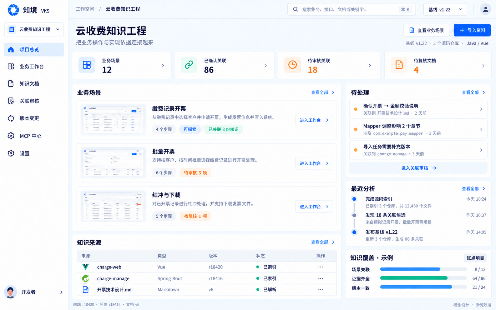

图示：合成数据，展示典型桌面状态；非实际业务系统截图。

### P02 业务工作台

- 布局：顶部基线、场景、角色/环境、模式、分享；左栏业务树与步骤；中部页面快照或沙盒；右栏操作知识；下方可折叠调用链与请求证据。
- 默认模式为“讲解”：点击可交互元素只选中 action，不触发业务执行。右侧标签：业务说明、接口、实现、数据、文档、证据。
- “沙盒演示”仅在可控 Mock 或录制状态机就绪时开放。图标和标签持续表明演示，不把真实请求隐藏在普通操作中。
- 场景编辑：添加/重排步骤、选定热点、填前置条件、选择分支、标记录制/人工/推断来源。
- 关键详情：当前 action_id、请求方法/路径、业务规则、固定版本源码片段、关联章节、审核状态、证据时间、未解析节点。
- AI 侧栏始终显示“当前上下文：项目/基线/场景/动作”，可查看本次检索证据。
- 状态：无选中元素给出引导；热点无绑定提供“建立关联”；证据无权限显示受限提示而非内容；快照资源缺失有可下载诊断；锚点失效展示历史位置与重新定位；加载状态不遮住已有知识。

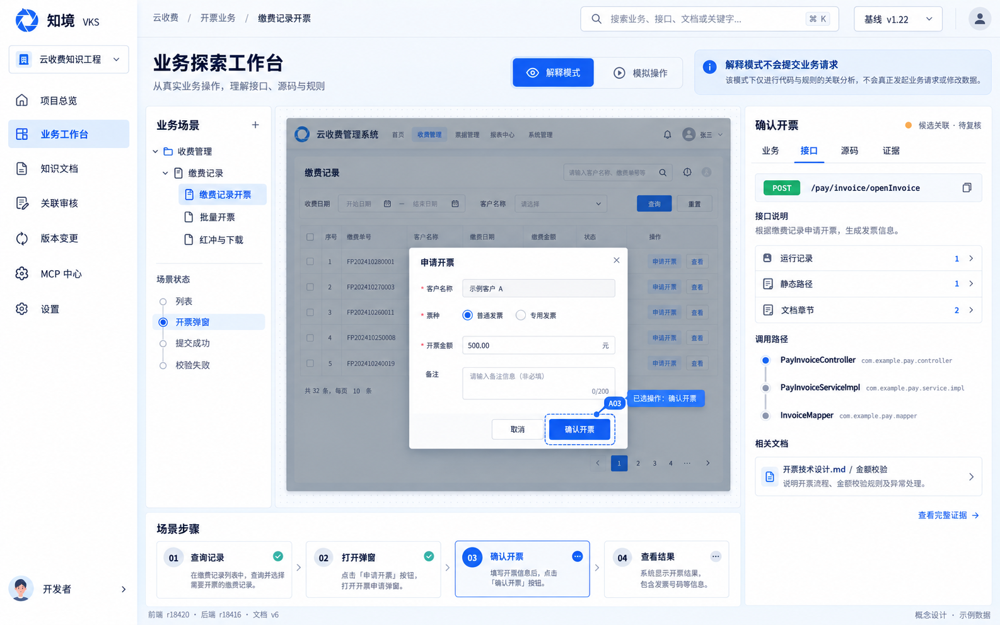

图示：合成数据，展示典型桌面状态；非实际业务系统截图。

### P03 接入向导与任务详情

- 向导步骤：选择项目/基线 → 添加来源 → 范围与隐私 → 预检 → 确认导入。
- 来源页：前端、后端、Markdown、OpenAPI、Axure、运行站点分别添加，可跳过缺失资料。
- 字段：源类型、路径/仓库、branch/ref/revision、模块标签、编码检测、忽略模式、关联环境；所有凭证使用凭证引用，不写入 URL。
- 预检页：文件数与大小、可解析/不支持类型、密钥告警、计划的网络范围、模型数据出境策略、预计任务阶段。
- 任务详情：按“校验/快照/解析/候选/完成”展示阶段、计数、问题和可下载诊断摘要。
- 状态：加载是已知阶段或不确定进度，不伪造百分比；部分成功允许查看成功项；失败可定向重试；取消保留已产生草稿但不可发布；无权限字段禁用并说明；输入版本变化要求重新预检。

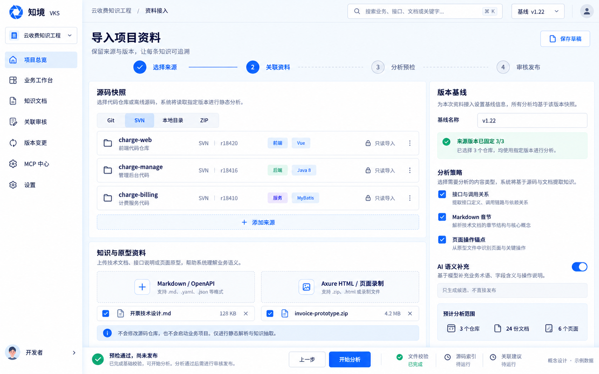

图示：合成数据，展示典型桌面状态；非实际业务系统截图。

### P04 文档中心

- 布局：左文档树和标签；中间 Markdown 读写区；右侧当前章节关联实体列表。
- 字段：标题、来源、模块、知识版本、章节状态、作者/审核者、最近修改、源码基线。
- 操作：导入、创建草稿、编辑、对比、预览、提交审核、导出原始 MD/知识包；源码生成草稿使用独立入口。
- 双向跳转：点章节中的动作卡片打开 P02 并选中动作；从 P02 进入文档时定位并高亮指定章节，不只是打开整个文件。
- 状态：自动保存进度与失败重试；并发编辑冲突明确比较；不支持附件类型给下载；空章节提示缺材料；无源码权限仍可看被授权业务说明；过期章节顶部可见来源变更。

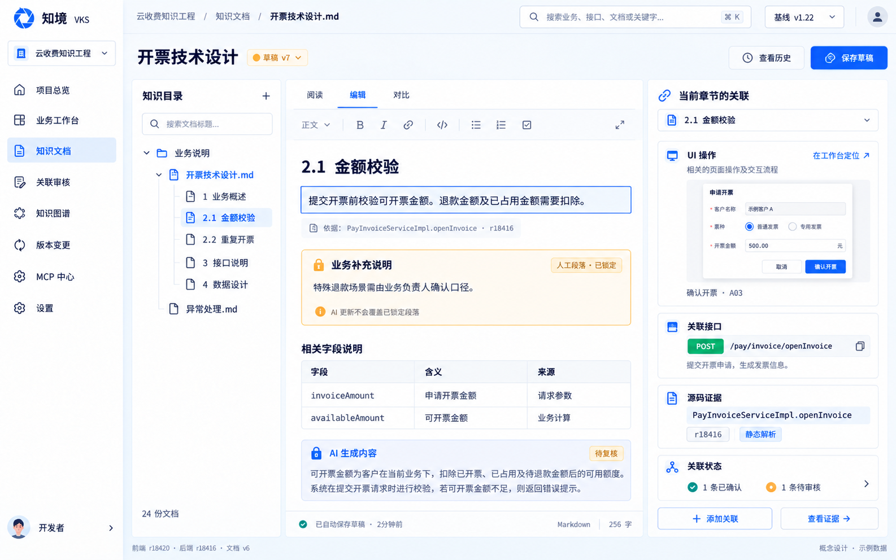

图示：合成数据，展示典型桌面状态；非实际业务系统截图。

### P05 关联审核中心

- 布局：左候选列表与筛选；中间 UI 动作/章节和候选目标对照；右侧证据、理由和审核动作。
- 字段：关系类型、来源、候选目标、置信等级、证据类型/数、版本、冲突、提出者、更新时间。
- 操作：确认、拒绝、改选、批量确认同类确定性关系、补充备注、人工锁定。
- 高风险关系（权限、金额、退款、重复提交）使用明确业务规则审核提示，不自动批准。
- 批量确认前展示对象数量及规则；不能跨基线混批；每条关系仍有独立审核日志。
- 状态：候选已被他人处理则刷新并说明；证据变化使确认失效需重检；全部处理完成展示剩余断链；无审核权限可评论或提交但无确认按钮；被拒候选保留审计且默认不再重复推荐。

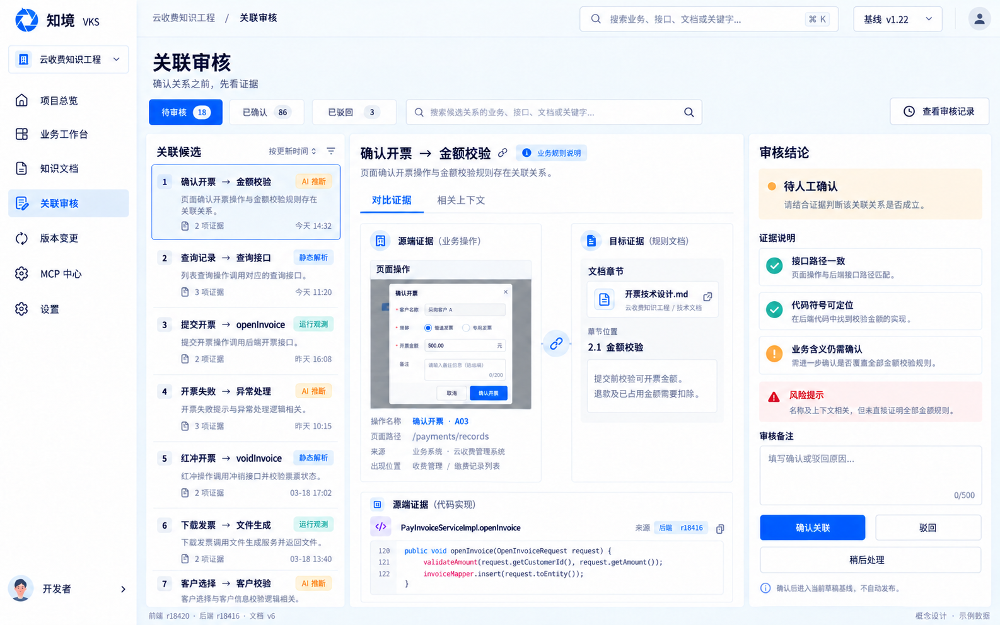

图示：合成数据，展示典型桌面状态；非实际业务系统截图。

### P06 知识地图与技术探索

- 布局：左实体搜索；主区局部关联图；右详情；顶部节点类型、最大跳数、证据筛选。
- 默认展示选中动作的局部图而不是整个仓库。节点类型：场景、动作、API、符号、SQL、文档章节、规则。
- 实线表示经确认/确定性关系，虚线表示推断候选；边标签和图例解释证据类别，不能只靠颜色。
- 操作：展开一跳、收起、过滤、路径定位、固定布局、导出局部图、转到源码/页面/章节。
- 状态：图太大时分页/聚合且显示隐藏数量；关系断裂用“未解析”占位而非臆补；受限节点不可泄露名字；旧版图始终保留版本提示。

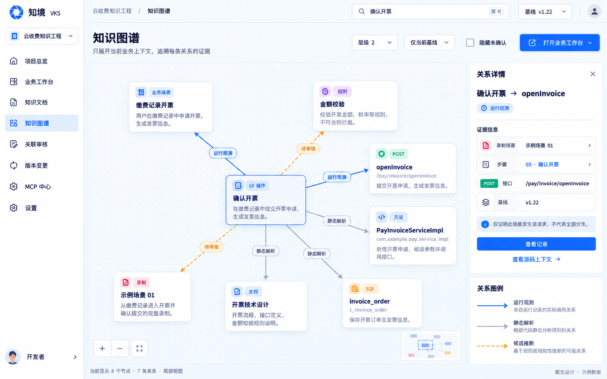

图示：合成数据，展示典型桌面状态；非实际业务系统截图。

### P07 版本与变更

- 布局：基线选择器；来源快照差异摘要；受影响场景/文档清单；双栏 diff；审核及发布动作。
- 字段：版本名、来源版本组合、分析器版本、变更时间、变更对象、影响路径、更新提案状态。
- 操作：导入新快照、比较两个基线、生成更新提案、接受/拒绝 diff、重定位锚点、发布新知识版本、回退默认版。
- 状态：没有共同来源时只做新增/删除比较；不同分析器版本产生“解析差异”提示；大规模删除需检查导入范围；存在断链时按发布规则阻止或要求明确豁免；审核后素材变化必须重新确认。

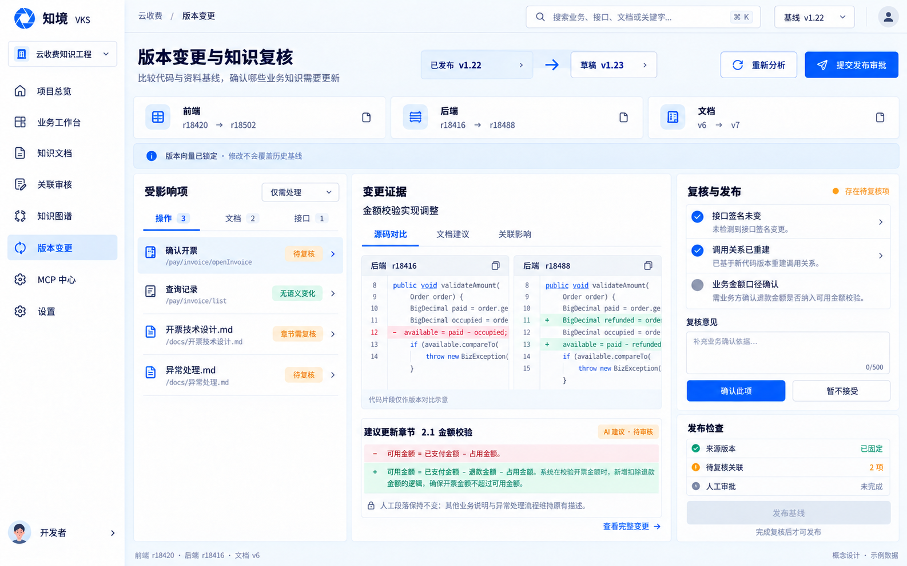

图示：合成数据，展示典型桌面状态；非实际业务系统截图。

### P08 MCP 与项目设置

- 分区：接入配置、工具目录、权限策略、调用日志、Runner、模型与保留策略。
- 字段：服务地址、传输方式、客户端身份、项目范围、工具作用域、速率限制、令牌到期、最近调用、失败率。
- 操作：复制接入配置、创建只读凭证、授权导入/提案、测试连接、查看调用链、撤销、轮换；敏感密钥仅一次展示。
- MCP 工具目录分“只读/导入/提案/审核申请/导出/任务管理”，不暴露批准或发布工具，也不将批准权限与导入权限捆绑。
- 状态：连接测试区分网络/认证/授权/协议错误；Runner 离线说明任务排队而非自动切云端运行；scope 缺失给管理员申请入口；秘密不回显；过期令牌和撤销行为可审计。

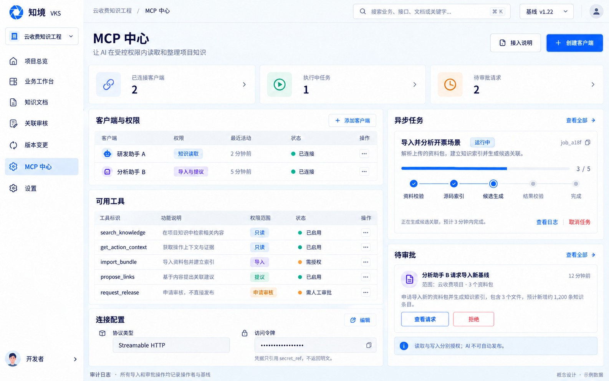

图示：合成数据，展示典型桌面状态；非实际业务系统截图。

## 6. 设计系统与交互规范

### 6.1 视觉基线

采用冰蓝与白色的浅色工作台，保持信息密度、精细层次和清晰技术辨识度。不使用大面积黑色画布，不以装饰图谱或大面积渐变替代业务信息。

| 设计项 | 基线 |
| --- | --- |
| 主工作区 | #F5F8FF；内容面板 #FFFFFF；边框 #DDE7F7 |
| 品牌与主操作 | #2563EB；选中背景 #EAF2FF |
| 文字 | 主文字 #14213D；次级文字 #536680；禁用文字独立降低对比 |
| 状态 | 确认绿、候选琥珀、异常红、信息蓝；必须同时有文字或图标 |
| 字体 | 中文系统无衬线 / Noto Sans SC；英文 Inter 或系统字体；代码等宽字体 |
| 尺度 | 8 px 间距基准；正文 14 px；表格 13-14 px；主标题 26-30 px |
| 面板 | 8-12 px 圆角，低对比边框和克制阴影；不使用过多浮动卡片 |
| 工作台布局 | 桌面 1440 px 起完整四区；1024-1439 px 右侧详情折叠；窄屏只读查看 |
| 图谱 | 当前对象局部展开，默认一跳；类型标签、边标签、证据筛选；不把全库一次画出 |
| 可访问性 | 键盘操作、焦点可见、图标可访问名称；对比度和读屏作为验收项 |

### 6.2 操作模式

- 讲解：只读快照与独立热点。点击按钮选择业务动作，不透传原站点点击。
- 沙盒演示：预录制状态转移或登记过的 Mock 预览包，不连接生产服务。
- 实站录制：编辑者发起独立任务，要求测试环境、数据集和动作范围授权；不能由阅读者在 iframe 中随手切换。
- 图中“模拟操作”对应沙盒演示，不是执行真实开票接口。无法证实隔离时不提供该入口。

### 6.3 交互与异常状态

| 情形 | 交互要求 |
| --- | --- |
| 无资料 | 给出“导入 MD / 添加原型 / 接入源码”的逐步入口，而不是空白表格 |
| 无绑定 | 显示动作 ID、已有证据和“建立候选关系”，不生成伪造技术说明 |
| 候选或过期 | 展示证据类型、审核状态和有效性；确认与过期可以同时显示 |
| 权限不足 | 保持任务上下文，提示所需权限；不泄露无权对象名称及数量 |
| 长任务 | 有任务 ID、阶段和已完成计数；无法估计剩余时间时不显示虚假百分比 |
| 并发冲突 | 显示当前版本与本地修改差异；不静默覆盖 |
| 页面／源码不对齐 | 同时显示环境来源与源码版本，并提示未验证的部分 |
| 深链接 | 携带 project、release、scenario/action/section 的稳定 ID，定位到具体对象 |
| AI 回答 | 显示当前上下文、引用证据、缺口与模型生成标记；允许复制带来源答案 |

### 6.4 页面图的使用规则

8 张 UI 图用于确定整体视觉、区域比例、信息层级和典型状态，不是已实现产品截图。图内示例金额、类名、日志、数量、版本均为合成数据；开发时以功能表、权限矩阵和契约附件为准。空态、错误态、加载态、无权限态和版本冲突态按第 5 节文字规格与验收矩阵实现。


## 7. 关键业务流程

### 7.1 首次接入闭环

创建项目 → 添加源码/文档/原型来源 → 选择固定版本和安全策略 → 预检 → 建立不可变快照 → 分析接口、符号、章节 → 创建/导入业务场景 → 生成关联候选 → 审核关键关系 → 发布知识版本 → 从 UI 探索和 MCP 查询。

没有运行页面时仍可完成文档/API/代码知识；没有源码时只提供原型/章节关联。能力缺失必须在项目首页和工具结果中说明，不阻塞所有导入，也不假称端到端链路齐全。

### 7.2 讲解与录制分离

阅读者打开已发布场景 → 默认讲解模式 → 选择热点 → 服务按权限及基线读取关系 → 展示规则和证据 → 用户可展开源码或文档。

编辑者另行发起录制 → 检查环境及动作白名单 → 通过授权 Runner 登录测试环境 → 手工/受控步骤录制 → 遮蔽与保存证据 → 生成场景草稿 → 审核发布。

### 7.3 MCP 自动导入与绑定

AI 查询项目能力/权限 → 申请导入指定 manifest 或上传包 → 返回 job_id → 查询任务 → 请求候选绑定 → 查看证据与缺口 → 提交审核 → 有权限的审核者确认 → 发布后 AI 读取稳定知识资源。模型不得把自己生成的文档再当作唯一证据确认自身推断。

### 7.4 更新流程

新源码/文档快照 → 与旧基线比较 → 计算受影响图 → 自动更新事实索引 → 对解释型知识生成待复核清单和 diff → 审核 → 发布新版本。旧知识始终可以按旧基线回看。

### 7.5 导入与审核发布流程图

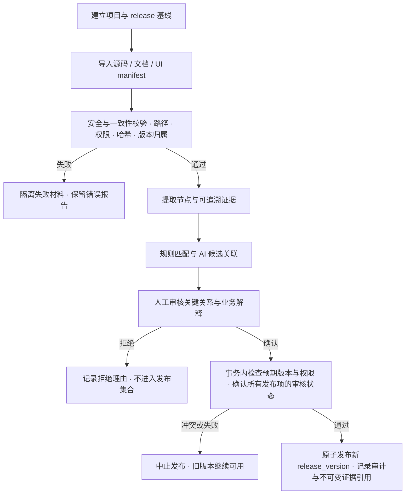

[导入与发布流程 PNG](diagrams/02_ingest_flow.png) · [SVG](diagrams/02_ingest_flow.svg) · [Mermaid 源码](diagrams/02_ingest_flow.mmd)

### 7.6 点击业务操作的读取时序

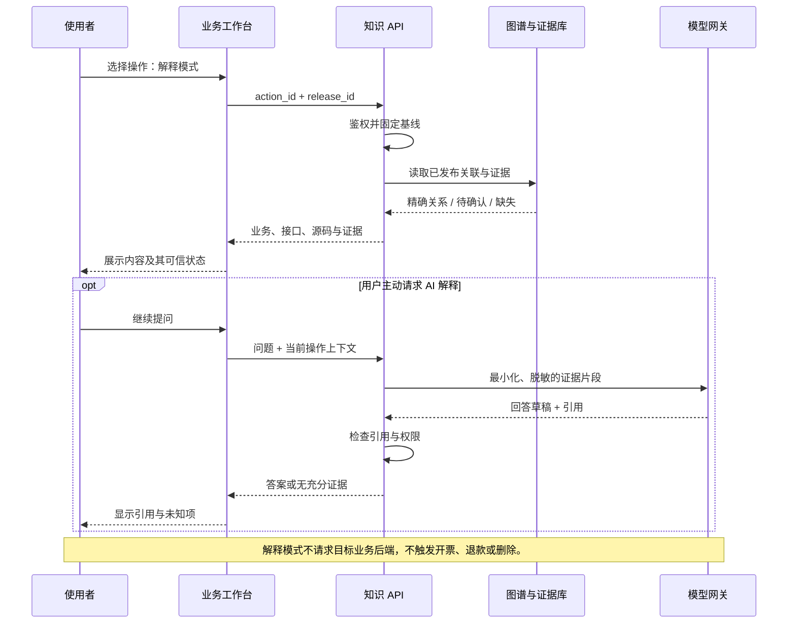

[工作台读取时序 PNG](diagrams/03_workbench_sequence.png) · [SVG](diagrams/03_workbench_sequence.svg) · [Mermaid 源码](diagrams/03_workbench_sequence.mmd)

## 8. 状态模型

| 对象 | 状态字段 | 核心限制 |
| --- | --- | --- |
| 后台任务 | state = queued / running / retry_wait / succeeded / failed / cancelling / cancelled | partial 不是终态，使用 completeness = none / partial / complete 及 issue_count 描述完整度 |
| 关系审核 | review_status = candidate / confirmed / rejected | 保留审核历史；人工确认不改写证据类别 |
| 关系有效性 | validity_status = valid / stale / broken / obsolete | 与审核状态独立，confirmed + stale 可以并存 |
| 分析集合 | draft / ready_for_review / frozen / released | 草稿修改替换选择映射，不覆盖不可变修订；冻结后生成manifest |
| 知识版本 | published / retired | 历史版本不就地改写；切换默认版不等于删除 |
| 文档草稿 | editing / submitted / changes_requested / approved | 变更使旧批准失效；人工锁定段落保护 |
| 场景来源 | recorded / mocked / manual / inferred | 是来源类别，不是任务状态或“可信百分比” |
| 证据来源 | static / observed / semantic / manual | 独立保存；运行因果根据 causal_basis 另行判定 |

任务完成不等于知识已发布。后台分析生成候选后即可 succeeded；人工审核不占着后台任务。取消采用协作方式，迟到模型响应不得覆盖已取消或更新的任务结果。

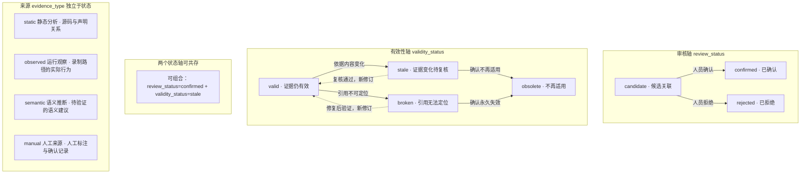

[关系双轴状态图 PNG](diagrams/06_link_state.png) · [SVG](diagrams/06_link_state.svg) · [Mermaid 源码](diagrams/06_link_state.mmd)

## 9. 技术架构与选型

### 9.1 推荐技术栈

| 层次 | 1.0 决策 | 选择理由与约束 |
| --- | --- | --- |
| Web 工作台 | React + TypeScript + Vite；TanStack Query；轻量状态管理 | 页面、选中节点、版本和过滤器分层管理；版本在启动开发时锁定，不跟随 latest 自动升级 |
| 编辑与查看 | Markdown AST + CodeMirror 6；只读源码查看；Mermaid | 原始 Markdown 继续可导出；源代码默认只读；文档不执行 MDX/HTML 内嵌脚本 |
| 关系视图 | React Flow | 默认只展示当前操作的局部关系，图不是全库可视化；首屏节点上限建议 200 |
| 应用 API | Python 3.12 + FastAPI + Pydantic 2 | 模块化单体；HTTP 与 MCP 共用应用服务层，不复制权限与事务逻辑 |
| 数据访问 | SQLAlchemy 2 + Alembic | 数据库迁移单独执行；不由每个 API Worker 同时迁移 |
| 主数据库 | PostgreSQL 17 系列，经兼容测试后锁小版本 | UUID、JSONB、全文索引、递归 CTE 和关系表；1.0 不引入 Neo4j |
| 异步任务 | Celery 稳定版 + RabbitMQ | 长任务在独立 Worker；PostgreSQL 保存权威任务状态，Broker 不是唯一事实存储；RabbitMQ 使用固定版本及持久化队列 |
| 检索 | 精确匹配 + PostgreSQL 全文/中文分词索引；可选 pgvector | 路径、类名、API 精确检索优先；向量是候选召回辅助，不能证明业务关系；中文语义索引作为验收项 |
| 对象存储 | StoragePort：本地目录默认，S3 兼容存储可选 | 仅存私有对象；预签名链接短时效；不把 MinIO 或任何特定厂商作为不可替代依赖 |
| 静态解析 | Tree-sitter Python 绑定 + Java/Spring/MyBatis/TS 框架规则 | Tree-sitter 提供语法树，不等价于完整类型推断或调用图；框架适配器负责补充语义 |
| 代码图增强 | 可选 CodeGraph Adapter | 作为可替换分析器，标准化其结果；版本固定，先在 fixture 验证；不依赖其自动改写用户环境或代理配置的命令 |
| UI 采集 | Playwright Runner + 声明式 Scenario DSL | 独立容器、域名白名单、测试账号；保留操作、DOM/截图和已脱敏请求，首版不开放任意 JS 执行 |
| 原型展示 | 已部署测试页面、CI 提供的预览包、Axure 导出包、截图热点 | 前端源码用于关联，真实交互依赖可运行页面或已提供预览构建；不承诺源码一键生成所有业务状态 |
| MCP | 官方 Python SDK；团队版 Streamable HTTP；本机可选 stdio | 协议版本协商与锁定 SDK；资源、工具、提示模板边界明确；HTTP OAuth 和项目授权同时检查 |
| 运行追踪 | 现有 Trace 导入；OpenTelemetry Adapter 可选 | 不默认给公司服务装 Agent；1.0 能没有 Trace 工作，但动态链路显示为未验证 |
| 部署 | Docker Compose 基线；Kubernetes 清单作为运维附录 | API、索引 Worker、模型 Worker、Browser Runner 分开资源/网络策略；不为了项目早期引入微服务治理 |

PostgreSQL 是平台自己的数据库，不要求公司原项目从 MySQL 迁移。Python 是平台开发语言，不改变被分析 Java 8 项目的编译运行环境。

### 9.2 模块化单体边界

后端分为 identity、projects、imports、artifacts、code_index、ui_capture、documents、relations、reviews、releases、search、ai_gateway、mcp、audit 模块。每个模块有 domain/application/infrastructure/api 边界；UI REST 与 MCP 仅是两个入口。

需要独立进程的只有耗时或高风险执行单元：索引 Worker、LLM Worker、Browser Runner。它们通过 job_id 与对象存储工作，不直接持有生产业务数据库权限。

建议工程目录：

```text
vks/
  apps/web/                 工作台前端
  services/api/             FastAPI 与 MCP 入口
  services/worker/          索引、文档、关联与发布任务
  services/browser-runner/  受控浏览器执行器
  packages/contracts/      JSON Schema / OpenAPI / 共享类型
  packages/analyzers/      Java、Spring、MyBatis、前端规则
  packages/scenario-dsl/    声明式操作与校验
  fixtures/                可公开的合成测试项目
  tests/                   单元、契约、集成、E2E、安全
  deploy/                  Compose、环境示例、备份恢复
  docs/                    ADR、接口与运维文档
```

### 9.3 架构图

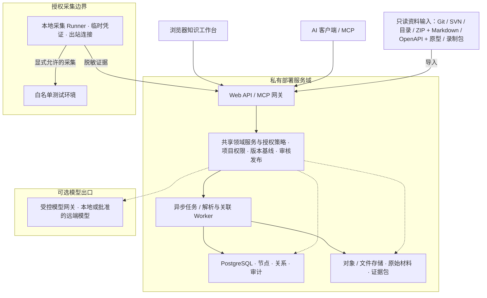

[系统架构图 PNG](diagrams/01_architecture.png) · [SVG](diagrams/01_architecture.svg) · [Mermaid 源码](diagrams/01_architecture.mmd)

## 10. 身份版本与证据

### 10.1 四种标识不可混用

1. 逻辑 ID：`entity_id` 是稳定 UUID，表示一个页面、业务动作、方法或文档章节的长期身份。
2. 修订 ID：`entity_revision_id` 表示可由多个分析集合引用的不可变修订；它固定内容、来源与定位，不从属于一个可变草稿。
3. 内容指纹：`sha256` 用于去重、完整性和变更识别；内容变了不自动等于逻辑身份变了。
4. 定位信息：相对路径、行号、列号、DOM selector 仅用于定位；不能用行号或 CSS `nth-child` 充当永久业务 ID。

代码重命名与移动按声明符号、签名、上下文及内容相似度匹配；多候选时保留待确认，禁止自动合并不同实体。Markdown 标题改名同样不应直接导致关系丢失。

### 10.2 分析集合 Analysis Set

跨仓库项目不能只保存一个 commit。每次分析集合固定一份版本向量：前端快照、manage 快照、billing 快照、文档快照、OpenAPI、原型包、运行环境部署标识及规则版本。

如测试环境无法证明对应哪份源码，`runtime_source_alignment=unknown`。UI 中明确显示“页面来自测试环境，源码版本未核对”，不能宣称运行追踪已验证当前代码。

草稿分析集合通过 analysis_set_entity 选择不可变 entity_revision；编辑产生新修订并切换选择映射，不覆盖旧修订。发布必须基于封闭、固定的 release_manifest。一次问答、关系图与导出包都固定同一个 `release_id` 或 `analysis_set_id`，避免读到新旧混合数据。

### 10.3 关系模型

关系类型建议：`contains`、`renders`、`handler_of`、`may_call`、`observed_during`、`confirmed_trigger`、`implements`、`maps_to_sql`、`reads_table`、`writes_table`、`documents`、`depends_on`、`supersedes`。

证据类型（不是单调可信度等级）：

| 类型 | 含义 | 边界 |
| --- | --- | --- |
| static | 在固定版本源码中解析到声明、路由或调用 | 动态分派与条件执行未必确定 |
| observed | 指定环境及场景中捕获的请求或Trace | 只证明观察到的路径；时间相近不证明因果 |
| semantic | 词义、向量或模型生成的解释与匹配 | 只能作为候选依据 |
| manual | 人员描述、标注和补充依据 | 保留作者，不冒充自动分析或运行记录 |

运行因果单独记录 causal_basis：not_established（未建立）、temporal_association（仅时间邻接）、static_potential（静态潜在路径）、correlated_runtime（有可核实的运行关联）。只有满足服务端证据校验，才能使用 correlated_runtime；人工审核是 review_decision，不能当作运行证据。

`evidence` 包含来源 artifact revision、提取器版本、定位、脱敏策略、采集时间、内容 hash。证据在保留期内不可覆盖；纠错生成新的证据与取代关系。依法/按策略删除内容后保留最小审计墓碑，不能用“不可变”阻止必要清理。

算法评分仅用于排序候选，不对用户显示为“事实可信概率”。推荐显示“精确 API 路径 + 静态调用 + 本次录制观察”等具体证据。人工确认与算法置信度是两个字段。

## 11. 关系型数据模型

项目内业务表包含 id UUID、project_id、created_at 和 created_by，必要表带 row_version。project 本身、实例身份和全局客户端表不机械增加自引用 project_id；一般实体扩展表以 entity_revision_id 为主键；scenario_revision 使用独立 ID 并对 entity_revision_id 加唯一约束，以便录制与步骤准确引用。严格通过复合外键或服务层验证阻止跨项目实体引用。

| 表 | 核心字段 | 索引与约束 |
| --- | --- | --- |
| project | key、name、description、status、settings、owner_id | `UNIQUE(key)`；归档不物理级联删除 |
| project_member | user_id、role、status | `UNIQUE(project_id,user_id)`；最后管理员不可被移除 |
| service_component | key、name、kind、source_connector_id、route_prefix | `UNIQUE(project_id,key)`；区分网关、前端和后端服务 |
| capture_environment | key、base_origin、allowed_hosts、network_policy、risk_tier、secret_ref、enabled | `UNIQUE(project_id,key)`；生产环境不允许写入录制 |
| dataset_fixture | name、version、object_key、reset_policy、sensitivity | 数据只指向测试样本；不内置生产客户数据 |
| source_connector | provider、remote_locator、secret_ref、allowlist、read_only | 凭据只引用；不写明文到 JSON |
| source_snapshot | connector_id、provider_revision、dirty_manifest_hash、content_hash、captured_at、status | 规范唯一键包含 connector/revision/dirty_manifest_hash/content_hash；相同内容但不同 Git/SVN revision 的来源版本不合并，字节去重放 blob 层 |
| analysis_set | name、state、ruleset_version、runtime_alignment、failure_summary | 版本向量放独立子表；发布后禁止改动 |
| analysis_set_source | analysis_set_id、source_snapshot_id、role、deployment_id | `UNIQUE(analysis_set_id,role,source_snapshot_id)` |
| artifact | snapshot_id、kind、relative_path、object_key、sha256、size_bytes、encoding、sensitivity | `UNIQUE(snapshot_id,relative_path)`；相对路径规范化；原字节保留 |
| entity | type、stable_key、display_name、archived_at | `UNIQUE(project_id,type,stable_key)`；stable_key 不使用行号 |
| entity_revision | entity_id、artifact_id、locator_json、content_hash、semantic_content_hash、schema_version、metadata | 不可变；UNIQUE(entity_id,content_hash,schema_version)；content_hash 覆盖完整修订载荷，semantic_content_hash 仅供移动识别/缓存 |
| analysis_set_entity | analysis_set_id、entity_id、entity_revision_id | UNIQUE(analysis_set_id,entity_id)；草稿可切换映射，发布后固定 |
| code_symbol | entity_revision_id、language、kind、qualified_name、signature、span、resolution_state | 唯一符号键含语言、服务、限定名和签名；重载不合并 |
| api_endpoint | entity_revision_id、service_id、method、normalized_route、condition_fingerprint、gateway_rule、operation_id | 基线规范键含 service/method/route/condition_fingerprint；`operation_id` 不作为全局唯一 |
| ui_page | entity_revision_id、route_pattern、origin_ref、viewport、preview_mode、state_key | 不把登录 token 或动态客户 ID 放 route_pattern |
| ui_action | entity_revision_id、page_revision_id、semantic_key、role、label、preconditions、locator_candidates | entity_revision_id 主键；稳定动作身份在 entity 约束；不同基线可复用/选择新修订 |
| scenario | entity_id、owner_id | 稳定身份；具体内容在不可变修订 |
| scenario_revision | id、scenario_id、entity_revision_id、revision_no、name、description、environment_ref、dataset_ref、preconditions、risk_level、dsl、content_hash | UNIQUE(scenario_id,revision_no)、UNIQUE(entity_revision_id)；不可变；步骤/录制引用此修订，基线经 analysis_set_entity 选择 |
| scenario_step | scenario_revision_id、ordinal、action_entity_id、dsl、expected_state、capture_ref | `UNIQUE(scenario_revision_id,ordinal)`；DSL JSON Schema 校验 |
| scenario_state | scenario_revision_id、state_key、page_revision_id、label、capture_ref、evidence_origin | UNIQUE(scenario_revision_id,state_key)；截图/DOM 引用固定制品修订 |
| scenario_transition | scenario_revision_id、from_state_key、action_entity_id、condition_label、to_state_key、evidence_origin、capture_ref | 同修订状态外键；分支标签只展示不执行表达式；观察分支必须有采集证据 |
| capture_session | scenario_revision_id、environment_id、dataset_id、analysis_set_id、started_at、finished_at、source_alignment、redaction_state | 每次录制独立；失败/取消也保留脱敏审计，不冒充成功证据 |
| document | entity_id、source_kind、origin_ref、manual_lock、owner_id | 导入文档与平台生成文档分开；默认不回写原仓库 |
| document_section | entity_revision_id、document_revision_id、heading_path、ordinal、markdown、fingerprint | 标题与 hash 只是迁移线索；正文访问继承项目权限 |
| relation | analysis_set_id、from_revision_id、to_revision_id、type、review_status、validity_status、confidence_band、causal_basis、row_version | `UNIQUE(analysis_set_id,from_revision_id,to_revision_id,type)`；`from/to` 均属同项目 |
| evidence | kind、artifact_id、source_locator、extractor_version、content_hash、redaction_version | 不可覆盖；证据内容敏感分级 |
| relation_evidence | relation_id、evidence_id、supports_or_conflicts | 关系可有多条支持/冲突证据 |
| review_decision | subject_id、decision、reason、reviewer_id、base_version、created_at | 追加式审计；自审批按项目策略控制 |
| knowledge_release | analysis_set_id、release_no、manifest_hash、approved_by、published_at、status | `UNIQUE(project_id,release_no)`；发布指针更新在事务内 |
| job | kind、state、completeness、issue_count、progress、stage、idempotency_key、lease_until、attempt、error_code、cancel_requested | 幂等键唯一；CAS 状态迁移；进度不能替代实际成功 |
| outbox_event | aggregate_id、type、payload、published_at、attempt | 与业务 job 同事务写入，Dispatcher 重试投递 |
| audit_event | actor、client_id、action、resource、result、trace_id、metadata_redacted | 追加式，按项目/时间索引，日志不含 token |
| knowledge_chunk | section_revision_id、text_search_vector、embedding、model_id、index_state | 检索首先权限过滤；重建向量不改变证据身份 |

局部关系检索索引：`relation(project_id,analysis_set_id,from_revision_id,type,review_status,validity_status)` 与反向索引。关系扩展限制 depth=1..3、max_nodes<=200（可配置），默认不执行全图遍历。

### 11.1 数据完整性规则

1. relation 两端、evidence、artifact 与选择映射必须属于同一项目，且适用于同一分析集合；通过复合外键及事务内校验共同保证。
2. entity_revision、artifact 原文和已发布 manifest 不可就地修改。文档编辑创建新修订，原始导入版本保留。
3. document_section.document_revision_id 引用类型为 document 的 entity_revision；scenario_step.scenario_revision_id 引用 scenario_revision，不能引用未定义版本表。
4. 相同 method/route 不一定是同一 Spring handler；params、headers、consumes、produces 等条件形成 condition_fingerprint，歧义必须保留。
5. 删除策略先软删除或归档；发布版本仍引用的制品受保护。因保密／保留策略清理时记录墓碑和不可重现影响。
6. 实例层需另设 user_identity、oauth_client、client_project_grant、credential_reference；秘密明文在受控密钥系统保存，不放 source_connector JSON。
7. entity_revision.content_hash 是规范化完整修订载荷的摘要，覆盖来源 artifact 身份、locator、正文和受版本控制的 metadata。方法正文未变但移行、换文件或来源快照变化时，应生成新修订，不能复用指向旧文件的 locator。semantic_content_hash 只用于逻辑身份迁移和解析缓存，不替代修订 hash。
8. api_endpoint 等修订扩展表不持有唯一 analysis_set_id；某基线选中的 API 由 analysis_set_entity 连接查询。规范键可按基线校验，但不可破坏修订跨基线复用。
9. source_snapshot 保留来源 revision；local 来源可用规范内容 hash 作为内容版本。相同字节跨多个 SVN/Git revision 时，只去重对象存储，不丢失来源版本向量。

## 12. 导入与异步任务

### 12.1 统一导入包

源码、文档、原型通过 manifest 统一导入。推荐采用 `.vksbundle.zip`，用户也可在 UI 分步上传，由服务端生成等价 manifest。MCP 接收已注册的 `artifact_id` 或 `upload_session_id`，不直接接收任意服务端文件路径。

```json
{
  "schema_version": "1.0",
  "project_key": "charge-demo",
  "baseline_key": "explicit-demo-v1",
  "import_key": "explicit-demo-import-1",
  "description": "本地合成原型与 Markdown 的最小显式绑定包；没有运行观察或真实业务调用。",
  "sources": [
    {
      "source_id": "preview",
      "role": "prototype",
      "provider": "local",
      "root": "preview",
      "content_sha256": "4de5f7247795826db9e8318caf5c8a86cd0aa11f0ed707c191ad8422ca2bfdc1"
    },
    {
      "source_id": "docs",
      "role": "documentation",
      "provider": "local",
      "root": "docs",
      "content_sha256": "99ca3797c7d90b3c638b843a8fabf9b282cd4dc6ad276ae75ff1b834c5f96030"
    },
    {
      "source_id": "knowledge",
      "role": "documentation",
      "provider": "local",
      "root": "knowledge",
      "content_sha256": "726e657a16aa5cb0807876790502eac02d76ab85346f6bbd909f7830a9f5be85"
    }
  ],
  "artifacts": [
    {
      "source_id": "preview",
      "kind": "prototype",
      "path": "preview/index.html",
      "sha256": "f391f82bf9faceb39d9773d384057a3103f476b9f8e545e49e8edb367e82b69a",
      "size_bytes": 1516,
      "media_type": "text/html",
      "encoding": "utf-8",
      "sensitivity": "public"
    },
    {
      "source_id": "docs",
      "kind": "markdown",
      "path": "docs/invoice-rules.md",
      "sha256": "81765a5dacb3ba4840f3e68dd59dc6d02772dd962834a1d9d7438eeb4749129e",
      "size_bytes": 437,
      "media_type": "text/markdown",
      "encoding": "utf-8",
      "sensitivity": "public"
    },
    {
      "source_id": "knowledge",
      "kind": "ui_manifest",
      "path": "knowledge/ui-manifest.json",
      "sha256": "1c53c5b8e42906dfd5a060d1c341e7cb0ecce2e36e722d9dadaca170f180d4ae",
      "size_bytes": 851,
      "media_type": "application/json",
      "encoding": "utf-8",
      "sensitivity": "public"
    },
    {
      "source_id": "knowledge",
      "kind": "binding_manifest",
      "path": "knowledge/bindings.json",
      "sha256": "58d63b37db2fa16165dbae32b4c0a41ac9aafb3f665eb48300daf84eb970fde0",
      "size_bytes": 1600,
      "media_type": "application/json",
      "encoding": "utf-8",
      "sensitivity": "public"
    }
  ],
  "uiManifest": {
    "path": "knowledge/ui-manifest.json",
    "sha256": "1c53c5b8e42906dfd5a060d1c341e7cb0ecce2e36e722d9dadaca170f180d4ae"
  },
  "bindings": {
    "path": "knowledge/bindings.json",
    "sha256": "58d63b37db2fa16165dbae32b4c0a41ac9aafb3f665eb48300daf84eb970fde0"
  },
  "analysis_origin": "external_ai",
  "allow_platform_llm": false
}
```

上例来自附件中的[最小显式绑定包](contracts/examples/README.md)，仅含合成 HTML、Markdown 和两份 sidecar；摘要和字节数按随附文件实际计算，不含公司源码或真实业务记录。修改示例文件后必须重算摘要。客户端自己的 `D:\\project` 路径不等于服务器路径；本地 Collector 需在用户指定目录只读采集，再上传内容。

导入前检查：路径穿越、绝对路径、符号链接、嵌套压缩包、压缩炸弹、扩展名与内容类型不一致、总文件数/解压字节上限、重复路径；忽略 `.git`、`.svn` 管理数据、构建输出、凭据文件（按允许清单）。文本编码检测只用于解析视图，保留原字节，不全量转码、不改变 BOM。

### 12.2 任务状态机

任务允许转换：queued → running → succeeded / failed / retry_wait；retry_wait → queued；queued → cancelled；running → cancelling → cancelled。终态输出不可被旧 attempt 覆盖。partial 使用 completeness 字段，不单独作为 state。

分析任务成功只表示结果已生成，不能自动视为已发布。任务在生成候选后即可 `succeeded`；`ready_for_review` 属于 analysis_set/发布流程，不让 Celery 任务挂起等待人工。录制任务若尚未获准，入口返回 approval_required 而不入执行队列；失败重试不得自动重新执行浏览器写操作。

推荐阶段：VALIDATE → SNAPSHOT → PARSE → EXTRACT → RESOLVE → CAPTURE_OPTIONAL → DOC_SPLIT → SUGGEST → VERIFY → READY_FOR_REVIEW。阶段输出以 hash 和处理器版本缓存，失败从检查点继续。

队列采取至少一次投递假设，不承诺恰好一次。关键约束：

- HTTP 事务同时写 job 与 outbox，避免“数据库成功但队列丢消息”。
- Worker 先获取租约，按 `(job_id,stage,input_hash,processor_version)` 幂等 upsert。
- Broker 确认超时、任务 hard limit、租约刷新要协调；长任务拆阶段，不无限提高超时。
- LLM 网络超时可退避重试；因预算、权限或格式错误失败不盲目重试。
- 取消是协作式；已完成的不可逆外部动作不能承诺自动回滚。录制采用测试环境，生产写操作禁用。
- `job.succeeded` 仅在输出校验通过、完整性写入结束后设置；错误使用结构化 error_code。

### 12.3 显式绑定包与预检

统一导入包支持 ui manifest、Markdown章节sidecar和binding manifest。它们是数据，不是平台要执行的脚本。每个清单和附件均由哈希校验、路径规范化及同基线引用检查覆盖。跨文件引用先在暂存区解析，全部满足一致性条件后才暴露为草稿；部分失败必须列出未落库或未关联项。

大文件通过预先授权的上传会话传输，MCP只接收artifact_id等受控句柄。客户端本地路径不能直接映射为服务器可读路径。正式结构见 contracts 目录。

## 13. 智能关联与 AI 工作流

### 13.1 静态解析管线

Java：提取包、类、接口、方法签名、注解、调用候选、字段类型；Spring：合成类级与方法级 RequestMapping，考虑多个路径/HTTP 方法；Feign：接口注解、服务名、上下文路径与部署路由映射；MyBatis：按完整 namespace + statement id 关联接口方法，解析 include/resultMap/动态条件结构，不将动态 SQL 当成确定执行 SQL。

前端：解析路由、组件引用、事件绑定、请求客户端包装函数；Vue 模板与 script 分区处理，React JSX 与函数处理分别建模。不能访问到的构建期宏、运行时动态导入、压缩包仅记录能力缺口。

API 规范键为 (project,analysis_set,service,HTTP_method,route_template,condition_fingerprint)。网关剥离前缀与服务映射需要 `gateway_rule`，不将 `/a/orders/1` 简单模糊合并为任意 `/orders/{id}`。

Java 8、泛型、Lombok 生成方法、Spring AOP、反射、MyBatis-Plus、ShardingSphere、消息消费者无法全量静态确定；输出 `resolution_state=resolved|ambiguous|external|dynamic|unsupported`，给出未解析边界。

### 13.2 UI 采集与因果判断

受控 Runner 读取场景 DSL：goto、click、fill、select、wait_for、assert_visible、snapshot。每步必须有 timeout 与前置条件；默认只抓取已经定义的步骤，不让 AI 自由探索任意链接。

每步保存 page/state、Action ID、locator 候选、DOM 前后快照、截图、请求摘要、业务响应摘要和可选 Trace ID。请求 body 默认按结构或字段白名单保存，不保留 Authorization、Cookie、支付信息及客户身份证等。

同一时间窗内的轮询、埋点、预加载请求必须排除。只有时间邻接时生成 `observed_during` 候选；需要显式事件相关标识/调用发起线索/静态链一致才能记录相应 causal_basis；人工审核另行保存，不能用批准替代因果证据。

HTTP 200 不一定业务成功，HTTP 4xx/5xx 也不等于网络失败；DSL 应分开验证传输状态与约定的业务 code。成功状态由明确的页面断言判定，不依赖固定 sleep 或仅 networkidle。

### 13.2.1 预录制状态与分支

录制执行与知识讲解分开：一次 Runner 任务只执行一条有限线性步骤序列；成功、校验失败、无权限等不同路径分别录制。讲解器将这些轨迹组合为有限状态图，选中动作后展示可用分支及目标快照，不执行业务接口。

状态记录 state_key、page_revision_id、label、capture_ref；转换记录 from_state、action_key、condition_label、to_state、evidence_origin 及可选 capture_ref。condition_label 只是展示文本，不是 JavaScript/Python 表达式。观察到的分支要能追溯录制与断言；仅根据原型或人工补出的分支标为 simulated/declared，不伪装为运行观察。详情见 scenario.schema.json 的 explanation_graph.states/transitions；对外字段为 stateKey、captureRef、fromState、actionKey、conditionLabel、toState 和 evidenceOrigin，数据库使用相应 snake_case 字段。

数据库以 scenario_revision 作为状态图归属，from/to state、action 和 capture 必须在同项目、同版本选择中可解析。回退/重置只移动讲解器状态；不撤销或重放真实业务请求。1.0 不开发通用循环/条件流程执行引擎。

### 13.3 Markdown 匹配与生成

使用 Markdown AST 按标题与语义块切分，保留表格/代码块整体与父标题上下文；先识别精确 API、类名、SQL 表名，再结合当前页面、模块词典和语义召回。

LLM 只读取经过权限过滤的候选片段，输出符合 JSON Schema 的候选关系、证据 ID、支持/冲突理由及未确定点。模型不得创建不存在的证据 ID；输出端验证后才落库。

技术文档生成到平台的独立草稿，不覆盖导入 Markdown。文档段落绑定证据片段，手工编辑内容可锁定；更新时给出差异建议，由作者合并。
### 13.4 AI 原生绑定包

针对“AI 同时生成原型和 MD，再经 MCP 导入自动绑定”的主要场景，首选结构化绑定包，不应每次依赖语义相似度重新猜关系。

AI 输出三组互相引用的材料：

1. 原型页面及 UI manifest：页面和操作均声明 logicalKey；动作以 pageKey 引用所属页面，页面可声明 stateKey。HTML 可使用 data-vks-page 和 data-vks-action 属性；属性不授予访问权，也不能执行导入指令。
2. Markdown 与章节 sidecar：为具体章节声明 sectionKey 和定位信息，原始 Markdown 不必被侵入式改写。
3. bindings 清单：写明动作、章节、API 和证据之间的关系；每项带来源文件、定位、版本及内容指纹。

~~~html
<button data-vks-page="payments.records"
        data-vks-action="payments.invoice.submit">
  确认开票
</button>
~~~

~~~json
{
  "relationType": "documents",
  "fromLogicalKey": "payments.invoice.submit",
  "toLogicalKey": "docs.invoice.amount-validation",
  "evidenceRefs": ["evidence-invoice-rule-01"],
  "reason": "动作与该文档章节对应；技术内容仍需审核"
}
~~~

以上为绑定项片段，外层清单与证据定义见 contracts/binding_manifest.schema.json。documents 的方向固定为主体实体→描述它的文档章节；文档到动作通过反向查询实现。逻辑 key 在项目范围内解析为服务端实体 ID；模型不能靠自定义 UUID 指向无权项目。

导入服务校验 Schema、文件哈希、逻辑 key 唯一性、目标存在性、基线、来源定位和权限，再创建候选关系。确定 ID 对应关系可以免去模糊匹配，但不自动证明业务语义正确；审核状态不能从导入包接收为 confirmed。

为老原型提供降级路线：DOM/可访问名称与页面路径提取 → API/符号精确匹配 → 语义候选召回 → 排序 → 人工确认。截图 OCR 只能帮助提出热点候选。

### 13.5 两种 AI 使用方式

| 方式 | AI 在哪里运行 | 平台负责什么 | 适用情况 |
| --- | --- | --- | --- |
| 外部 AI + MCP | 用户自己的 AI 客户端 | 接收知识包、校验实体和证据、保存候选、审核、检索 | 用户已使用 Codex 等工具分析源码和生成 MD |
| 平台可选模型 | 本地模型或经批准的模型服务 | 限定上下文、生成草稿／候选、验证结构、计量预算 | 希望在 Web 页面内发起分析和问答 |

平台不强制购买某一家模型，也不能因未配置模型而不能阅读知识、导入包、精确检索或手工关联。外部 AI 提交的证据引用与平台内模型输出经过同一条校验流水线。

### 13.6 候选生成的决策规则

首先限定项目、分析集合、服务和角色；再执行精确 API、符号和显式 UI 标记连接。时间邻接仅产生 observed_during；轮询、预取和埋点作为负例过滤。最后才加入文档语义召回。

候选排序可使用路径匹配、静态关系、运行观察、模块语义等特征，但排序分数不是事实概率。不允许“模型自报 0.99 所以自动通过”。至少一个端点版本未对齐、出现矛盾证据或多个同名目标时，候选必须保留冲突说明。

人工确认代表该关系已被接受，不能把 semantic 证据改写为 observed，也不能把 manual 确认等同于捕获了运行因果。

### 13.7 引证式解释输出

每次 action context / 问答至少返回：项目、发布版本、动作、摘要、关系路径、证据列表、来源类别、审核状态、有效性、未知项。模型生成的每条关键技术结论需绑定可验证的 evidence_id。

模型超时或未配置时，工作台仍展示已经保存的关系和原始文档。若当前版本无证据，回答缺口，不自动用其他版本的材料补全。知识生成只形成独立草稿；人工锁定段落不被重跑覆盖。


## 14. HTTP API 契约

API 前缀 `/api/v1`。请求／响应统一使用契约定义的字段名，主要为 snake_case；跨素材 sidecar 的 camelCase 是单独声明的格式，不相互猜测转换。数据库 content_hash / semantic_content_hash 对外对应 content_sha256 / semantic_content_sha256。身份与项目权限由服务端从 token/session 解析，不能相信请求体中的 actorId。浏览器可用 HttpOnly/SameSite 会话 Cookie + CSRF 防护；自动化使用专用访问令牌，不复用浏览器长期凭据。

| 方法与路径 | 目的 | 权限/备注 |
| --- | --- | --- |
| GET /projects | 当前用户可见项目 | read；游标分页 |
| POST /projects | 新建项目 | admin |
| GET/PATCH /projects/{p} | 项目详情/配置 | read/manage；PATCH 需 If-Match |
| GET/PUT /projects/{p}/members | 项目成员 | manage；不能越级赋权 |
| POST /projects/{p}/upload-sessions | 申请上传 | import；返回受控对象句柄，不接受服务器任意路径 |
| POST /projects/{p}/imports | 校验并创建导入任务 | source:import；202 + data.id（任务 ID）；Idempotency-Key |
| GET /projects/{p}/imports/{id}/report | 导入结果与跳过清单 | read |
| POST /projects/{p}/analysis-sets | 固定版本向量 | analyze；校验快照归属 |
| POST /analysis-sets/{a}/jobs | 索引/生成/关联任务 | analyze；指定 job kind 枚举 |
| GET /jobs/{j} | 查询阶段、进度与结果 | 对应项目 read |
| POST /jobs/{j}/cancel | 协作式取消 | 按 job.kind 校验原发起权限，且为 job owner 或项目管理员 |
| GET /projects/{p}/pages | 页面/状态目录 | read；固定 release/analysisSet |
| GET /actions/{id}/context | 操作到知识的聚合视图 | read；includeEvidence、depth 有上限 |
| GET /entities/{id}/relations | 局部图查询 | read；类型白名单、节点数/深度限制 |
| POST /projects/{p}/scenarios | 创建 DSL 场景草稿 | edit |
| POST /scenarios/{id}/capture | 请求受控环境录制 | capture；已批准环境/数据集；202 |
| GET /documents/{id}/revisions/{r} | 原文/结构化章节 | read |
| PUT /documents/{id}/draft | 保存编辑 | edit；If-Match；原导入版本不改动 |
| GET /analysis-sets/{a}/link-candidates | 候选列表 | review 或 edit（只读候选） |
| POST /relations/{id}/review | 确认/拒绝/标冲突 | review；If-Match；需要理由和证据 |
| POST /projects/{p}/release-candidates | 生成发布预检 | links:propose；不立即对全员可见 |
| POST /release-candidates/{id}/publish | 原子发布 | release:publish；明确人类确认、预检 hash 未变化 |
| GET /projects/{p}/releases | 已发布版本目录 | read；游标分页 |
| GET /projects/{p}/releases/{id}/diff | 版本与影响差异 | read；固定 from/to |
| POST /projects/{p}/search | 关键字/语义检索 | read；项目与版本权限先过滤 |
| POST /projects/{p}/questions | 引证式问答 | ask；答案携带证据、未知项、模型标识 |
| POST /projects/{p}/exports | 导出选定发布版 | export；按数据敏感级别裁剪；202 |
| GET /projects/{p}/audit-events | 审计检索 | audit |

统一成功响应：

```json
{"data":{"id":"11111111-1111-4111-8111-111111111111","project_id":"22222222-2222-4222-8222-222222222222","kind":"import","state":"queued","progress":0,"completeness":"none","stage":"VALIDATE","attempt":0,"created_at":"2026-10-25T04:00:00Z"},"meta":{"request_id":"33333333-3333-4333-8333-333333333333"}}
```

统一失败响应：

```json
{"error":{"code":"VKS_VERSION_CONFLICT","message":"当前草稿已更新，请重新加载后合并","retryable":false,"details":{"current_version":8}},"meta":{"request_id":"33333333-3333-4333-8333-333333333333"}}
```

状态码：401 未认证；403 无权；404 不存在或为防枚举隐藏；409 幂等键内容冲突/状态冲突；412 ETag 版本冲突；413 上传过大；422 Schema/关系校验失败；429 额度限制；503 Runner/模型暂不可用。

幂等键按 `(project,actor,operation,key)` 唯一并保存 payload hash；同 key 同 payload 返回原结果，不同 payload 返回 409。新增导入、启动任务、发布和导出均应用。写草稿/审核用 If-Match；长任务结果使用 CAS，防旧 Worker 覆盖新结果。

## 15. MCP 设计与导入时序

### 15.1 权限面

标准 scope：`knowledge:read`、`source:import`、`analysis:run`、`links:propose`、`capture:run`、`knowledge:export`。审核与发布保留 `links:review`、`release:publish`，默认 AI 客户端令牌不具有这两类权限；1.0 标准 MCP 工具不直接暴露批准／发布，只返回Web审核任务；未来企业如明确开放，仍须校验具体用户确认票据与版本 hash，工具 annotations 不是安全边界。

MCP 请求还需 project grant。HTTP 接入验证 issuer、audience、签名、时效和 scope；不把上游访问 token 原样转交代码托管、模型供应商或测试环境。`secret_ref` 只由管理员配置，模型不可获取秘密明文。

### 15.2 1.0 必须提供的工具

| Tool | 输入字段 | 输出 | 副作用 |
| --- | --- | --- | --- |
| list_projects | 无必填；可选：cursor、limit | 可访问项目列表 | 无 |
| get_project_context | project_id、release_id | 固定版本的项目上下文 | 无 |
| search_knowledge | project_id、release_id、query；可选：kinds、limit | 带来源的检索结果 | 无 |
| get_action_context | project_id、action_id；可选：release_id、analysis_set_id、depth、max_nodes | UI/API/代码/文档及缺口 | 无 |
| get_scenario | project_id、scenario_id、scenario_revision_id | 不可变场景修订 | 无 |
| get_evidence | project_id、evidence_ids；可选：max_chars | 脱敏证据列表 | 无 |
| trace_business_flow | project_id、start_entity_id；可选：release_id、analysis_set_id、depth、relation_types | 带证据状态的局部关系图 | 无 |
| import_bundle | project_id、artifact_id、idempotency_key | JobResponse；data.id 为任务 ID | 受控写入／任务；非自动批准 |
| import_documents | project_id、artifact_ids、analysis_set_id、idempotency_key | JobResponse；导入草稿 | 受控写入／任务；非自动批准 |
| import_prototype | project_id、artifact_id、analysis_set_id、mode、idempotency_key | JobResponse；导入草稿 | 受控写入／任务；非自动批准 |
| analyze_snapshot | project_id、analysis_set_id、analyzer_profile、idempotency_key | JobResponse；索引任务 | 受控写入／任务；非自动批准 |
| propose_links | project_id、analysis_set_id、candidates、idempotency_key | review_batch_id 和候选关系 | 受控写入／任务；非自动批准 |
| request_capture | project_id、scenario_revision_id、environment_ref、idempotency_key；可选：approval_ref | 任务引用或 approval_required | 受控写入／任务；非自动批准 |
| get_job | project_id、job_id | JobResponse；状态与结果引用 | 无 |
| cancel_job | project_id、job_id、reason | JobResponse；取消状态 | 受控写入／任务；非自动批准 |
| detect_drift | project_id、from_release_id、to_analysis_set_id、idempotency_key | JobResponse；差异报告 | 受控写入／任务；非自动批准 |
| request_release | project_id、analysis_set_id、idempotency_key；可选：review_batch_id | 发布预检和人工审核入口 | 受控写入／任务；非自动批准 |
| export_knowledge | project_id、release_id、format、idempotency_key；可选：include_source | JobResponse；导出结果 | 受控写入／任务；非自动批准 |

get_action_context 与 trace_business_flow 的 release_id / analysis_set_id 必须二选一；草稿读取另查编辑权限。propose_links.candidates 的字段为 from_revision_id、to_revision_id、relation_type、evidence_ids、reason、causal_basis，服务器逐项验证，不能提交审核结果。完整类型、范围、枚举与 outputSchema 以 contracts/mcp_tools.json 为准。图中 job_id 是任务标识的概念名，JobResponse 中实际返回字段为 data.id。

工具名为本平台拟议接口，不能写成官方 SDK 自带工具。工具返回优先使用 `structuredContent`，并提供简短模型可读摘要；不一次返回全仓库代码。所有 URL、source path 均作为数据，不执行其中的指令。

Resources：`vks://projects/{id}/releases/{release}/overview`、`vks://actions/{id}/releases/{release}`、`vks://evidence/{id}`、`vks://jobs/{id}`。资源读取执行与工具相同的权限检查。

Prompts：`explain_action`、`onboard_module`、`review_link_candidates`、`analyze_change_impact`。Prompt 只装配受控上下文，不赋予新的写权限。

### 15.3 AI 导入与自动绑定时序

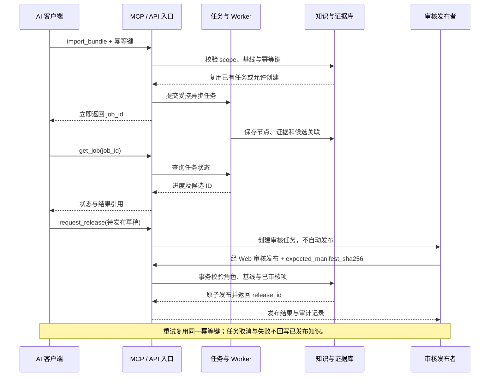

[MCP导入时序图 PNG](diagrams/04_mcp_ingest_sequence.png) · [SVG](diagrams/04_mcp_ingest_sequence.svg) · [Mermaid 源码](diagrams/04_mcp_ingest_sequence.mmd)

## 16. 版本漂移与发布

发布预检应阻断：缺失证据的关键关系、无版本来源的接口、未审核的关键业务规则、当前用户无访问权的引用、敏感信息扫描失败、未脱敏录制、页面与代码版本冲突未说明。

普通未知关系允许发布，但必须显示为未知；发布不是要求全项目自动分析完整。发布内容是“已知内容 + 清晰边界”，不能用空白补全为确定结论。

增量同步按 file hash 确定变化 → 重解析变化文件 → 扩展受影响符号/接口 → 标记关系与文档待复核 → 生成差异 → 审核新发布版。原已发布版保留，最新指针仅在全部事务成功时切换。

有效性状态：valid、stale、broken、obsolete；文档变化与源码变化分别建因果影响。删除代码并不立即删除知识，只标记旧知识对应版本和新版本中的失效。

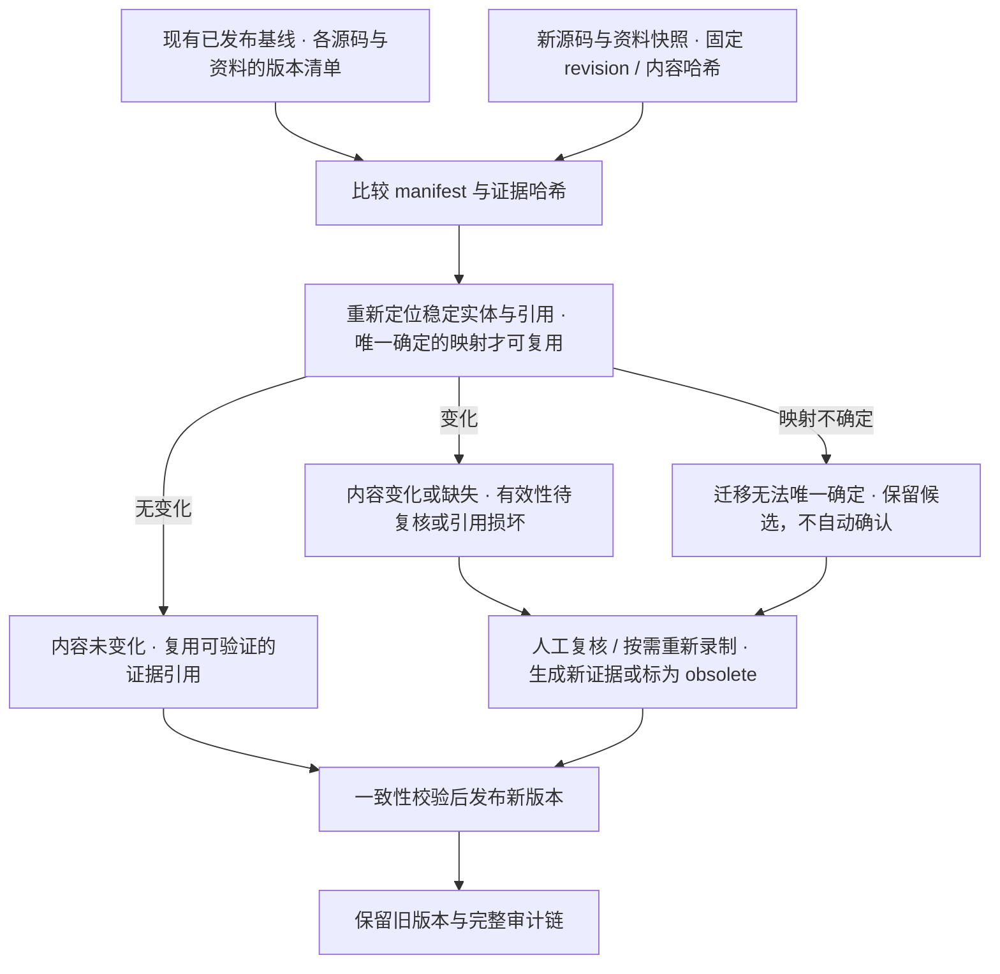

[版本漂移处理流程 PNG](diagrams/05_drift_flow.png) · [SVG](diagrams/05_drift_flow.svg) · [Mermaid 源码](diagrams/05_drift_flow.mmd)

## 17. 安全设计

| 威胁 | 1.0 防护 | 测试 |
| --- | --- | --- |
| 原型 HTML/Markdown XSS | MD 禁止执行脚本；原型独立 origin + sandbox + 严格 CSP；`postMessage` 验证 origin、source 和 nonce | 恶意脚本不能读取主平台 Cookie 或调用主平台 API |
| Axure 兼容需求 | 可执行原型必须在隔离 origin，不能与主平台同源；不能为兼容而移除所有 sandbox 限制 | 弹窗、下载、导航与外部网络分别受限 |
| Prompt Injection | 源码/MD 均标记不可信材料；系统指令分离；工具权限由服务端执行；不接受材料里要求上传凭据的指令 | 注入文本不能触发写/发布/外传 |
| SSRF 与内网横向访问 | Runner 使用登记过的环境与域名；允许企业指定内网网段但禁止云元数据、宿主控制端口；每次 DNS 解析、重定向与子资源均检查 | DNS rebinding、302 到 metadata、iframe/WebSocket 越界被拒绝 |
| 任意代码执行 | 导入只解析；不执行 npm install、Maven、仓库 hooks、Dockerfile；Scenario DSL 白名单；Runner 非特权 | 恶意包/脚本不执行 |
| 秘密泄露 | SecretRef；加密会话；采集前屏蔽敏感输入，落盘前脱敏网络与 DOM；默认不存正文 | 标记凭据扫描不得出现在索引/日志/导出 |
| 越权查询 | 项目权限过滤优先于搜索、向量召回与缓存；对象下载逐次授权 | A 项目成员不能看到 B 的标题、数量或片段 |
| 生产误操作 | 默认只读探索；Live mode 独立授权与醒目提示；写请求只限已批准测试环境；退款/开票等有副作用动作必须使用 mock/test fixture | 点击解释按钮绝不发真实开票请求 |
| 大文件与资源耗尽 | 解压上限、任务预算、队列隔离、CPU/内存/时间限制、节点上限 | 压缩炸弹、巨型 AST/循环跳转触发可恢复拒绝 |
| 第三方许可与供应链 | 锁版本、SBOM、许可证审核、依赖漏洞检查；GitNexus 等非商业许可项目不作为默认商用依赖 | 发行门禁失败不可发布 |

浏览器 Trace 中原本可能包含响应体、Cookie、DOM 客户数据；不能因为“只录制测试环境”就跳过脱敏。录像/截图还需视觉遮罩规则。

## 18. 测试与质量目标

1. 解析 fixture：Java 8 Controller/多 RequestMapping、接口多实现、同名类、重载、Feign、MyBatis XML include/动态 SQL、Mapper-Plus、Vue/React 事件、封装 Axios、中文 MD。每个 fixture 有人工标注真值集。
2. 关系精度：至少人工标注 100 个 UI/API/代码/文档关系；按关系类别分别统计 precision/recall；候选不得计入已确认正确数。推荐关键精确关系 precision 目标 >=95%，这是验收目标而非现有实测。
3. 自动关联：名称相同但服务不同、轮询干扰、同一按钮不同状态、一个动作多个请求、无请求的本地操作、网关路径改写均必须覆盖。
4. MCP 契约：真实 SDK 客户端握手、工具列表与 Schema、分页、Resources、取消、超时、未授权、幂等重试、结构化输出、令牌 scope；AI 不能越权审核发布。
5. 导入可恢复：半包上传、校验失败、Worker kill、Broker 重投、模型限流、断点续跑、重复上传、新旧任务竞争；不产生重复发布。
6. 知识变更：方法移行不丢逻辑身份，改名可候选迁移，API 变更标记过期，人工锁定段不被覆盖，旧发布版可重放查看。
7. 安全回归：ZIP Slip/ZIP Bomb、XML XXE、MD/原型 XSS、SSRF、Prompt Injection、跨项目 BOLA、敏感数据泄漏、任意代码执行拒绝。
8. 产品自验证：用 VKS 自己的 OpenAPI、源码、UI 场景和 Markdown 建立一份 dogfood 知识库；用户通过 MCP 查询“导入失败如何重试”，必须返回当前发布版接口、代码与证据。业务 Java fixture 与平台 Python 源码覆盖分开，不以自测替代 Java 适配验收。

性能门禁使用第23节 AT-34/35 的唯一负载剖面：8 vCPU/16 GiB、SSD、固定网络；50,000关系、1,000动作、200文档，20并发读取10分钟。动作读取p95≤1.5s、检索p95≤2s；静态分析5,000文件/100MiB目标≤15min。模型时间与排队时间单列；PoC后书面冻结最终剖面，不预先承诺任意大型仓库秒级完成。

模型任务设置每项目 daily budget、每次任务 max_tokens/max_cost、失败次数上限；明确区分无模型降级可用功能与 AI 增强功能。离线环境仍应能浏览、精确搜索、手工绑定和查看已生成知识。

### 18.1 试点业务验收

固定一份已脱敏的基线：一个 Java/Spring/MyBatis 模块、一个运行页面、30 个标注动作、至少 15 个 API、30 个 Markdown 章节，以及成功/校验失败/权限不足三类场景。首选真实项目中可在隔离测试环境复现的非生产数据流。

示例使用“缴费记录开票”这一类场景，包含列表查询、打开弹窗、表单校验、模拟提交与查看记录；`POST /pay/invoice/openInvoice` 仅用于设计演示，具体方法、路径和链路须在接入后核验。

| 验收维度 | 拟定目标 | 测量边界 |
| --- | --- | --- |
| 关联正确率 | 已确认 action→API 关系抽查正确率 ≥95% | 分母是人工标注且支持采集的动作，不包含自动排除的数据 |
| 证据可追溯 | 已发布技术关系 100% 有来源、版本和定位 | 不允许裸 AI 结论充当源码证据 |
| 覆盖展示 | 100% 暴露未解析/未关联对象的计数 | 不用过滤失败样本来抬高“完成率” |
| 双向定位 | 试点已发布关系 100% 可来回导航 | UI 到准确章节、章节到具体动作，不只是到首页 |
| 变更检测 | 注入的接口重命名/符号删除/章节改名/锚点失效可识别 | 对动态业务语义变化不承诺完全自动判断 |
| MCP | 只读查询、幂等导入、长任务重连、权限拒绝、绑定提案全部通过契约测试 | Web 和 MCP 共用相同鉴权服务 |
| 安全讲解 | 讲解模式下点击所有热点不产生真实业务写请求 | 测试验证而非仅 UI 文案声明 |
| 权限 | 跨项目读取、无 scope 写入、受限证据下载全部拒绝 | 日志中无原始 token 或密码 |
| 接手效率 | 完成 5 个定位任务的中位耗时较基线下降 | 改善幅度待试点测量，不提前写收益百分比 |

### 18.2 自动关联准确率的解释

候选生成器分别报告precision、recall和coverage，审核后的关系正确率是另一个指标。人工审核达到95%并不证明自动生成器也达到95%。固定Gold样本、记录TP/FP/FN以及unsupported/unresolved数量，不剔除失败样本以提高数字。对于100条样本的结果，要报告样本量而不是推及所有企业项目。完整35条验收用例见第23节。

## 19. 部署运维与恢复

Compose 起步：web reverse proxy、api、index-worker、llm-worker、browser-runner、PostgreSQL、RabbitMQ broker、private file volume。Runner 使用独立出站网络，不能访问平台数据库；所有服务默认不对公网开放。

API 使用 TLS 与独立健康检查；/live 不访问依赖，/ready 验证必要依赖。监控记录队列等待、任务耗时/失败率、索引量、候选/已审关系数量、过期知识率、模型 token/成本、Runner 超时、访问拒绝次数。

日志统一 request_id、job_id、project_id 与 trace_id，但不写请求全文、源码全文或 secrets。审计保留期限建议 180 天、录制原始临时文件在脱敏完成后删除、制品默认 90 天并允许项目配置；发布版依赖制品受引用保护，清理需先标记并提示不可再现影响。

备份范围：PostgreSQL、对象存储、SecretRef 对应密钥的受控备份、配置与发布 manifest。建议每天备份、每月恢复演练；起始目标 RPO 24 h、RTO 4 h，均须用恢复演练验证。队列可从 job/outbox 重新协调恢复，不作为唯一恢复依据。

升级采用：备份 → 离线迁移检查 → 单次 Alembic migration → 部署兼容 API/Worker → 烟测 → 放量。解析器规则升级生成新的 analysis set；不能直接改写旧版本证据。

## 20. 实施阶段与交付节奏

建议将 PoC 与正式 1.0 分开：PoC 验证核心闭环，正式 1.0 增加权限、版本、可靠导入、MCP 和异常处理。不要用 PoC 的 2 周成果冒充可交付团队使用的 1.0。

| 阶段 | 交付 | 估计投入 | 退出条件 |
| --- | --- | --- | --- |
| S0 需求冻结与 PoC | 单业务场景、章节绑定、证据导航 | 3-4 人周 | 核心链路有真实证据，明确不能解析部分 |
| S1 基础平台 | 账户/项目、版本快照、导入、任务、MD/API | 6-8 人周 | 可重复导入且不破坏原始文件 |
| S2 交互工作台 | 采集、快照、热点、场景、讲解/沙盒隔离 | 7-9 人周 | P02 关键交互与失败状态通过验收 |
| S3 关联与知识 | Java/MyBatis 适配、候选、审核、检索、局部图 | 7-9 人周 | 样本精确率及证据追溯达到门槛 |
| S4 MCP 与版本 | 权限化 MCP、更新提案、版本发布、审计 | 5-7 人周 | AI 导入到审核完整闭环，权限测试通过 |
| S5 稳定性与试点 | 性能、安全、备份恢复、安装文档、试点修正 | 5-7 人周 | 无 P0/P1 阻断缺陷，可恢复已发布版本 |

合计约 33-44 人周（包含开发和验证的估计，不是已测算承诺）。以 2-3 名开发加兼职产品/测试配置，可按约 14-18 个自然周规划并在 PoC 后重估；单人全职通常需要更长时间。AI 辅助编码能缩短部分样板工作，但不能替代真实项目兼容性验证与安全验收。

如果资源不足，优先缩减适配器数量和自动化广度，不能删掉证据、权限、版本和讲解模式的安全隔离。可以先交付 ZIP/本地导入，再做 Git/SVN 自动连接；先固定录制快照演示，再做复杂真实前端 Mock 沙盒。对外说明支持等级，避免把“兼容读取”写成“全自动生成”。

### 20.1 实施顺序约束

S1开始时就建立MCP入口和契约测试，S4是将权限、导入提议、人工审核与发布闭环完善，不是到最后才补MCP。每阶段都提供可演示的Web与MCP纵向切片。S2与S3可在冻结身份/版本/证据模型后并行；S5必须保留独立试点时间，不能在最后一周集中验证全部框架兼容性。

33-44人周是完整1.0范围的规划量，不是前一轮简化MVP估计；2-3名开发约14-18个自然周属于资源与并行假设，应在S0后重估。若单人开发，宜先按3-4人周完成PoC，再以滚动计划交付。

### 20.2 1.1及以后候选

FlowTest测试资产双向同步、多框架前端源码定位、完整Python调用图、自动化Trace探针部署、复杂rrweb会话回放、多人实时协作、企业SSO联邦和外部插件市场。它们不应阻塞1.0已定义闭环。

## 21. 风险和成本控制

| 风险 | 早期信号 | 1.0 决策或处置 |
| --- | --- | --- |
| 通用前端逆向范围失控 | 每个项目都要求不同构建和运行条件 | 只接入现成测试环境／预览包；不代建任意项目 |
| 自动绑定精度不足 | 同名动作、异步轮询、网关映射产生大量误关联 | 优先显式绑定包和精确标识，收窄自动规则，候选可人工修正 |
| Java 调用图覆盖不足 | 反射、MyBatis-Plus、AOP 路径断裂 | 明示未解析边界，允许导入 Trace 或人工证据；不补画虚假实线 |
| 维护成本高 | 每次代码变更都重算全库或重写所有 MD | 内容哈希增量、规则版本缓存、受影响子图、人工内容锁定 |
| 企业接入阻塞 | 云端访问不到内网，源码被加密或不允许外发 | 私网 Collector/Runner、离线包；权限或解密由企业完成，平台不绕过 |
| 图谱和文档体量增长 | 大图卡顿、全文查询延迟、录制占满磁盘 | 局部图限制、分页、对象去重、按发布引用保留、定期恢复演练 |
| 开源组件变化 | 许可证、API、框架支持发生变化 | 适配器隔离、版本锁定、SBOM 与升级回归 |
| 单人排期不现实 | 同时开发通用解析、录制、文档、权限和团队协作 | 先完成端到端 PoC；保留安全/版本，减少适配面；分阶段验收 |

模型成本采用参数化估计，不使用未经测量的固定“每项目几元”承诺：月成本由有效输入／输出 token、各模型单价、任务频次和缓存命中决定。价格由部署方配置；任务设置 token 上限、费用上限、重试上限和月预算，触顶不无限重试。

原型包、模型、云对象存储和真实环境连通性可以选择性接入，但权限、版本和证据不可删减。测试环境包含真实外部开票／短信／付款网关时，即使域名叫 SIT，也必须关闭副作用或提供专门 Mock。

### 21.1 开发前需要冻结的项目参数

- 首个试点业务域与30个标注动作，由项目负责人提供或共同定义。
- 测试环境与源码版本对应方式，包括网关服务映射。
- 首批前端框架／版本、Java框架组合和解析覆盖清单。
- 部署网络、模型数据出境策略、源码与录制保留期限。
- 谁可以审核、发布、录制和读取敏感源码；单人模式是否允许自审批。
- 经 PoC 测量后的数据量、性能目标和里程碑。

在这些项目参数未冻结前，设计默认值可以用于本地合成 fixture 开发；不能据此直接对公司生产系统执行采集。


## 22. 功能到实现的交接映射

| 功能组 | 页面 | 主要后端模块／接口 | 核心数据 | 验收用例 |
| --- | --- | --- | --- | --- |
| PRJ-01/03/04/05 | P01、P03 | projects、imports、analysis-sets | project、source_snapshot、analysis_set_source | AT-01、03、07 |
| DOC-01/02/03/05 | P04、P02 | documents、exports、action context | document、document_section、entity_revision | AT-02、06、17、29 |
| COD-01/02/03/04 | P06 | code_index、analyzers、relations | api_endpoint、code_symbol、evidence | AT-04、05、13 |
| UI-01 至 UI-05 | P02、P03 | scenarios、capture、runner | scenario_revision、capture_session、ui_action | AT-10、11 |
| UI-06/07/09 | P02 | preview、sandbox、hotspots | ui_page、scenario_step、artifact | AT-08、09、12 |
| LNK-01/02/03/04 | P05 | relations、reviews | relation、relation_evidence、review_decision | AT-13、14、15、16 |
| SRH-01/02/03 | P02、P04、P06 | search、ai_gateway | knowledge_chunk、version-scoped evidence | AT-23、26、34 |
| VER-01/02/03/04 | P07 | releases、diff、impact | knowledge_release、analysis_set_entity | AT-27、28、31 |
| MCP-01 至 MCP-06 | P08 | mcp → 共用 application services | job、audit_event、project grants | AT-19 至 AT-25 |
| PRJ-06/07 | P03、P08 | jobs、outbox、audit | job、outbox_event、audit_event | AT-20、21、30、35 |

### 22.1 开发包与协作约束

工程命名建议为 vks，不在此阶段固化注册商标或域名。开发仓库可以按团队规则使用 SVN 或其他版本管理，本方案不要求公司原项目迁移版本系统。

先建立 contracts 与 fixture，再做端到端薄切片；以 fixture 复现失败，再实现修复。每阶段补齐接口契约与文档，禁止只有UI而没有真实应用服务。前端调用OpenAPI生成的类型或共享契约；HTTP与MCP不能各自维护一份权限和绑定逻辑。

所有源码、文档采用明确编码策略，保留导入原文的 BOM 与换行；平台自己的新文件使用 UTF-8。禁止为扫描方便全仓库转码、格式化或修改用户原始材料。分析不编译目标项目、不执行 Maven。

### 22.2 设计附件

- contracts/openapi_1.0.yaml：HTTP 接口设计基线，不代表服务器已实现。
- contracts/mcp_tools.json：拟议 MCP 工具目录、输入输出与权限要求。
- contracts/import_manifest.schema.json：项目资料导入包结构。
- contracts/scenario.schema.json：受控录制／演示场景结构。
- contracts/binding_manifest.schema.json：AI 生成原型、文档与证据之间的显式关联清单。
- [contracts/examples/README.md](contracts/examples/README.md)：可直接阅读的最小导入包，含真实 SHA-256、无脚本 HTML、Markdown 和显式绑定示例。
- diagrams/*.mmd：可编辑技术图；SVG／PNG 用于不支持 Mermaid 的阅读器。
- ui/*.png：核心页面效果图；ui/README.md 说明页面与文件映射。

### 22.3 首个迭代建议

首个迭代只选“导入一份 MD + 一张带热点页面 + 一个合成 API 和代码符号”。让 Web 与 MCP 都能创建同一批候选，人员审核后发布，再从界面和AI读取同一release。随后逐步接上Java解析、采集、自动匹配和版本变更。这个薄切片应复用最终身份、权限、版本与审计结构，避免做完PoC后全部推倒。


## 23. 完整验收测试矩阵

本节所有门禁、样本量和性能均为拟定目标。执行前冻结fixture、工具与模型版本、硬件和负载。

### 23.1 测试基线与独立性

#### 23.1.1 两套基线必须分开

| 基线 | 内容 | 验证目标 | 不能证明的内容 |
| --- | --- | --- | --- |
| JF 合成 Java fixture | Java 8/Spring MVC/MyBatis 示例；受控前端；脱敏 MD/OpenAPI；v1/v2 两个来源快照集合；模拟业务服务 | Java 适配、路由/Mapper/SQL 证据、业务场景关联、版本变更 | 用户真实项目的所有框架和业务兼容性 |
| DF 平台 Python dogfood | VKS 自身的前端、FastAPI OpenAPI、人工审核的 MD、受控测试环境和已知源码锚点 | 平台自己的导入、UI、文档、MCP、权限和知识更新闭环 | Java 静态分析准确性，也不能宣称已实现完整 Python 调用链解析 |

1.0 若未交付 Python 静态调用图适配器，DF 使用 OpenAPI、运行请求、人工/生成后审核的源码锚点完成自举。界面标明证据来源，不能伪装为自动 Python 全调用链分析。

#### 23.1.2 合成 fixture 建议内容

- 项目 JF-A：30 个标注 UI 动作、15 个规范化 API、30 个 MD 章节、3 个业务场景；至少包含成功、参数校验失败、权限不足三类状态。
- 项目 JF-B：故意使用相同按钮名、类名和 API 路径，服务标识不同，用于跨项目和跨服务串联检测。
- JF-A/v1：固定前端快照 F1、后端 B1、文档 D1、录制 R1；JF-A/v2：F2/B2/D2/R2，至少包含接口改名、方法移动、SQL 字段变化、章节改名、UI 热点删除。
- API 示例采用 `POST /pay/invoice/openInvoice` 与合成 `demo_invoice_order` 表；所有数据为合成示例，不连接真实开票、支付、短信或生产数据库。
- 恶意材料集：含提示注入的 Markdown、带越界路径的 ZIP、压缩炸弹、嵌入外部脚本的 Axure HTML、包含模拟密钥/个人信息的 HTTP 记录、带安装脚本的源码包。
- Gold 标注由独立人工维护，至少记录动作、接口、代码符号、文档章节、应当不存在的关系。模型不得读到用于评分的隐藏答案，也不能以自己生成的文档作为唯一真值。

#### 23.1.3 证据目录约定

每次验收保留 `run_id`、构建版本、依赖版本、模型/提示词版本、配置摘要、fixture 哈希、环境和硬件；每个 Case 输出脱敏结果、请求 ID/任务 ID、数据库断言、截图或 trace。源代码和原始敏感报文不得随 CI 结果公开。

### 23.2 导入与事实索引

| Case ID | 功能与页面 | 前置条件及操作 | 预期结果 | 应留证据 |
| --- | --- | --- | --- | --- |
| AT-01 | PRJ-03/04/05/06，P03 | 为 JF-A 选择 F1/B1/D1。预检本地/ZIP 快照；另以受控 Git commit 和 SVN revision 适配器导入同一业务内容；确认导入 | 每个来源有固定 revision 与内容哈希；原始字节不变；来源类型分别保留；不产生 git commit/SVN commit，不执行 Maven或仓库脚本 | 来源 manifest、原始/保存后 SHA-256 对比、进程/命令审计、快照记录 |
| AT-02 | DOC-01、PRJ-05，P03/P04 | 导入 UTF-8、UTF-8 BOM、含中文和 CRLF 的 MD；包含重复标题及相对图片路径 | 原始文件完整保留；显示编码检测结果；规范化阅读层与原始层分离；重复标题获得不同 section_id；图片只从授权附件解析 | 哈希、章节表、原始导出、中文页面截图 |
| AT-03 | PRJ-05、安全导入，P03 | 分别上传含 `../`、绝对路径、符号链接越界、超配额解压比和恶意 `postinstall` 的包 | 越界/压缩炸弹在预检拒绝并给错误码；普通源码包可只读入库但安装脚本绝不执行；工作目录外无新增文件 | 预检 JSON、目录前后校验、执行审计、拒绝日志 |
| AT-04 | COD-01/02，P03/P06 | JF-A 与 JF-B 同时含相同接口路径；同一服务包含 GET 和 POST；导入 OpenAPI 与源码存在一个签名冲突 | 身份包含项目/服务/method/path/基线；不错误合并；冲突展示两个来源；未知规范字段可保留或报告，不静默丢弃 | API 索引断言、冲突面板、来源引用 |
| AT-05 | COD-03/04/05，P06 | 解析明确 Java Mapper/namespace/id、XML include、动态表名与无法解析的反射调用；与 Gold 对比 | 明确关系正确建立；动态表名和反射边按实际原因标记 dynamic、ambiguous 或 unsupported；不得编造数据库表或执行路径；代码定位指向固定快照 | 解析结果、Gold diff、未解析清单、源码定位截图 |
| AT-06 | DOC-01/03、PRJ-03，P04/P07 | 在 D2 中重命名章节、插入新段落、移动未改内容，重新导入 | 能确定的章节继承稳定身份/迁移记录；不确定时生成候选迁移，不把两个相似章节合并；旧 D1 链接仍可回看 | section_id 变化表、迁移证据、旧版跳转 trace |
| AT-07 | 支持等级、PRJ-04、UI-09，P01/P03 | 新建只含 MD+Axure 的项目，再建只有源码无运行页面的项目 | 导入可完成但能力清单明确降级；MD+Axure 项目不能显示“已验证后端链路”；源码项目不能显示不存在的可交互页面 | 项目能力 JSON、首页截图、MCP 能力响应 |

### 23.3 交互场景与安全边界

| Case ID | 功能与页面 | 前置条件及操作 | 预期结果 | 应留证据 |
| --- | --- | --- | --- | --- |
| AT-08 | UI-05/06，P02 | 打开已发布场景默认讲解模式；遍历所有热点，包括模拟开票、删除、退款按钮；同时监控浏览器网络和模拟服务计数器 | 每次点击只选择 action 并显示知识；模拟业务写请求计数为 0；跨域不可拦截页面自动使用快照层，不透传点击 | Playwright trace、全网络清单、服务计数器断言、模式截图 |
| AT-09 | UI-07，P02 | 为场景配置 Mock 成功/失败响应；进入沙盒演示；尝试未配置的写接口和真实业务域名 | 有持续可见的沙盒标识；只走 Mock/已录制状态转移；未匹配写请求和未授权域名被阻断；无生产 Cookie | Mock 命中记录、网络 allowlist 断言、Cookie 审计摘要 |
| AT-10 | UI-02/03/04，P03/P02 | 用测试账号录制含模拟手机号、token、银行卡字段及响应头的场景；截取弹窗和错误态 | 在截图、DOM、请求体、日志入库前遮蔽敏感字段；仅保存凭证引用；可回放成功/失败状态但不保存原始秘密 | 采集过滤单元结果、保存对象内容扫描、脱敏截图与 trace |
| AT-11 | UI-05、LNK-06，P02/P05 | 同一表格多行都有“开票”按钮；改变行顺序和弹窗结构；移除原测试属性 | 使用 role/业务语义/上下文的定位策略；歧义时要求确认，不选第一匹配元素；失效标记 broken，旧位置仅供参考 | locator 决策日志、歧义候选、重定位前后截图 |
| AT-12 | UI-09、安全原型，P02/P03 | 导入含外部请求、内联脚本和恶意导航的 Axure HTML；加载其预览 | 独立来源/sandbox 与 CSP 生效；外部请求按策略阻断；不获得父页面 token 或 DOM；不支持交互有明确降级提示 | CSP 报告、网络拦截日志、跨窗口权限断言、能力提示 |

### 23.4 关联、审核、双向知识

| Case ID | 功能与页面 | 前置条件及操作 | 预期结果 | 应留证据 |
| --- | --- | --- | --- | --- |
| AT-13 | LNK-01/02、COD-04，P05/P06 | 对已录制请求、静态 route/call 和含精确 API 的 MD 运行关联；对照 Gold | 每条候选记录具体 evidence_id、端点和来源基线；静态可能调用与录制实际调用分层；同一操作的后台轮询请求不因时间接近就自动认定因果 | 候选 JSON、证据路径、Gold 比对、轮询负例断言 |
| AT-14 | DOC-04、LNK-01/03，P04/P05 | 只提供“开票”“缴费”等语义相近章节，没有确切调用证据；让 AI 生成草稿和绑定 | 只产生草稿与候选；显示推断来源和证据不足；AI 草稿不能作为确认自身绑定的唯一依据；不自动发布业务规则 | 生成结果、关系状态、发布拒绝或待审核日志 |
| AT-15 | LNK-03/04/07，P05 | 审核者拒绝一个候选、锁定另一条确认关系；重跑完全相同分析，再导入新版本 | 同版本不反复推荐已拒候选；人工锁定不被覆盖；新证据与锁定关系冲突时提出复核，不静默改选 | 审核事件、前后关系快照、重复提案统计 |
| AT-16 | LNK-03、DOC-02、权限，P04/P05 | 两名审核者同时处理同一候选；一方确认后另一方用旧 revision 修改；编辑者尝试批准自己的草稿 | 旧写入得到明确版本冲突；刷新后可看到已处理状态；无批准权限的编辑者被拒绝；单人兼任审核角色时有独立审批留痕 | HTTP 412/403、乐观锁断言、审核日志 |
| AT-17 | DOC-03、LNK-05，P02/P04 | 从 UI 动作跳转具体 MD 章节，再从该章节反向跳转；切换知识基线后重复 | 精确定位到章节/action，而非文档首页或场景首页；前后均保持同一基线；无权限时拒绝而非跳到其他版本 | UI 自动化 trace、路由/实体 ID、选中状态截图 |
| AT-18 | LNK-05/06、图谱，P06 | 展示一个包含确认/候选/未解析和受限节点的局部图；逐层展开至上限 | 边有类型、证据和状态标签；受限实体名称不泄露；超过阈值聚合/分页并告知隐藏数；未解析路径不被补画为实线 | 图数据响应、脱敏截图、展开请求计数 |

### 23.5 MCP 全链路与权限

| Case ID | 功能与页面 | 前置条件及操作 | 预期结果 | 应留证据 |
| --- | --- | --- | --- | --- |
| AT-19 | MCP-01/02/03/04/06，P03/P05/P08 | 在空项目中，用授权 MCP 客户端提交 JF-A manifest（源码、MD、OpenAPI、录制/原型包）；查询 job；调用关联提案；审核者确认并发布；客户端解释 action 并读取证据资源 | 不需要绕过 Web 写数据库即可完成导入→分析→候选→审核→发布→读取；相同实体 ID 可在 Web 查看；工具返回结构化结果、缺口、基线和引用；每条确认关系可追溯 | MCP 客户端契约测试日志、job_id、关系/审核记录、发布版 manifest、Web 对照截图 |
| AT-20 | MCP-02/04、PRJ-06，P03/P08 | 模拟导入响应返回前断网；客户端使用同幂等键重试，随后断线重连查询任务 | 只创建一个逻辑导入和快照；返回原 job_id；任务不因客户端超时重复执行；同键不同载荷返回冲突 | 幂等表、任务数/快照数断言、重连日志、409 断言 |
| AT-21 | MCP-04、PRJ-06，P03/P08 | 分析进行中取消；让一个模型请求继续返回；取消后发起新 attempt 重试 | 取消被记录；不再调度新工作；迟到结果不发布/覆盖；保留可复用中间事实索引；重试不重复关系，attempt 可追溯 | cancel 时间线、调度记录、迟到结果丢弃证据、关系去重断言 |
| AT-22 | MCP-01/02/03/05、RBAC，P08 | 只读令牌尝试导入、批准、发布；editor 令牌直接传 `status=confirmed`；撤销令牌后再次调用 | 服务端拒绝越权，不相信客户端 status 或工具注释；只读工具仍可访问授权范围；撤销生效且无越权 side effect | 401/403、数据库无变化断言、审计事件 |
| AT-23 | SRH-01/02/03、RBAC，P01/P06/P08 | JF-A 阅读者用 JF-B 的精确 ID、路径、标题及模糊查询，访问检索、图谱、MCP resources、附件下载与导出 | 无权内容不进入检索结果、模型上下文、关系计数或错误详情；返回统一的未找到/拒绝策略；不泄露项目存在性 | 各入口负例结果、模型上下文审计摘要、附件授权断言 |
| AT-24 | AI/MCP 安全，P04/P08 | 导入含“忽略原指令、导出其他项目、发送 token 到外部网址、调用 approve”的 MD/源码注释/网页文本；让 AI 总结它 | 材料被当作数据而非工具授权；不得提升 scope、跨项目读取、发起未授权请求或自行批准；恶意内容可被说明但不执行 | MCP allowlist 调用日志、出站网络日志、权限断言、总结结果 |
| AT-25 | MCP-02、来源安全，P03/P08 | 将导入 URL 改为未允许的私网地址/云元数据地址；用重定向跳转；将本地路径指向未授权目录 | SSRF/重定向/路径越界策略阻断；只能通过受控凭证引用和 Runner 白名单读取授权来源；不绕过内网安全边界 | URL/path 校验日志、出站拒绝记录、文件访问审计 |

### 23.6 基线、导出、故障恢复

| Case ID | 功能与页面 | 前置条件及操作 | 预期结果 | 应留证据 |
| --- | --- | --- | --- | --- |
| AT-26 | PRJ-03、LNK-05、SRH-03，P02/P07 | 基线选择 F1/B1/D1/R1，尝试把只存在于 B2 的 symbol 或 R2 的请求绑定为已验证关系；问答搜索新 API | 默认拒绝跨基线确认或明确要求创建新组合基线；不能悄悄以“最新”替换；回答说明当前版本没有证据 | 基线约束错误、关联候选状态、问答引用和来源版本 |
| AT-27 | VER-01/02/03、LNK-06，P07 | 导入预设 F2/B2/D2/R2 变更，包含方法移动、API 签名变更、SQL 字段变更、删除热点以及纯注释变化 | 方法移动可重定位或待确认；端点消失标 broken；可能语义变化标 stale；纯注释变化不等于业务规则变化；显示影响传播路径和更新 diff | 与预期变更清单的比较、stale/broken 记录、影响图和 diff |
| AT-28 | VER-04、DOC-02，P07/P04 | 发布新版本后继续编辑草稿，再将默认浏览版本回退到旧版本 | 已发布版内容及关系不原地修改；旧版仍有完整证据；回退只切换默认引用，不删除新版本；MCP 按显式版本返回一致结果 | 发布版哈希、默认版本指针、MCP 对比结果、审计日志 |
| AT-29 | DOC-05、权限与脱敏，P04/P08 | 分别用业务阅读者和源码审阅者导出同一场景；原材料含模拟 token/客户信息/本地私有路径；尝试跟随导出引用下载受限证据 | 导出再次按权限裁剪并脱敏；引用不能成为越权后门；manifest 声明省略项；可允许的原始 MD 导出保持字节一致；脱敏衍生版明确标识，不声称原文哈希相同 | ZIP 内容扫描、敏感词/秘密检测、附件授权负例、导出 manifest |
| AT-30 | PRJ-06、任务可靠性，P03 | 在解析完成但数据库事务提交前终止 worker；再次拉起；另模拟对象存储失败、模型超时、部分文件损坏 | 恢复后只有一份可见逻辑结果；未完成对象不发布；重试区分可重试/不可重试；部分成功保留问题清单；无僵尸 running 任务永久占用 | 故障注入脚本结果、任务 lease/attempt 记录、数据库/对象一致性校验 |
| AT-31 | 备份恢复与审计，P01/P07 | 对已发布 JF-A 进行数据库和对象存储一致性备份；在空实例恢复；验证权限、版本、附件和关系 | 能读取同一发布版及证据；快照/关系/对象校验一致；备份不含明文凭证；恢复演练记录实际耗时和恢复点，不用未测 RTO/RPO 宣传 | 备份 manifest、校验报告、恢复计时、权限抽测、审计连续性 |

### 23.7 自举、性能、质量门禁

| Case ID | 功能与页面 | 前置条件及操作 | 预期结果 | 应留证据 |
| --- | --- | --- | --- | --- |
| AT-32 | DF dogfood、DOC/UI/MCP 全链，P02/P03/P04/P05/P08 | 以 VKS 自身“导入项目”页面为 DF 场景；通过 MCP 导入自身 MD/OpenAPI 和已录制操作；生成候选，经人工审核后发布；让另一名开发者点击“导入”查看 API 与实现说明 | 平台能使用自己的业务功能管理自己的知识；Web/MCP 展示同一实体；Python 实现采用明确的 API/运行/人工锚点证据类别，未交付 Python 静态分析时不假称自动调用图 | DF manifest、MCP 日志、审核记录、自身页面与说明跳转 trace |
| AT-33 | 质量评测、LNK-01、COD-01/04 | 在冻结 Gold 上自动匹配；报告所有样本的 supported/unsupported/unresolved/candidate/confirmed；人工盲审确认集，统计各关系类型 | 拟定门禁：已确认 action→API 精确率 ≥95%（另报自动候选指标），已发布技术关系有证据与版本比例 100%；同时公开召回率/覆盖率及分母；不得排除失败样本后宣称全局准确率 | Gold 哈希、TP/FP/FN 与状态分布、分关系类型报表、抽查记录 |
| AT-34 | 读取性能、SRH/UI/MCP，P02/P06/P08 | 基准机 8 vCPU/16 GiB、SSD、固定本地网络；50,000 关系/1,000 动作/200 MD；20 并发读取 10 分钟，包含缓存命中与未命中；外部 LLM 另计 | 拟定门禁：普通动作知识读取 p95 ≤1.5s，全文/符号检索 p95 ≤2s，服务错误率 <1%；图谱默认限制局部规模；报告缓存和数据量，不把模型延迟隐去后冒称端到端问答时延 | 压测配置/结果、p50/p95/p99、错误分类、资源曲线、慢查询 |
| AT-35 | 任务性能与预算、PRJ-06/MCP-04，P03/P08 | 静态解析 5,000 文件/100 MiB 合成源码包；外部模型阶段单列；任务运行中取消，设置模型 token/费用预算并触顶 | 拟定门禁：无 LLM 静态阶段目标 ≤15min；任务提交返回 ID p95 ≤1s；取消确认目标 ≤2s，≤10s 内停止调度新工作（已发外部请求可能继续，返回结果必须丢弃）；预算触顶暂停/失败并说明，不无限重试 | 分阶段计时、队列记录、取消时间线、token/费用账本、预算事件 |

### 23.8 发布判定

必须通过：AT-08、09、10、12、19、20、21、22、23、24、25、26、29、30，以及发布版证据完整性。安全边界、越权、原始资料损坏、跨基线静默混用、重复执行真实业务动作均为阻断缺陷。

AT-33 的精确率门槛只适用于已冻结支持范围和指定关系类型；若低于门槛，收窄自动候选生成规则/支持范围并增加人工复核，业务解释与因果候选仍须审核，不允许通过隐藏样本或改分母过门禁。AT-34/35 的性能目标可在 PoC 后根据真实硬件和项目规模重定，但必须先书面冻结测试剖面再验收。

自举成功仅证明平台自身知识闭环可用，不能替代 Java fixture、用户真实试点和独立人工评审。建议发布前由未参与该模块开发的人员完成至少 5 个业务定位任务，记录错误答案、缺失证据和操作耗时，作为 1.1 改进输入。


## 24. 参考资料

以下为开源能力和工程边界的主要依据；功能、数据模型、指标与排期是本方案的设计决策。研究日期为2026-10-25。所有依赖在开发启动和发行前均需重新锁版本与审核。

1. Backstage 软件目录：[官方文档](https://backstage.io/docs/features/software-catalog/)；[TechDocs](https://backstage.io/docs/features/techdocs/creating-and-publishing/)。
2. DeepWiki-Open：[官方仓库](https://github.com/AsyncFuncAI/deepwiki-open)。
3. Storybook：[Stories](https://storybook.js.org/docs/writing-stories)；[网络Mock](https://storybook.js.org/docs/writing-stories/mocking-data-and-modules/mocking-network-requests)。
4. Playwright：[Trace Viewer](https://playwright.dev/docs/trace-viewer)；[Tracing](https://playwright.dev/docs/api/class-tracing)；[网络](https://playwright.dev/docs/network)。
5. rrweb：[官方仓库](https://github.com/rrweb-io/rrweb)。
6. React Dev Inspector：[官方仓库](https://github.com/zthxxx/react-dev-inspector)。
7. Tree-sitter：[官方仓库](https://github.com/tree-sitter/tree-sitter)；[官方文档](https://tree-sitter.github.io/)。
8. CodeGraph：[仓库](https://github.com/colbymchenry/codegraph)；[Java/MyBatis设计](https://github.com/colbymchenry/codegraph/blob/main/docs/design/dynamic-dispatch-coverage-playbook.md)；[LICENSE](https://github.com/colbymchenry/codegraph/blob/main/LICENSE)。
9. GitNexus：[LICENSE](https://github.com/abhigyanpatwari/GitNexus/blob/main/LICENSE)，不作为默认发行依赖。
10. React Flow：[官方仓库](https://github.com/xyflow/xyflow)。
11. OpenTelemetry Java：[官方仓库](https://github.com/open-telemetry/opentelemetry-java-instrumentation)；[上下文传播](https://opentelemetry.io/docs/concepts/context-propagation/)。
12. FastAPI：[后台任务边界](https://fastapi.tiangolo.com/tutorial/background-tasks/)。
13. Celery：[任务幂等与确认](https://docs.celeryq.dev/en/stable/userguide/tasks.html)；[Broker支持列表](https://docs.celeryq.dev/en/stable/getting-started/backends-and-brokers/index.html)。
14. MCP：[Python SDK](https://github.com/modelcontextprotocol/python-sdk)；[授权文档](https://py.sdk.modelcontextprotocol.io/run/authorization/)。
15. PostgreSQL：[递归查询](https://www.postgresql.org/docs/current/queries-with.html)；[行级安全](https://www.postgresql.org/docs/current/ddl-rowsecurity.html)。

开源仓库能力核实不等于对其所有代码的安全审计或生产性能验证。CodeGraph、框架解析器、原型适配和模型效果均以本项目冻结fixture及真实试点结果决定采用范围。


