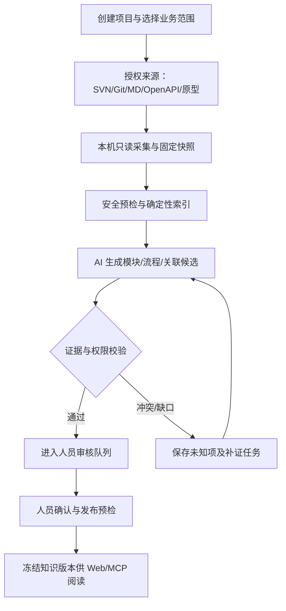
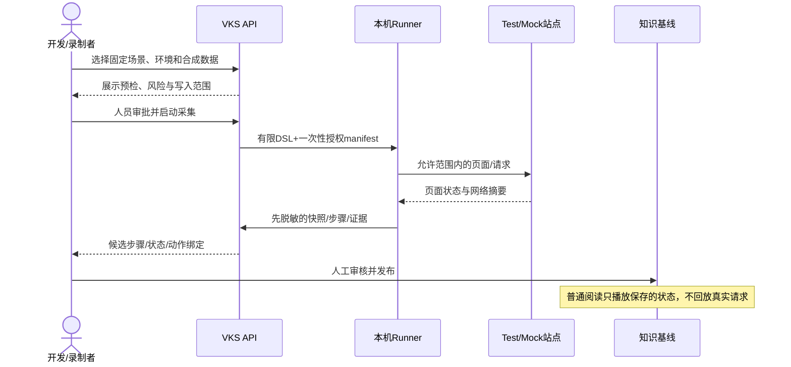
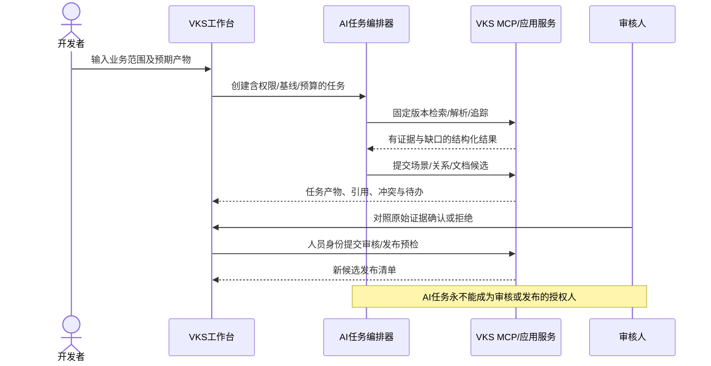
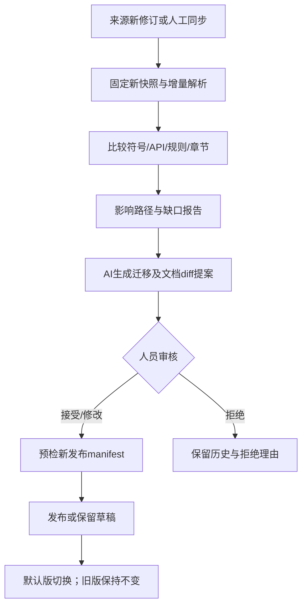
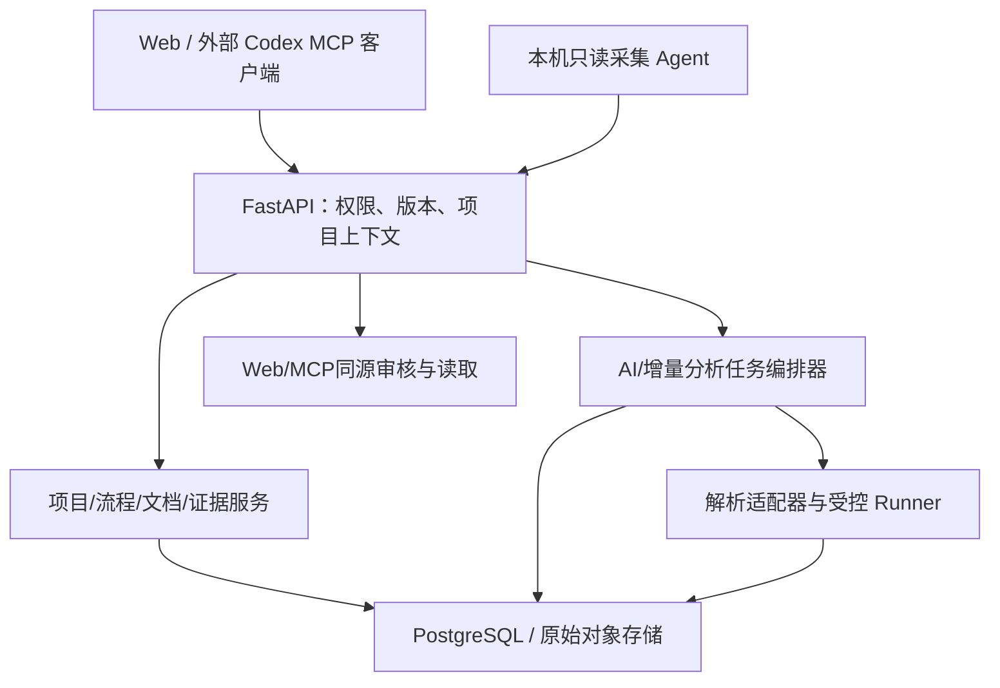
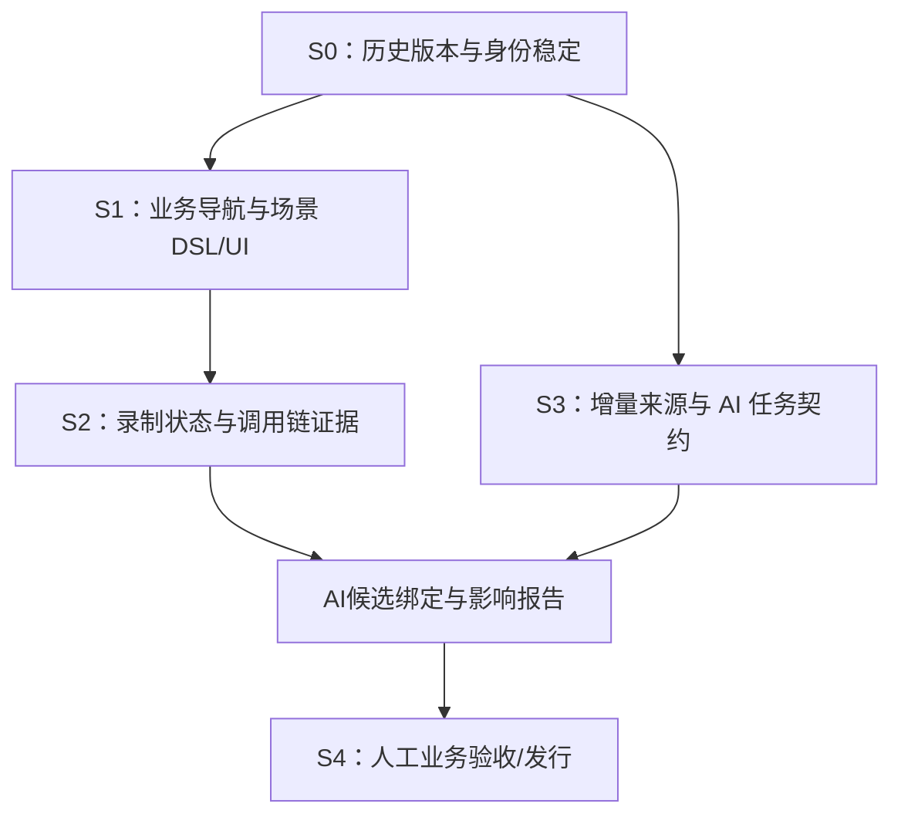

# 知境 VKS 2.0：完整产品升级与技术设计方案

> **设计版本**：2.0 Draft 1 · 2026-10-26  
> **源码基线**：`a3384379/VKS`，`main@b8926b0d2665034f24d85a534ec258d544398990`  
> **文档性质**：下一版本产品与技术设计，不代表功能已经实现或验收通过  
> **配套交付**：`VKS_2.0_UI_概念原型.html`（四个可切换页面，全部使用示例数据）

## 0. 执行摘要

VKS 1.0 已交付项目/来源、资料导入、Java/MyBatis 静态解析、场景和热点、受控录制、文档、关系审核、局部图谱、版本漂移、18 个 MCP 工具及权限/证据模型。然而，产品的主要操作仍围绕“上传—检索—选择—审核—阅读”展开：自动化构建不连贯，业务场景以人工配置与静态预览为主，技术知识仍需要用户反复在多个页面之间寻找，AI/MCP 具有底层工具但缺少高级任务编排，来源变化后也未形成便捷的持续维护过程。

**2.0 产品定义：面向开发人员的交互式业务知识工程工作台。**

用户应能从一个真实业务步骤出发，连续看到：页面状态、前置条件、业务规则、API、调用链、源码、SQL/数据对象、版本与证据；AI 则能在允许的项目范围内组织资料采集、候选生成、关联补全、文档修订和影响分析，由人确认并发布可信知识。

**核心设计原则**：业务场景优先；一次接入、多处复用；原始事实与推断严格区分；历史版本不可变；讲解默认无业务副作用；AI 只能提案不能代替审核；UI 以“当前任务”为中心；优先真实项目验证而非追求功能计数。

## 1. 目标、范围和验收对象

### 1.1 用户明确的五个痛点及目标

| 痛点 | 2.0 目标 | 核心验收方式 |
|---|---|---|
| 自动化程度低 | 项目向导、受控本地采集、模块/流程/关联建议一体化 | 不编写绑定 JSON，仅经向导完成首个场景知识草稿 |
| 业务交互不够真实 | 受控多状态采集 + 被动可交互讲解 + 时间轴/分支 | 成功、校验失败、无权限路径可连续切换，并定位同版证据 |
| UI 缺乏高级感 | 冰蓝白、任务化导航、集中式业务探索与操作反馈 | 1440px 桌面任务测评、视觉走查、键盘/适配验收 |
| AI/MCP 不够智能 | 可恢复的知识任务编排器，复用现有 18 工具 | AI 生成可审核的场景/规则/文档与关系，失败可定位续跑 |
| 持续维护弱 | 增量快照、变更影响、知识修订提案和发布闭环 | 同一项目两个固定修订的差异可追踪到场景和章节 |

### 1.2 目标人群与典型任务

1. **新接手开发**：在 5–10 分钟内理解一条业务流程，找到涉及的 Controller/Service/Mapper、SQL、规则和缺失证据。
2. **老项目维护者**：输入问题（如“为什么部分违约金不能开票”）获得准确版本、关联场景、源码位置与待确认事项。
3. **业务分析/测试**：通过流程与录制快照了解成功/校验/权限/异常分支，找到对应接口及约束。
4. **知识管理员/审核者**：对 AI 新增或因源代码变更而失效的关系批量审查，确认后发布新基线。
5. **外部 Codex/MCP 客户端**：按任务查询固定知识或提交候选，不读取无权项目、不持有批准和发布权限。

### 1.3 北极星指标（目标值需以试点实测校准）

**北极星**：实际开发者在 VKS 中“从业务问题到有依据的正确技术定位”的成功率及耗时。

| 指标 | 建议 2.0 验收门槛 | 测量备注 |
|---|---:|---|
| 关键业务动作可探索率 | ≥ 85% | 分母为冻结的 30 个试点动作；必须有页面/步骤、至少一条经审核关联，不能用候选凑数 |
| 已确认关系证据可追溯率 | 100% | 逐条能返回同项目同版 artifact/hash/locator/证据类型 |
| 未参与项目的开发者独立定位任务成功率 | ≥ 80% | ≥ 5 人、每人 ≥ 5 任务；禁止帮助或预先透露答案 |
| 典型定位任务中位耗时改善 | ≥ 30% | 与原 Markdown + IDE 工作法做配对实验；改善值不是当前事实 |
| 关键路径自动化候选精确率 | ≥ 90% | 冻结独立人工 Gold、分别报告覆盖率和准确率；候选不自动确认 |
| 源码/文档变更后的影响识别 | ≥ 90% Gold 召回 | 预先标注的变更集；同时报告误报、未解析与风险漏报 |
| 历史版本读取一致性 | 100% | 固定 release/修订多次读取始终相同，重导/修订不改变历史结果 |
| 受控采集业务副作用越权 | 0 | 未审批写请求、生产地址、越界 Origin/IP、敏感信息泄露负例必须全部阻断 |

## 2. 对照 1.0 主干的源码差距与复用策略

本节基于实际仓库文件和 `docs/ROADMAP_V1.md`、`docs/VERIFICATION.md`，不是根据演示截图臆测。

| 现有模块与源码落点 | 已有可复用能力 | 2.0 的真实缺口与处理方式 |
|---|---|---|
| `apps/web/src/App.tsx`（八入口、路由/项目状态） | 会话、项目与基线、深链接 | 拆出业务主导航、任务型全局搜索和上下文路由；缩小入口的认知成本 |
| `apps/web/src/pages.tsx`（总览/工作台/文档/审核/图谱/版本/设置约 3,300 行） | 业务数据读取、内容呈现、版本导航 | 分模块组件化；将业务工作台变成独立页面/状态/证据多栏布局；图谱不再只用最多 13 节点的径向展示 |
| `apps/web/src/ScenarioStudio.tsx` | DSL 修订、人工状态/分支、采集审批与绑定 | 提供流程图编辑器、录制生成节点草稿、分支关联、缩略图时间轴、差异对照 |
| `apps/web/src/ImportCenter.tsx`、`SourceManagement.tsx` | 安全预检、资料上传、只读来源登记 | 统一五步项目向导，连接本机采集 Agent 与持续同步，不让用户反复复制命令 |
| `packages/collector/snapshots.py` | 目录/Git/SVN 固定修订和只读采集 | 增加显式授权范围、增量清单、同步游标与本地调度；不执行仓库代码 |
| `packages/analyzers/java_spring.py`、`vks_ingest.py` | Java Spring/Feign/MyBatis 静态候选与来源索引 | 补充跨服务映射策略、消息/定时任务适配器、业务标签和不足说明；不把动态分派猜成事实 |
| `services/api/vks_api/scenarios.py`、`services/browser_runner/runner.py` | Test/Mock 环境、有限 DSL、敏感数据过滤与录制 | 多轨迹归档、状态比较、候选动作合并与证据关联；安全边界保持不变 |
| `services/api/vks_api/ai_gateway.py` | 受限模型出站、问答/文档草稿、预算与引用验证 | 引入 AI 任务规划器、分步结构化产物、检查点、人工确认点、效果评估 |
| `services/api/vks_api/mcp_gateway.py`、`packages/contracts/mcp_tools.json` | 18 个 SDK 工具/资源/提示、权限/版本 | 为复杂工作流组织工具，补充工作流草稿/质量/影响报告等能力；机器仍不得确认关系或发布 |
| `services/api/vks_api/versions.py` | 基线比较、深度有限影响传播、迁移提案 | 接入来源变化事件、增量调度、跨版本证据迁移预检与审查收件箱 |
| `services/api/vks_api/documents.py`、`models.py` | 稳定实体、修订、原始材料、人工锁与审核 | **优先修复 R01/R02**；固化文档修订→章节修订映射，保护显式章节 key 和历史发布 manifest |
| `services/api/vks_api/jobs.py`、Celery/outbox | 任务、幂等、租约、取消、检查点 | 复用作知识构建流水线调度；新增分阶段结果、重跑边界与任务诊断 |

### 2.1 2.0 绝不能破坏的 1.0 契约

- `entity` 为稳定逻辑身份，`entity_revision`/`artifact`/`evidence` 为版本化事实；已发布 manifest 不可变。
- 关系的审核状态、有效性、证据类型与因果依据分离；人工批准不改变证据类别。
- 同项目、同版本、同权限读取；跨版本/来源不自动拼接为真实调用链。
- 本地 SVN/Git 采集始终只读；企业私有化、资料不可默认发往公网模型。
- 不执行导入材料中的指令、脚本或项目构建；真实业务写入只可在固定 Test/Mock 环境经人员审批发生。
- 原始 Markdown UTF-8、BOM、换行和附件字节保留；生成/编辑保存为新修订，不做全量转码。

## 3. 产品信息架构与导航重组

### 3.1 推荐一级信息架构

保留原有八大能力，但前台以用户目的而非技术管理对象组织导航。

| 新一级导航 | 子功能 | 旧模块映射 |
|---|---|---|
| **项目空间** | 项目概览、模块地图、业务路径、知识健康 | Overview / ModuleTree / ProjectProfile |
| **业务探索** | 页面/场景、状态回放、操作知识、调用链、AI解释 | Workbench / ScenarioStudio / HotspotEditor |
| **知识构建** | 智能接入、采集任务、AI工作台、候选和文档 | ImportCenter / SourceManagement / Documents / AI |
| **变更与审核** | 待办、关系审核、版本对比、影响、发布 | Reviews / Versions / ChangeProposals |
| **项目设置** | 团队权限、来源、MCP、模型、环境与策略 | Settings / TeamSettings / ModelSettings |

业务探索为默认首要 CTA，知识图谱/文档/技术详情成为上下文页签或抽屉；保留深链接及权限清晰的高级入口，不直接删除原 API。所有旧 hash 深链接需要兼容重定向。

### 3.2 核心导航体验

1. 进入项目：展示业务域、最近场景、已确认覆盖率和待处理变更。
2. 点击业务域：显示流程卡片而不是按来源目录堆文件。
3. 打开流程：左边步骤、中央页面/状态、右侧知识、底部调用链；选中动作时始终保持同一个上下文。
4. 点击接口/代码/章节：打开同版上下文面板，可返回原动作；显示原始定位和最新/历史版提示。
5. 点击“让 AI 帮我整理”：创建可取消的后台任务，展示候选、证据、冲突、审核队列，不直接覆盖知识。

## 4. 2.0 功能清单与边界

### 4.1 P0：自动化项目接入与知识构建（ING）

| ID | 功能点 | 关键行为 | 最小验收 |
|---|---|---|---|
| ING-01 | 五步项目接入向导 | 选择项目与范围→来源→隐私→预检→解析/候选 | 未提供源码也可跳过并明确能力降级 |
| ING-02 | 本机只读采集 Agent | Windows 首批；选择授权目录/本机 Git/SVN 工作副本 | 不读取未授权路径、不执行脚本/命令、不上传秘密 |
| ING-03 | 多来源版本对齐 | SVN revision/Git commit、OpenAPI build id、原型导出版本单独记录 | 不一致显示 `unknown/unverified`，阻止伪造确定关联 |
| ING-04 | 自动发现业务模块 | 从路由、目录、类名、文档、现有 manifest 提候选 | 模块候选可查看理由，需人员确认或调整 |
| ING-05 | 自动发现页面动作/场景 | Manifest 精确 ID 优先，DOM/文本/路径作候选，形成流程草稿 | 相同名称/跨项目不模糊合并；可批量拒绝 |
| ING-06 | 增量索引 | 哈希/路径/依赖影响分片，未变化保留身份与人工决定 | 同快照重跑幂等；局部变更不全库重算 |
| ING-07 | 项目接入报告 | 已发现/已确认/未知数量与来源/缺口清单 | 指标均给出分母、来源版本和可重试操作 |

**首版范围**：目录/SVN/Git、Markdown、OpenAPI、HTML/Axure 及截图。Java 8/Spring/MyBatis 为深度分析主路径。React/Vue 的构建 manifest/显式锚点优先；Python/TS 复杂调用图保留后续适配等级。

### 4.2 P0：真实业务交互与流程工作台（EXP）

| ID | 功能点 | 关键行为 | 最小验收 |
|---|---|---|---|
| EXP-01 | 流程画布 | 页面、动作、判断、分支、终止、文档/接口引用六种节点 | 拖拽、连接、撤销/重做、保存/冲突、键盘导航 |
| EXP-02 | 多状态安全回放 | 成功、失败、校验、无权限等快照/DOM/时间轴 | 点击不向业务系统发请求；可显示状态来源 |
| EXP-03 | 录制转流程草稿 | 固定 DSL + 已批准测试环境采集，生成步骤/分支候选 | 原始采集只读、人工绑定可修正，源与版本一致 |
| EXP-04 | 操作知识抽屉 | 业务规则/API/实现/数据/文档/证据六页签 | 同一动作切页不丢上下文，原文/源码精确定位 |
| EXP-05 | 技术调用链 | UI→API→Service→Feign/Kafka/Job→Mapper→SQL/表 | 静态/运行/语义证据不同线型，动态缺口不补画实线 |
| EXP-06 | 页面与代码双向跳转 | 从操作定位源符号/章节，再从代码反查场景 | 带 project+release+action+symbol 的稳定深链接 |
| EXP-07 | 角色与状态对比 | 不同角色/前置条件/成功失败两轨迹比较 | 明确可比较范围及未覆盖状态 |

**三种操作模式**：`讲解`（默认、被动）、`模拟`（只使用已录状态/声明数据）、`受控采集`（另一个审批流程，仅 Test/Mock）。任何模式都不得静默切换为真实生产写入。

### 4.3 P0：AI/MCP 知识工程（AIE）

| ID | 功能点 | 关键行为 | 最小验收 |
|---|---|---|---|
| AIE-01 | 任务模板 | 项目概览、模块解析、业务链路、文档草稿、证据补全、差异复核 | 无模型配置时普通检索/手工编辑可用 |
| AIE-02 | AI 任务规划和执行 | Plan→Collect→Analyze→Propose→Validate→Review | 每阶段结构化产物、日志、任务 ID、失败恢复 |
| AIE-03 | 来源受限 RAG/证据检索 | 项目、基线、权限、敏感标记先过滤再查询 | 无权内容不能出现在提示、计数、结果或缓存 |
| AIE-04 | 多候选与冲突报告 | 明示静态/观察/语义证据、歧义、替代目标 | AI 不得自报置信度就自动确认 |
| AIE-05 | MCP 任务组合 | 复用 18 工具，追加任务状态/草稿/覆盖和影响报告工具 | 官方 SDK 读取与 Web 同一实体/版本/权限 |
| AIE-06 | AI 生成章节/流程 | 写入独立待审核草稿，段落引用证据 | 不能替换人工锁段落、不能改发布版 |
| AIE-07 | 预算与回滚 | 模型/Token/任务预算、断线/取消/重试、同输入幂等 | 外部调用失败不留下“已确认”假结果 |

### 4.4 P1：持续维护与文档治理（CHG）

| ID | 功能点 | 关键行为 | 最小验收 |
|---|---|---|---|
| CHG-01 | 变化检测 | 手动同步优先，可选择在授权本机调度 Git/SVN/目录扫描 | 保留来源身份/游标，未授权不可自动拉取 |
| CHG-02 | 分层差异 | 源文件/符号/API/流程/规则/章节/关系的差异 | 区分纯注释、移动、改名、业务变化候选 |
| CHG-03 | 影响路径 | 变化节点→API→业务动作→流程→文档 | 路径跳数、来源、证据、是否截断可见 |
| CHG-04 | 更新提案收件箱 | AI 草稿/迁移/章节 diff，支持接受、拒绝、拆分、重定向 | 不自动改变历史发布、审核日志不可覆盖 |
| CHG-05 | 知识健康 | 已确认覆盖、过期、断链、无运行证据、审查积压 | 每个指标有分母、范围、排除项和版本 |
| CHG-06 | 审核后发布 | 预检→人员签署→冻结新 manifest→可回退默认版 | 机器令牌不能签署/发布，权限更改即时生效 |

### 4.5 P2/后续

- 新员工角色化学习路径、题卡和“我需要了解的 10 个业务流程”。
- 高级全文检索与知识地图多视角布局、路径收藏、分享只读链接。
- 多浏览器/多角色对比、完整前端调用分析、消息中间件深入插件。
- 企业级 SSO、多人实时富文本协同、插件市场、视频级长会话回放均非 2.0 首发阻塞项。

## 5. UI/UX 全面升级：设计系统与页面规格

### 5.1 视觉策略：Ice Blue × Precision

延续用户认可的“冰蓝＋白色”方向，但避免极端简化、白底表格堆叠和深色星空图谱。视觉关键词为：**通透、精密、层次、克制的科技感、可辨识的业务状态**。目标接近成熟专业工具的审美，而非生成式后台模板。

| 元素 | 设计值/行为 |
|---|---|
| 背景 | `#F3F8FF`，内容主面 `#FFFFFF`，次级浅蓝 `#ECF4FF` |
| 主色 | `#2868EF`；选中/路径高亮 `#E7F1FF`；辅助青蓝 `#27B7D9` |
| 文字 | 主文字 `#112744`，次级 `#5B708E`，弱提示 `#8496AD` |
| 分割 | `#DCE8F7`、内部分割 `#EDF2F8`；以精密线条和留白划分层级 |
| 状态 | `确认`绿色、`候选`琥珀、`断链`红色、`未解析`灰蓝；颜色+文字+图标三重编码 |
| 字体 | Inter / SF Pro、苹方/微软雅黑；代码 JetBrains Mono / Consolas，正文 13–15px |
| 圆角 | 按控件等级 8/12/16/20px，卡片阴影轻而有层次，避免浮动弹窗泛滥 |
| 网格 | 8px 基准，桌面设计参考 1440/1600px；主栏最小宽度 580px，右侧面板 336–380px |
| 动效 | 常规 150–220ms、轻量入场、流程路径动态追踪；禁用或尊重 `prefers-reduced-motion` |
| 图谱 | 默认任务局部路径而非全屏撒点；一屏先看 5–10 个重要节点，再逐级展开 |

**UI 交互规范**：一项业务任务使用一个持久的上下文头（项目、知识版本、业务模块、场景、动作、证据策略）；跳到文档/接口/源码后仍可“返回操作”；异步作业默认侧栏进度；错误给原因、范围、下一步；信息密度可在“概览/详细”切换；全站统一空态、加载态、权限态、冲突态、过期态。

### 5.2 UI-01 项目空间 / 项目驾驶舱

**目标**：3 秒内知道“项目是什么、从哪个业务入口开始、知识哪里还不完整”。

**布局**：

- 左侧 224px：五大入口导航、项目选择和最近访问。
- 上方：项目名、版本、同步状态、固定的“探索业务”主操作。
- 第一屏：业务模块卡（如缴费、账单、开票、报表）及完成度，**完成度带分母说明**。
- 中部：最近业务流程横向卡，每张给流程步骤数、可信关系、变化状态。
- 右侧 320px：AI 快速任务、同步状态、待审核变更，而不是混杂大量 KPI。
- 下方：来源健康、最近变更、快捷进入接入向导。

**交互**：点模块进入过滤的流程列表；点缺口进入审核/补证；点“自动构建知识”创建带预检的任务；首次无项目时显示三步起步，而不是空表。

### 5.3 UI-02 业务探索工作台（核心优先）

顶部持久上下文：项目 / 发布版本 / 业务域 / 流程 / 角色 / 模式 / 分享。

| 左侧：业务域与流程 | 中央：页面与状态 | 右侧：当前操作知识 |
|---|---|---|
| 场景树、步骤、分支、页面缩略图 | 录制状态/安全原型、热点、成功/失败/无权限状态、时间轴 | 业务规则、接口、源码、SQL/数据、文档、证据 |

底部可折叠链路为 `Action → API → Controller → Service → Mapper → SQL`，每一段独立显示证据和未解析情况。

上图为区域规格，不是实际代码布局或已实现截图。建议 1600px 下左右栏分别 252/362px，中央自适应；1024–1439px 将右侧知识折叠为抽屉；窄屏只提供只读阅读。

**行为**：

1. 页面中的被授权热点响应“选中”而不透传真实业务点击。
2. 底部状态时间轴切换快照；从录制路径切换到声明/模拟路径始终有明显标记。
3. 当前动作右侧按“业务说明 / API / 调用链 / 数据 / 文档 / 证据”切换，保持 selection 不变。
4. 链路节点展开显示原始位置、修订 hash、原因、审核与因果类别；未知边界显示灰色占位。
5. AI 提问自动带当前固定上下文，但可见证据由服务端权限校验。
6. 发现错误时可在原动作创建“纠错/补证”提案，不跳出业务探索。

**核心差异**：不是再把静态截图渲染更漂亮，而是使“录制状态—业务动作—技术实现—知识反馈”在一个界面连续发生。

### 5.4 UI-03 AI 知识构建工作台

**三栏**：左栏任务模板与来源范围；中栏五阶段执行流水线；右栏产物与证据审核。顶部显示模型/隐私策略/本次预算、固定版本。右侧可在“模块图、流程草稿、文档草稿、候选关系、缺口报告”间切换。

功能按钮：“预检任务”“开始分析”“暂停/取消”“重试失败阶段”“查看引用”“发送人工审核”。执行中不得出现虚假的完成百分比；每阶段的输入/输出版本、预计费用、实际任务 ID、错误和未知项可展开。

**两种启动方式**：

- 引导式：选择“生成一个业务模块知识包”，系统提出范围/预估/产物清单。
- 自然语言：例如“围绕批量开票生成业务流程、规则、接口和 SQL 关系候选”。模型先提出计划供人员确认范围，不可自由越界读取/执行。

### 5.5 UI-04 变更影响与知识维护

左栏比较两个固定来源版本；中间显示受影响业务链路和差异；右侧为待审提案与“旧/新”章节 diff。风险默认按“直接高置信事实变化、潜在影响、仅格式变化、未知/截断”分组，不声称推断概率。

示例：某个批量开票服务方法改动 → 相关 API 与场景高亮 → 旧金额规则章节标记“可能过期” → AI 提供基于新旧源码证据的修改提案 → 人员确认 → 新发布版。

### 5.6 UI-05 智能接入向导

五步：① 范围与目标 → ② 来源与版本 → ③ 隐私/运行约束 → ④ 预检问题 → ⑤ 分析任务与成果。前端始终说明：客户端只读采集、服务器无权访问任意本地目录、模型默认不接收禁止出口材料。对 SVN 有专属 revision/工作副本帮助及一键导出采集任务。

### 5.7 视觉质量验收

- 精确检查 1440/1600px、1024px、768px、375px 四类宽度，禁止横向裁切重要操作；窄屏可合理降级只读。
- 通过键盘焦点、可访问名称、对比度、`reduced-motion` 和关键信息不依赖单一颜色的测试。
- 真实材料测试长类名、超长路径、多行 SQL、中文大段 Markdown、10+ 步骤与缺失截图。
- UI 组件形成复用设计系统，禁止在各页复制不同按钮、Tag、Modal、Notice 规则；对 1.0 旧入口采用渐进迁移。
- 人工 UI 评审至少包含“首次接入”“首次打开动作”“未知链路”“运行证据缺失”“多人审核冲突”“两个版本对比”六种实际状态。

## 6. 关键用户流程、状态和时序

### 6.1 首次自动建库闭环



### 6.2 受控采集、状态回放的分离



### 6.3 AI/MCP 任务时序



### 6.4 增量维护与发布



### 6.5 关系生命周期（正交状态）

审核轴：`candidate → confirmed/rejected`；有效性轴：`valid → stale/broken`；证据轴：`explicit/static/observed/semantic/manual`；因果轴：`not_established/observed_during/correlated/trace_proven`（仅示意，最终枚举需按契约冻结）。这四轴不能合成一个随意升降的“可信分数”。

## 7. 技术架构与核心模块

### 7.1 架构选择

**不重写整体技术栈。** 前端继续 React + TypeScript/Vite；API 继续 FastAPI/Pydantic/SQLAlchemy；主存储继续 PostgreSQL（开发 SQLite）；任务继续 outbox + Celery/RabbitMQ；源资料继续不可变对象与源快照；Runner 继续 Playwright；MCP 继续官方 Python SDK。只在有数据证明时再考虑单独搜索引擎/向量索引/图数据库。



### 7.2 分层服务边界

| 层 | 新/扩展组件 | 原有复用点 | 边界 |
|---|---|---|---|
| 表现层 | ProjectCockpit、BusinessExplorer、JourneyCanvas、AgentWorkspace、ImpactWorkbench | `App.tsx`、`pages.tsx` 的会话/导航 | 所有读写走后端权限；UI 不拼写原始凭据 |
| 采集层 | LocalCollectorAgent、SyncProfile、SnapshotDelta | `packages/collector`、ImportCenter | 只读白名单目录/固定 ref；浏览器/仓库执行分隔 |
| 解析层 | ModuleDiscoverer、FlowCandidateBuilder、ServiceTopologyAdapter | `java_spring.py`、`vks_ingest.py` | 能解析即事实，不能解析给未知/歧义 |
| 场景层 | JourneyService、StateReplayService、CaptureBindingPlanner | `scenarios.py`、`HotspotEditor`、Runner | 被动讲解绝不执行站点脚本或业务请求 |
| 知识层 | ActionContextComposer、BusinessRuleIndex、ImpactService | `reading.py`、`relationships.py`、`versions.py` | 同版、同权限、受限图遍历 |
| AI/MCP 层 | KnowledgeTaskOrchestrator、EvidenceValidator、DraftProposalService | `ai_gateway.py`、MCP Gateway、`jobs.py` | 结构化候选、预算、可取消、不可批准发布 |
| 治理层 | ReviewInbox、QualityMetrics、ReleaseGate | 文档审核、发布、审计和权限 | 人员决定不可被任务或模型伪造 |

### 7.3 推荐 UI 与观测组件

- 流程画布：`@xyflow/react` 自定义业务节点与边、ELK/Dagre 排布；与业务 DSL 通过显式编译器相互转换，避免直接持久化任意前端节点对象。
- 录制回放：研究 Playwright Trace Viewer 的“动作时间轴、前后 DOM 快照、网络时窗”交互，但沿用 VKS 的**入库前脱敏**，不直接上传或保存包含 Cookie/客户资料的原始 Trace。
- Java 运行链：**可选** OpenTelemetry Java Agent（支持 Java 8+）；按服务、操作和采集批次关联 span。只能把有有效 trace_id/span_id 与版本/环境对齐的路径视为运行证据。
- SQL/表关系：从静态 Mapper/XML 与被允许的运行数据库调用摘要中提取，默认不保存 SQL 绑定参数或用户私密字段；动态 SQL 保留范围表达与未知项。

## 8. 数据模型、版本兼容与迁移

### 8.1 保留已有核心表，不进行破坏性重构

既有 `project`、`analysis_set`、`source_snapshot`、`artifact`、`entity`、`entity_revision`、`analysis_set_entity`、`evidence`、`relation`、`review_decision`、`knowledge_release`、`job` 保留。新关系以 `project_id`、`analysis_set_id`、稳定实体 ID、固定修订 ID 定位；不从前端自由传递跨项目 UUID。

### 8.2 建议新增/扩展的持久实体

| 模型 | 关键字段 | 设计目的 |
|---|---|---|
| `business_journey` | project_id, stable_key, module_id, title | 业务流程逻辑身份，不是某次录制 |
| `journey_revision` | journey_id, analysis_set_id, revision_no, dsl_hash, state, created_by | 不可变流程修订与编辑冲突检测 |
| `journey_step_binding` | journey_revision_id, step_key, action_revision_id, page_state_id, order_index | 流程步骤到 UI/动作/状态的显式关联 |
| `capture_state_snapshot` | capture_id, step_key, state_key, artifact_id, redaction_version, evidence_origin | 归档已脱敏状态与浏览器快照；支持多状态 |
| `source_sync_profile` | project_id, source_id, provider, allowed_roots, mode, consent_version | 客户端允许范围和调度政策；凭据只存引用 |
| `source_sync_cursor` | profile_id, revision, content_hash, status, last_job_id | 幂等增量同步，不用本机路径当远端文件 |
| `knowledge_task_run` | project_id, analysis_set_id, task_kind, plan_json, budget_json, state | AI 长任务与授权快照、阶段追踪 |
| `knowledge_task_artifact` | run_id, stage, kind, immutable_artifact_id, evidence_refs, state | 每阶段可复核产物；失败不覆盖旧草稿 |
| `document_revision_section` | document_revision_id, section_entity_id, section_revision_id, order_index | **R01 修复**：固定文档修订对章节修订的精确映射 |
| `change_impact_report` | from_release_id, to_analysis_id, source_vector, report_hash, created_by | 增量分析的稳定结果，不回写旧 release |
| `review_inbox_item` | project_id, subject_kind, subject_id, source_job_id, resolution | 统一人工审核入口，关联原 relation/文档/流程主体 |

`source_sync_profile.allowed_roots` 应只指向经用户主动授权的客户端范围；服务器必须使用客户端声明的授权票据/会话，不接受任意请求体路径作为服务器读取目标。可根据实际需求将本地路径信息仅保存在 Agent 侧，服务器仅保留不敏感标识和策略摘要。

### 8.3 R01/R02 修复作为 S0 数据门禁

**R01 历史章节混读**：在保存文档新修订时，事务内写 `document_revision_section`，读取历史修订只根据固定映射返回准确的章节修订；已发布历史可依发布 manifest 重建可证明的映射，无法无歧义复原的旧草稿标为需复核，禁止用“最新修订”填补。不删除旧章节或改写旧 hash。

**R02 显式 sectionKey 身份漂移**：导入时的优先级应为合法显式 key（验证项目/来源/文档归属与唯一性）→ 同逻辑来源稳定映射 → 唯一正文/路径启发式匹配 → 新候选 ID；跨文档/来源冲突按明确错误处理。重导保留审核、证据和关系历史，冲突不能被随机 UUID 静默掩盖。

迁移必须先写失败复现（两次重导、历史修订、发布回退、人工锁、跨项目 key 冲突），修复后在 SQLite 与隔离 PostgreSQL 验证；正式环境先备份并在镜像数据上演练升级/回滚，不允许在数据迁移失败后继续对外宣称版本一致。

### 8.4 版本对齐模型

每个读取结果携带 `source_vector`，至少记录：SVN revision/Git commit、原型 snapshot、OpenAPI build 版本、运行环境 build id、分析器版本、知识分析集合/发布版。缺少对应版本不自动推断 `aligned`；支持 `matched / mismatched / unknown` 独立状态。

## 9. HTTP API、MCP 与数据契约建议

### 9.1 API 版本策略

保留 `/api/v1` 已有契约；新增行为在 `/api/v2` 或经字段兼容演进，并提供针对既有版本的适配器。不要在 2.0 首日批量改写全部 Web/MCP 客户端。新写接口要求 `Idempotency-Key`、请求人/项目授权、预检版本和乐观并发/ETag 校验；所有分页和诊断权限先过滤后统计。

| 建议端点（示意，编码前须冻结 OpenAPI） | 方法 | 权限和用途 |
|---|---|---|
| `/api/v2/projects/{pid}/onboarding/preflight` | POST | source:read/project:manage；验证来源范围与隐私 |
| `/api/v2/projects/{pid}/source-syncs` | POST | project:manage；创建本机同步会话/任务，不读取服务器路径 |
| `/api/v2/projects/{pid}/journeys` | GET/POST | read/edit；流程列表与候选创建 |
| `/api/v2/journeys/{id}/revisions` | POST | edit；保存 DSL 新修订，不覆盖已发布 |
| `/api/v2/journeys/{id}/replay` | GET | knowledge:read；只返回被动脱敏状态与版本标记 |
| `/api/v2/actions/{id}/explanation` | GET | read；合成同版规则、API、源码、SQL、证据、缺口 |
| `/api/v2/projects/{pid}/knowledge-tasks` | POST | edit + 模型策略；发起受限 AI 构建任务 |
| `/api/v2/knowledge-tasks/{id}` | GET | 当前身份可见阶段、预算、产物和诊断 |
| `/api/v2/projects/{pid}/change-impacts` | POST | edit；固定两个版本并发起影响计算 |
| `/api/v2/projects/{pid}/review-inbox` | GET | 审核者看到统一候选收件箱 |

### 9.2 `action explanation` 推荐返回结构（简化示例）

```json
{
  "project_id": "<固定项目ID>",
  "release_id": "<固定发布版ID>",
  "action_id": "<当前动作ID>",
  "action_revision_id": "<准确修订ID>",
  "source_alignment": "unknown",
  "business_rules": [{"rule_id": "rule.invoice.limit", "evidence_ids": ["ev-1"], "review_status": "confirmed"}],
  "paths": [{
    "nodes": ["ui-action", "api", "controller", "service", "mapper", "sql"],
    "relation_ids": ["r1", "r2", "r3"],
    "causal_basis": ["explicit", "static", "not_established"],
    "is_truncated": false
  }],
  "unknowns": ["没有与源码版本对齐的运行 Trace，不能声称完整的请求执行链"],
  "next_actions": ["request_capture", "review_link"]
}
```

这只是说明结构，实际字段和枚举必须通过 OpenAPI/JSON Schema 固化、契约测试与 SDK 同步后实施。`evidence_ids` 每一项都必须在当前授权版本中有效，客户端不根据 displayName 自行连接不同服务的方法。

### 9.3 MCP 2.0 策略：编排优先，不追工具数

已有 18 个工具覆盖项目列表、上下文、搜索、场景、证据、流程追踪、导入、静态分析、候选提案、受控采集、任务/取消、漂移、发布请求与导出。优先把它们组合为任务模板，而不是重新实现同名接口。

建议补充至多 4–6 个紧贴差距的 MCP 工具：`propose_journey`、`get_knowledge_task`（或复用 get_job 扩展）、`get_knowledge_coverage`、`get_change_impact_report`、`propose_document_revision`、`get_sync_status`。所有新增工具明确 `read/propose/import` 权限边界，不含 `approve/publish`。

对复杂任务使用服务端生成的不可猜测 `task_id`/`plan_id`，跨工具调用显式传递，不依赖模型在对话中自行记忆授权。输出需可分页、可复查、可重试、可撤销和携带版本/证据 URI。

### 9.4 AI 工作流示例

**任务**：“为账单批量开票生成端到端业务知识包”。

1. **Plan**：选择业务域和源码/原型/MD/OpenAPI 来源；预估预算、分支范围、预期章节数；用户确认分析范围。
2. **Collect**：调用 `search_knowledge`、`get_project_context`、`get_action_context`、`trace_business_flow`，必要时用 `analyze_snapshot` 创建新候选；结果固定来源 hash。
3. **Structure**：输出业务流程 DAG/场景 DSL、接口目录、规则清单、源码/SQL 依赖图；每项保留出处和未知项。
4. **Propose**：通过 `propose_links` 及新候选接口创建待审关系、流程和 Markdown 章节；绝不写 confirmed。
5. **Validate**：Schema、端点同版、证据真实性、引用权限、覆盖率、冲突/重复 key、敏感标记、预算再次校验。
6. **Review**：人的网页审核、变更预览、版本预检；AI 只汇报结果和需人工判断点。

**失败恢复**：单阶段使用幂等键，记录输入摘要/任务版本/阶段状态；阶段重跑需重新验证当前权限/撤销/来源策略；已过期计划不能继续用旧的授权快照无限执行。长任务可断线查询与取消；外部模型返回无证据引用的内容只能进入诊断，不能变成确认的知识。

## 10. 增量同步、影响分析与数据治理

### 10.1 自动维护原则

- **先检测来源变化，再计算受影响子图**：基于文件哈希、语义哈希、符号/API 稳定键、规则版本与分析器版本，区分改名、移动、纯注释和内容变化。
- **保留人工结论**：不因重解析把已拒绝候选重新提交为新关系；人工锁不可被机器清除；变更失效只生成待审提案。
- **来源与知识发布解耦**：源码已有新版不意味着知识版已自动发布；用户可继续查看上一个稳定发布版。
- **持续同步有显式授权**：默认人工触发；用户开启后由本机 Agent 在白名单目录/固定 SVN 仓库同步，失败只告警而不绕过权限。
- **范围变化与删除风暴防护**：若新增快照突然大量缺文件，先判定“采集范围缩小/权限不足”而不是把知识全判删除。

### 10.2 影响分类及处置

| 分类 | 系统处理 | 审核要求 |
|---|---|---|
| 源码路径改变、逻辑内容不变 | 唯一安全重定位候选 | 人员可批量确认，但不改历史 |
| API 方法/路由变更 | 标记关联 stale/broken，列出受影响动作/文档 | 显式新绑定和业务验证 |
| Service 业务判断变化 | 生成“规则可能改变”提示，展示新旧 diff | 不自动把代码 diff 转成确定业务规则 |
| SQL/表字段变化 | 追踪 Mapper/Service/API/场景影响 | 检查动态 SQL、权限、事务和版本 |
| 文档章节改写 | 比对章节修订、锁与原始 bytes | 章节身份稳定，发布前复审 |
| 运行路径变化 | 保存新 Test/Mock 证据并与原证据对比 | 不把不同部署版本的 Trace 混成一个结果 |

### 10.3 技术实现细则

1. 采集 Agent 输出固定 `source_snapshot` 清单与可验证内容摘要；首次完整，后续 delta 以快照清单为参照。
2. 分析器通过 `analyzer_version + input_hash + ruleset_version` 缓存确定性结果；依赖变化触发受影响文件/节点重解析。
3. 关系影响采用现有有界 BFS 扩展，不默认全库遍历；界面明确截断、权限过滤与未解析边界。
4. `change_impact_report` 固化源版本、检查策略与影响分母；人员针对固定报告审核，避免审核期间结果变动。
5. 发布阶段重新比对审批主体、源 hash、分析集合选择、章节/关系状态；不一致拒绝提交并指引刷新。

## 11. 权限、安全和风险控制

- **来源**：只读、显式目录/仓库白名单、忽略软链接/秘密/构建缓存；SVN/Git 使用既有用户授权，不自动检出额外分支或执行 hooks；适配器不用用户敏感令牌写入 manifest。
- **运行站点**：仅 Test/Mock，固定 Origin/IP/SNI/重定向策略，合成数据和准确写路径人员审批，永久禁止默认对生产执行支付/退款/开票等高风险操作。
- **录制数据**：DOM/截图/HTTP 摘要入库前脱敏；授权 Header/Cookie/Token、身份证/手机号、支付明细和客户数据不得落库；不把未经清洗的原始 Trace 上传到 AI；证据仍可查询哈希和精确来源。
- **模型**：默认关闭数据出境；项目级密级/来源级 `allow_platform_llm=false` 优先级最高。模型输出作为不可信结构化候选，工具调用通过服务端授予的固定范围与预算，不提供任意 Shell/SQL/网页访问能力。
- **MCP**：Web 与 MCP 共用权限、版本和读写服务；机器只能导入/提案/查询，不能审批或发布。凭据即时撤销，OAuth/项目授权按每请求重新验证。
- **一致性**：修订不可变、CAS/ETag、防重、关联证据 hash；任务 outbox/lease/cancel 保持幂等；恢复演练验证对象与数据库同一时间点。
- **成本**：按阶段额度/单任务 token 和费用、每日预算、最大重试与并发控制；超过预算暂停并出具可读的“已处理/未处理”报告。

## 12. 开发阶段、依赖与任务拆分

### 12.1 阶段安排（以单名主开发者 + Codex 辅助为估算假设）

| 阶段 | 主要交付 | 推荐人日区间 | 必须满足的退出门槛 |
|---|---|---:|---|
| **S0 基线治理** | R01/R02、历史版本映射、审计用例、当前版本快照/性能基准 | 5–8 | 历史读取/显式 key 回归通过；老数据迁移/回退已演练 |
| **S1 交互产品基座** | 2.0 设计系统、信息架构、项目向导、流程画布和业务探索框架 | 12–18 | 通过最小真实模块的页面→流程→动作→知识导航；旧链接可用 |
| **S2 业务/运行证据闭环** | 多状态回放、场景候选、调用链、跨服务映射、用户纠错 | 15–25 | Test/Mock 两条以上不同分支；同版双向定位；越权写入 0 |
| **S3 AI/MCP 与持续维护** | AI 任务编排、自动文档/关系提案、增量来源、影响/审核中心 | 15–25 | 固定项目两版全链路；断线/取消/撤销/幂等/预算通过 |
| **S4 真实业务试点和发布** | 云收费业务域验证、独立 Gold、UX 测评、容量/安全、迁移与文档 | 10–15 | 第 1.1 节质量门槛和第 13 节必须项签署；未通过不宣称 GA |

以上为规划用工程量而非合同工期；考虑模块重叠与项目素材准备，单人通常需要滚动安排，真实试点的权限和数据能否获得会影响排期。每阶段应交付一个可演示 Web + MCP 纵向切片，不接受直到 S4 才看到首个业务闭环。

### 12.2 必须遵守的依赖顺序



### 12.3 Codex 推荐任务单元（每个单元独立提交/评审）

| 编号 | 交付包 | 主要代码路径 | 先行回归/依赖 |
|---|---|---|---|
| T00 | 历史文档修订映射修复 | `documents.py`、`models.py`、Alembic、`tests/documents` | 先创建 R01/R02 两个失败复现 |
| T01 | UI 2.0 Design Tokens/布局基座 | `apps/web/src/` 新 `design-system/`、`App.tsx` | 视觉/响应式/路由/权限快照 |
| T02 | 项目接入向导 | `ImportCenter.tsx`、`SourceManagement.tsx`、`collector` | 路径白名单/重导幂等/资料泄露负例 |
| T03 | Journey DSL/流程编辑器 | `packages/scenario_dsl`、`scenarios.py`、新 JourneyCanvas | Schema round-trip、边/分支约束、旧场景适配 |
| T04 | 被动多状态回放/技术抽屉 | `runner.py`、`CaptureResults.tsx`、`pages.tsx` 拆分 | 浏览器真实 click 0 外发、快照脱敏、来源对齐 |
| T05 | 调用链 Context Composer | `reading.py`、`relationships.py`、`java_spring.py` | Static/Observed/Unknown 正交与权限过滤 |
| T06 | AI 任务编排服务 | `ai_gateway.py`、`jobs.py`、`mcp_gateway.py` | 模型合成服务、任务重入、证据伪造、预算/撤销 |
| T07 | 增量同步与影响报告 | `collector`、`versions.py`、`ChangeProposals.tsx` | 两个固定 source_revision、pure comment/rename/delete |
| T08 | MCP 2.0 工具/Schema | `packages/contracts`、`tests/mcp` | 官方 SDK、HTTP/stdin、输入输出 Schema/权限 |
| T09 | 云收费真实业务试点 | 独立 fixtures/试点脚本，现有项目源码不修改 | 30 动作、人工 Gold、独立 5 用户任务 |

**项目开发约束**：先阅读当前仓库 `AGENTS.md`、`docs/IMPLEMENTATION.md` 与对应契约；所有源文件 UTF-8，无 BOM/无全量转码；不接触实际公司的生产凭据和真实账务数据；不擅自执行 Maven/构建公司系统；先复现再改代码；同步更新对应 OpenAPI/MCP/Schema、迁移和测试。每个任务包含实现说明、兼容与数据迁移、验收日志及剩余风险。

## 13. 完整验收矩阵

以下测试应独立于模型输出进行；自动单测通过、合成回归通过、真实业务验收通过、生产部署通过四个概念分别记录。

### 13.1 必须通过的 AT01–AT24

| AT | 场景 | 验收断言 |
|---|---|---|
| AT01 | R01 历史文档修订 | 重导与再次编辑后，同一个历史 document_revision 返回同一有序 section_revision 集合及 hash |
| AT02 | R02 显式章节 key | 两次导入合法 key，entity_id 稳定；跨文档冲突阻断，审核/证据历史不变 |
| AT03 | 五步入库 | 无 AI 时可从授权本机目录/ZIP 建草稿；有 AI 时只增加候选，不改变原始字节 |
| AT04 | SVN/Git | 固定 revision/ref、只读、忽略链接与秘密；重复导入幂等；不执行 hooks 或项目脚本 |
| AT05 | 来源版本对齐 | 代码/OpenAPI/测试部署版本不同显示 unknown/mismatched，不自动合并同名端点 |
| AT06 | 模块自动发现 | 独立 Gold 覆盖准确率/漏报/多义冲突，不把候选计作确认 |
| AT07 | 流程画布 | 节点/连接/分支合法性、保存冲突、撤销/重做、导入导出 DSL 一致 |
| AT08 | 被动页面操作 | 点击讲解按钮仅选中业务 Action；网络无业务写请求、原型外联、未授权来源脚本 |
| AT09 | 多状态回放 | 成功/校验失败/无权限三个固定状态可切换，来源 origin 显式、旧版不变 |
| AT10 | Runner 录制 | Test/Mock 策略、审批过期、DNS/IP/Origin/SNI/跳转、请求白名单、Cookie 轮换与采集前脱敏 |
| AT11 | 绑定与因果 | 仅时间相邻的请求为候选；没有有效 Trace 不宣称真正触发或完整执行链 |
| AT12 | 业务→代码定位 | 从动作经 API 到准确代码位置，再通过反向引用返回同一操作与知识版 |
| AT13 | Java/MyBatis | Feign、XML namespace/include、动态 SQL/反射/异步消息缺口正确标记；独立样例无假阳性 |
| AT14 | AI 知识任务 | 规划、候选、证据、预算、人工确认流程完成；模型输出无权证据/伪造 ID 被拒绝 |
| AT15 | AI 掉线/取消 | 任务重入/租约/幂等/取消迟到输出、权限变更后丢弃过期结果 |
| AT16 | MCP 一致性 | 官方 SDK 在 stdio/HTTP 下与 Web 读取同版同权限，机器不能审批发布 |
| AT17 | 原始文档保护 | Markdown BOM/CRLF/图片/人工锁/章节精确定位不退化，派生草稿不改原始文件 |
| AT18 | 增量变更 | 纯注释、方法移动、API 重命名、SQL 表变化和大规模缺失范围均区分正确 |
| AT19 | 影响报告 | 变更→场景/动作/章节路径可证明；无权实体不可从路径、计数或摘要泄漏 |
| AT20 | 人员审核/发布 | diff 审核 CAS、人员身份和预检哈希复核、发布冻结、默认回退、旧版结果一致 |
| AT21 | UI 状态与响应式 | 5 主页面、空/加载/无权/冲突/过期/截断、移动端只读、键盘/读屏/对比度 |
| AT22 | 性能容量 | 固定硬件/PG 用真实 HTTP；冷暖、p95、错误率、文件数量和数据分母完整记录 |
| AT23 | 真实业务试点 | 云收费至少一个完整业务域，30 动作、3 分支类型、5 名独立用户、Gold 冻结并报告结论 |
| AT24 | 备份/升级/回滚 | 隔离 PG/Worker/对象恢复，迁移前后 hash 一致，旧凭据撤销且历史发布可读 |

### 13.2 建议性能门槛（需在固定基准机复测）

- 真实 API 20 并发/600 秒连续操作错误率为 0（不把模型供应商速率错误隐去）；工作台 context、局部路径、搜索三类 p95 目标均 ≤ 800ms，需分别报告。
- 5,000 文件/100MiB 采集可以异步完成，阶段和问题可见；增量 1% 文件变更时，不应全量重新解析全部素材，需报告实际处理文件/节点数量。
- 50,000 关系、1,000 动作、200 Markdown 章节的局部图和搜索仍有界；浏览器最多渲染设定上限的节点，后端主动分页/聚合。
- 录制一次含 10 步的测试路径，DOM/图片/请求摘要脱敏与保存耗时单独报告；对敏感内容覆盖无法证明时拒绝发布为已审运行证据。
- 模型成本与延迟按真实提供方独立验收；不把零模型调用当作 AI 工作流通过。

性能阈值是设计目标，不是当前 1.0 或未来 2.0 已取得的数据；需与现有 `docs/validation/PERFORMANCE_POC.md` 的 Mac/SQLite PoC 区分。

### 13.3 真实云收费 V1.22 试点验收剧本

使用开发人员已熟悉、且经企业授权提供的合成/脱敏材料，选择“账单/违约金批量开票”的代表流程：

1. 录入 manage/billing/pay 相关 SVN 修订、原型、OpenAPI 与原始 Markdown。
2. 自动生成开票模块候选和关键步骤：选择→查询可开票项→设置批次→确认→下载等；实际接口版本以接入的源码为准。
3. 在工作台选中“确认批量开票”，定位 `/batchInvoice/confirmBatchInvoice` 及相关源符号/SQL 候选，展示金额规则、分组条件、状态变化与证据。任何无法确定的调用链不得补画。
4. 在隔离 Test/Mock 用合成数据录制成功、校验失败和无权限三种状态；普通讲解浏览禁止访问真实开票接口。
5. 引入第二次 SVN revision（例如金额条件或 Mapper 修改）并重新采集；影响报告指出受影响步骤、文档章节和待审关系。
6. 人工审批、发布新知识版；旧版回退后仍能精确重现旧动作、接口、章节和证据。
7. 5 名未参与 VKS 实现的开发/测试人员独立执行定位任务，分别记录成功率、时间、困惑点和用户评价。

**项目边界**：VKS 与 FlowTest 是两个独立产品。FlowTest 可作为已存在的测试类试点或测试服务，但 VKS 的业务知识管理、导入、录制、MCP 与版本模型不能依赖 FlowTest 才可运行。云收费项目不能作为未经许可的实际测试目标或被平台操作的生产账务系统。

## 14. 风险、拒绝范围及策略

| 风险 | 预警信号 | 应对策略 |
|---|---|---|
| AI 自动生成太多假关系 | 候选数量上涨但人工确认率下降 | 固定 Gold、精确规则优先、证据与未知项显式、降低自动批量 |
| 交互过于真实带来业务副作用 | 讲解期间出现业务 POST/PUT/DELETE | 分离讲解/模拟/受控录制，独立网络测试阻断，禁用源脚本 |
| 复杂前端适配无底洞 | 每个项目均需手写构建插件 | 首批显式 manifest 和已知 DOM/录制支持，能力分级 |
| SVN 接入被权限/加密拦截 | Agent 只能看到局部源码或无法访问 | 尊重权限，离线 bundle 退化，不绕过加密/VPN |
| 变更风暴导致历史知识被重写 | 重新导入自动覆盖人工锁或已发布关系 | 不可变 manifest、CAS、拒绝/锁继承和增量提案 |
| UI 过度追求视觉噱头 | 图谱精致但真实任务操作步骤增多 | 任务测评和真实数据状态先行，动画/装饰服从定位效率 |
| 单人维护成本上升 | 新增大量框架、服务和插件 | 保留 FastAPI 模块化单体/SQLAlchemy；按指标决定拆分 |

**本版明确不做**：自动读取任意企业内网、生产自主点击支付/开票/退款、全框架无监督反向生成、AI 自行修改并提交业务源码、实时协作文档引擎、SSO/插件市场、图数据库强制迁移、无成本上限的代理循环。

## 15. 验收交付物与 Codex 交接标准

2.0 进入研发前，应冻结以下工件：

1. 本 MD + 对应 UI 概念原型/组件规范 + 五页的关键状态截图/走查记录。
2. 新增 Journey/AI Task/Sync/Impact 的 OpenAPI、JSON Schema、MCP 工具 Schema 与版本迁移说明。
3. 最小可运行的示例资料包：原型、规范、Markdown、Java/MyBatis、合成状态和两个固定来源修订。
4. 真实项目的独立 Gold 与定位任务（不与模型生成答案混用）。
5. AT01–AT24 自动/手工测试矩阵、真实结果、性能分母、设备/数据库环境、失败日志。
6. 各阶段的代码提交、数据迁移/回滚、权限影响、兼容/降级、已知缺口和旧版数据验证报告。

### 15.1 实施给 Codex 的总原则

> 先读取仓库 AGENTS.md、docs/IMPLEMENTATION.md、本升级方案及相关 OpenAPI/JSON Schema。以 main 固定提交为基线，先复现缺陷和建立验收断言，再按 T00–T09 的依赖顺序分批实施。保留已发布版本、原始资料、稳定实体 ID、人工锁/拒绝结果、权限/脱敏/因果边界；任何自动化只产生草稿和候选。单次任务只改关联模块，接口变化同步文档和测试，不执行公司业务系统的 Maven/生产脚本。完成后输出源码文件、数据迁移、自动测试、真实演示、兼容性及剩余风险清单，不以功能清单打勾代替真实业务验收。

## 16. 主要依据和相关参考

### VKS 主干

- [项目 README](https://github.com/a3384379/VKS/blob/b8926b0/README.md)、[1.0 范围/验收](https://github.com/a3384379/VKS/blob/b8926b0/docs/ROADMAP_V1.md)、[验证记录](https://github.com/a3384379/VKS/blob/b8926b0/docs/VERIFICATION.md)
- [1.0 原始设计](https://github.com/a3384379/VKS/blob/b8926b0/docs/design/VKS_1.0_%E5%AE%8C%E6%95%B4%E5%BC%80%E5%8F%91%E8%AE%BE%E8%AE%A1%E6%96%B9%E6%A1%88.md)、[MCP 设计](https://github.com/a3384379/VKS/blob/b8926b0/docs/MCP.md)
- [前端 App](https://github.com/a3384379/VKS/blob/b8926b0/apps/web/src/App.tsx)、[工作台/图谱/版本 UI](https://github.com/a3384379/VKS/blob/b8926b0/apps/web/src/pages.tsx)、[场景工作室](https://github.com/a3384379/VKS/blob/b8926b0/apps/web/src/ScenarioStudio.tsx)
- [来源管理](https://github.com/a3384379/VKS/blob/b8926b0/apps/web/src/SourceManagement.tsx)、[采集器](https://github.com/a3384379/VKS/blob/b8926b0/packages/collector/snapshots.py)、[Java 分析器](https://github.com/a3384379/VKS/blob/b8926b0/packages/analyzers/java_spring.py)
- [业务实体模型](https://github.com/a3384379/VKS/blob/b8926b0/services/api/vks_api/models.py)、[文档修订](https://github.com/a3384379/VKS/blob/b8926b0/services/api/vks_api/documents.py)、[版本影响](https://github.com/a3384379/VKS/blob/b8926b0/services/api/vks_api/versions.py)、[AI Gateway](https://github.com/a3384379/VKS/blob/b8926b0/services/api/vks_api/ai_gateway.py)

### 官方技术参考（选型建议，不代表已经引入仓库）

- [React Flow — 自定义节点与拖拽](https://reactflow.dev/learn/customization/custom-nodes)
- [Playwright — Trace Viewer 与录制](https://playwright.dev/docs/trace-viewer)
- [OpenTelemetry — Java Agent](https://opentelemetry.io/docs/zero-code/java/agent/)
- [Model Context Protocol — 2026-07-28 规范说明](https://blog.modelcontextprotocol.io/posts/2026-07-28/)

---

**最终决策**：优先建设“自动接入 → 有证据的业务流程 → 被动交互探索 → AI/MCP 辅助补全 → 人员审核 → 增量维护”的真实纵向闭环。对一个真实业务域验收成功，才有资格称 VKS 2.0。其余高级功能可据实用反馈逐步扩展。


