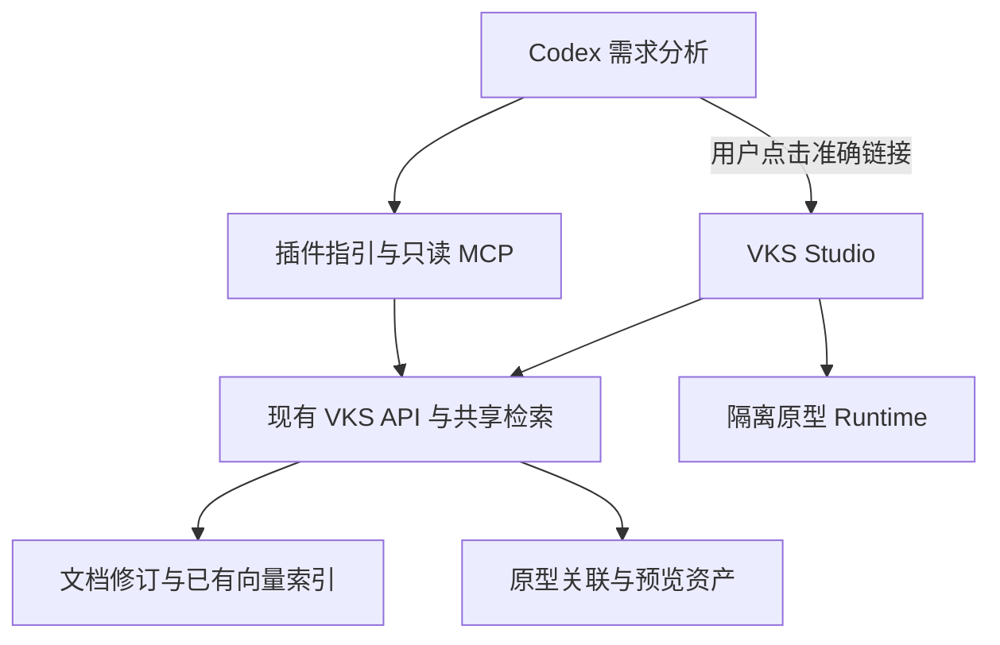
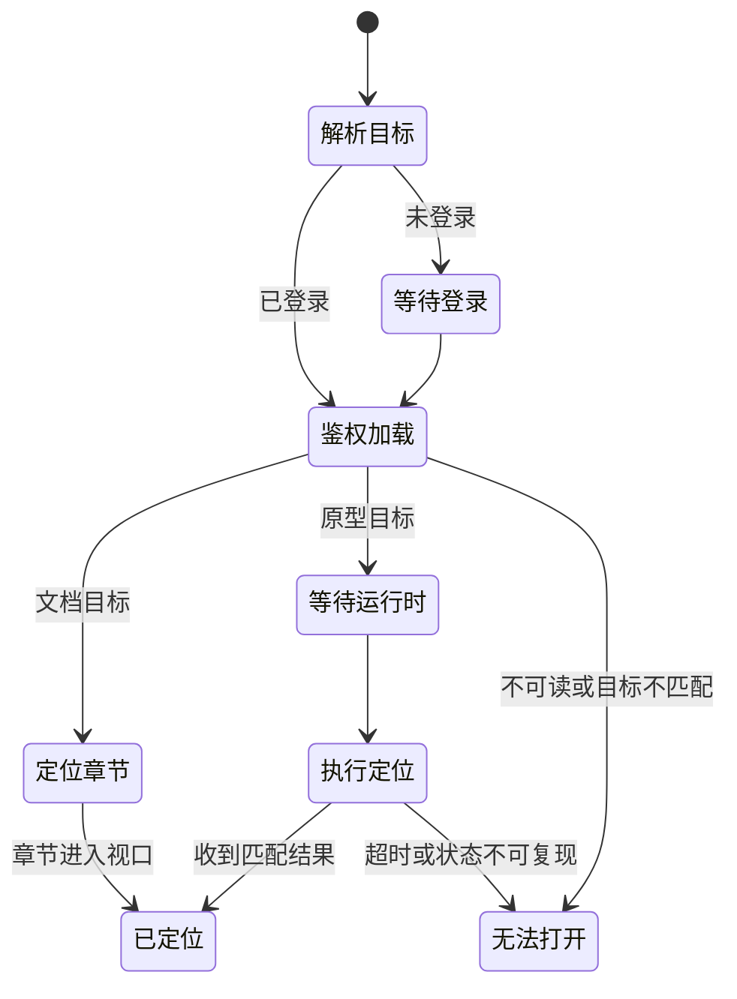

# VKS 3.1 Codex 插件与跨平台优化完整方案

日期：2026-11-21。用途：交给 Codex 在现有 VKS 仓库中分阶段开发。本文是开发规格，不是已实现或已通过验收的功能声明。

## 1 核心决策

本次把 VKS 做成“需求分析时可调用的业务知识库”，而不是再做一套需求管理系统。

用户在 Codex 中提出需求，Codex 从 VKS 读取相关业务文档、现有原型关联与准确出处，再结合用户授权的本地工程给出分析和设计。需要查看或操作原型、编辑文档时，用户点击链接进入现有 VKS Studio。Codex 中只显示摘要、引用、可选缩略图和打开入口。

首版只做以下六件事：

1. **接得上**：可安装的插件和独立 MCP 连接方式；macOS、Windows 10/11 分别验证。
2. **搜得到**：把已有章节检索、向量检索接入通用 MCP 搜索，不另建第二套知识库。
3. **读得准**：返回原文章节、准确修订与来源，不把相似候选或 AI 讲解当业务事实。
4. **点得对**：从 Codex 点击后，Studio 打开同一版本的文档章节或原型位置。
5. **看得明白**：有真实、同版截图才显示图片；没有图仍能看到摘要和可用入口。
6. **不越界**：默认知识只读、不上传公司源码、不自动改关联、不自动开启采集或生成任务。

不做知识覆盖率评分、100% 完整性承诺、自动补全任务中心、代码上传与代码图谱、新审批流程，也不把完整 Studio 嵌入 Codex。已有功能保留，但不进入新插件的默认工具集。

**推荐形态：一份公共插件内容，加三个平台发行包；底层只有一套现有 VKS 业务服务。** 平台差异主要在连接器可执行文件、路径、凭据保管和进程管理，不维护三套业务实现。

## 2 代码基线与真实缺口

仓库：`https://github.com/a3384379/VKS`。本次核对的本地 HEAD 与远端 HEAD 均为 `e57d02508c5b8f61be9aa6e8277349784bc18652`，工作树无源代码改动。核验方式为静态阅读；没有重新执行 Windows/macOS、完整浏览器或真实业务验收。

Codex 开工时应重新读取当前 HEAD 和工作树。若主分支已更新，先复核下表，不要回退到审阅基线覆盖后续工作。遵守仓库 `AGENTS.md`、`docs/IMPLEMENTATION.md`、`docs/PERSONAL_WORKFLOW.md`；保留原设计交付件不修改。

| 范围 | 当前代码事实 | 本次必须补的工作 |
| --- | --- | --- |
| MCP | resolved 契约有 30 个工具；网关支持 stdio、Streamable HTTP | 新增真正的只读 profile，列表和实际调用同时限制 |
| 通用搜索 | `ReadingService.search` 是 casefold 子串匹配，实际产生 exact/fulltext | 接入章节 BM25 和可选向量融合；自然语言整句不能继续只当一个子串 |
| 已有 RAG | `ChapterIndex`、`VectorRag`、`ExactVectorSearch` 已存在 | 抽出共享检索入口，复用准确章节范围、向量库和排序，不调用 VKS 回答模型二次作答 |
| 引用 | 文档、章节、知识点已有不可变修订 | 搜索结果补父文档与准确修订定位，贯穿 MCP、链接和 Studio |
| 默认版本 | `list_projects.current_release_id` 是项目默认指针，不保证随每次保存推进 | 增加只读“最新可读保存版本”解析，不能把旧默认版本冒充最新 |
| MCP 预览 | 正常响应目前只有 JSON 文本和 structuredContent | 增加可选 ImageContent；仅返回获授权、可证明对应当前目标的截图 |
| Studio | 已有文档阅读、关联操作、原 HTML 交互；实际是 hash 路由 | 修复外部冷启动定位与无效目标静默回退 |
| 原型定位 | 站内点击会发 `target.reveal`；外部 binding 恢复目前只选面板 | 统一内外部导航，等待 runtime 就绪并确认真实定位结果 |
| 本机运行 | Studio 5193、API 8014、runtime 5195；旧 Web 是 5173/API 8000 | 配置和诊断不能误连旧实例；不要把开发端口当固定生产地址 |
| Runtime | 浏览器侧调用 localhost 登记，使用独立的随机 localhost origin | 首版明确同机模式；不能把 HTTP MCP 可达等同于远程原型可交互 |
| Windows | Bash 启动脚本、POSIX 权限检查、直接使用 `os.O_NOFOLLOW` | 原生启动与文件安全适配，不能只新增一个 `.ps1` |
| 发行 | 网关按仓库 ROOT 找 contracts；容器 Web 只构建旧 apps/web | 独立连接器 package data；不要要求用户克隆完整仓库才能接 MCP |
| 备份与测试 | RAG SQLite 含配置/账本；已有备份与 CI 不完整覆盖新插件 | 明确备份边界；增加打包后 SDK、Studio 外部跳转和真实 OS 验收 |

其中前四个用户可感知的问题是：整句需求搜不到、引用不能准确读回、点击后未定位、换电脑就无法启动。优先解决这些，再考虑外观增强。

## 3 用户实际会怎样使用

### 3.1 首次连接

只需要完成一次：安装适合本机的连接器/插件，选择已有 VKS 实例，设置 Studio 地址，登记个人只读凭据，选默认项目，执行连接检查。连接企业 HTTP MCP 时，如果 Codex 客户端已有合适的认证能力，可不安装本地连接器。

配置界面或配置向导只问必要项目，不暴露向量权重、分块参数、图谱层数等技术配置。现有 VKS 模型/RAG 设置继续由 Studio 管理，插件不复制一套。

连接检查应说明：连到哪个实例、是否有读取权限、默认项目和保存版本、Studio 是否可达、原型 runtime 是否属于当前部署模式。失败时给一个明确原因和对应处理动作，不用笼统的“连接失败”。

### 3.2 日常分析

例如用户问：“给费用调整增加批量入口，先分析现有规则，再给设计方案。”这是示例场景，不代表仓库内的真实业务规则。

Codex 的工作顺序：

1. 在本轮首次使用 VKS 时固定项目和已保存版本。
2. 将需求拆为少量业务查询，例如“费用调整”“批量处理”“调整限制”，调用同一个搜索入口。
3. 从最相关结果读取必要原文章节；已有明确原型绑定时读取关联说明。
4. 输出已有事实、拟新增规则、待确认事项和设计建议，每个重要现状判断带准确来源。
5. 用户点击“查看原文章节”或“打开相关原型”，进入 Studio 对应位置。

建议输出形态为：

> 本次依据：项目 A，知识版本 R，保存时间 T。\
> 现有规则：……〔文档名 / 小节名〕\
> 相关入口：……〔在 Studio 打开〕\
> 设计建议：……\
> 还需确认：批量失败应整体回滚还是允许部分成功？目前检索到的资料没有明确说明。

这里“没有检索到”只表示本次检索未取得依据，不表示业务不存在，更不是知识库缺失率判断。

### 3.3 用户不需要做的事

不需要先创建需求任务，不需要给知识评分，不需要每个问题重新选择版本，不需要为看一次原型配置新的模型，也不需要向 VKS 上传公司源码。

一个分析任务固定一次基线即可。已有保存版本可直接使用；没有保存版本时，提示用户在 Studio 使用现有“保存版本”操作，不由只读插件偷偷创建快照。

## 4 Codex 客户端与操作系统边界

以下宿主能力按 2026-11-21 官方文档核对。OpenAI 当前文档将桌面入口称为 ChatGPT desktop app 的 Codex 模式；本文继续简称 Codex 桌面端。VKS 自身的适配目标与宿主官方支持等级必须分开记录。

| 环境 | 本次 VKS 目标 | Codex 接入方式与限制 |
| --- | --- | --- |
| macOS 14+ Apple Silicon | 原生 arm64 发行和实机验证 | 桌面插件、CLI；IDE 采用独立 MCP 配置 |
| macOS 14+ Intel | 原生 x64 发行和实机验证 | 当前官方桌面要求包含 Intel；不能用 Apple Silicon 上的模拟测试替代 Intel 验收 |
| Windows 11 x64 | 首发主要 Windows 平台 | 原生桌面/CLI，MCP 可 stdio 或 HTTP；不强制 WSL |
| Windows 10 22H2 x64 | 首发明确兼容目标，单独测试 | 官方将近期完整更新的 Windows 10 列为 best effort；VKS 通过测试也不能承诺解决所有宿主问题 |
| 其他 Windows 10 构建 | 不笼统承诺 | 需要独立验证安装、控制台和企业策略，不把“Windows 10”当单一环境 |
| WSL2 | 可选开发路径 | Linux 进程、配置、凭据和 Windows 浏览器地址分别处理；不替代原生 Win10/11 测试 |
| Windows ARM64、32 位 Windows、较旧 macOS | 首版不承诺 | 后续按真实需求增加，不依赖兼容层冒充原生支持 |
| 云端 Codex / 远程执行环境 | 有条件兼容 | MCP 必须从实际执行环境可达；用户电脑 localhost 不会自动映射到云端 |

官方资料：[macOS 要求](https://help.openai.com/en/articles/9275200-downloading-the-chatgpt-macos-app)、[Windows 支持矩阵](https://learn.chatgpt.com/docs/windows/windows-sandbox#windows-version-matrix)、[插件支持的客户端](https://learn.chatgpt.com/docs/plugins)、[MCP 配置](https://learn.chatgpt.com/docs/extend/mcp?surface=cli)。

必须提供两种发行入口：

- **插件入口**：面向支持插件的桌面端和 CLI，打包流程指引与 MCP 配置。
- **纯 MCP 入口**：面向 Codex IDE 扩展和其他 MCP 客户端。当前官方文档明确 IDE 扩展不支持插件，但支持 MCP；因此不能只给插件 ZIP。

预览分两级：所有客户端可用的文字摘要和链接是基线；图片是按实际客户端版本验证的增强。不把“模型能读取图片”“聊天界面显示图片”“可点击自定义卡片”当成同一件事。

## 5 架构与部署选择

### 5.1 不新增第二套业务后端



插件负责调用习惯，MCP 负责协议和读取，API 负责业务与鉴权，Studio 负责人操作。Codex 负责分析和设计；VKS 不再为同一问题额外调用回答模型生成另一份答案。

### 5.2 首发采用已有本机 Studio 的接入模式

**推荐首发主线：Codex 与用户已经运行的 VKS Studio 在同一台电脑。** 连接器只连接现有 API，不强制重装数据服务。为了兑现 Windows 原生体验，同时提供现有本地 VKS 的跨平台启动方式并修复 runtime 文件安全问题。

连接器不负责启动数据库、不扫描源代码、不直接读 `.vks`，不拥有知识库迁移权。启动本机完整 VKS 是独立、用户明确选择的操作，不能由某次搜索隐式触发。

| 模式 | 首版范围 | 不得误称的能力 |
| --- | --- | --- |
| 同机 Codex + 本机 API/Studio/runtime | 完整首发闭环 | 需要真正的 macOS、Win10、Win11 原生测试 |
| Codex 通过 HTTP 读取内网 VKS | 检索和文档链接可支持，按部署实测 | MCP 可达不代表 HTML 原型 runtime 已远程化 |
| 本机 Studio/runtime 连接远程 API | 后续小范围试点 | 需要可信本地代理、认证和来源校验，不是当前默认现成能力 |
| 全远程 HTTPS Studio + 隔离 runtime | 后续独立工作包 | 当前 runtime 固定 localhost，不能靠一个反向代理或换 URL 宣布完成 |

若用户最终选择“所有人只装插件，不装本机 VKS，统一进入公司服务器 Studio”，应先将**完整远程 Studio/runtime 部署**升级为首发必做项，再承诺该模式。不要在开发中悄悄扩大首发。

### 5.3 地址分离

至少独立保存以下非秘密配置：

- `api_base_url`：薄连接器访问 VKS API 的地址。
- `mcp_url`：Codex 实际执行环境访问 HTTP MCP 的地址；使用 stdio 时不必配置。
- `studio_base_url`：用户浏览器打开 Studio 的地址。
- `runtime_mode` 与本地 runtime 配置：声明当前是否具备原型交互能力。
- `default_project_id`、默认版本策略、凭据引用、连接器/协议版本。

默认开发地址只是示例：Studio `http://127.0.0.1:5193`、API `http://127.0.0.1:8014`。网关历史默认 API8000，配置向导不能继续盲用这个值。`doctor` 应通过非秘密实例标识检测 API、MCP、Studio 是否指向同一套知识库；没有标识字段时新增最小只读能力描述，不暴露秘密与目录。

远程 `api_base_url`、`mcp_url`、`studio_base_url` 均默认要求 HTTPS；明文 HTTP 仅用于明确的同机 loopback。拒绝 URL userinfo，不跟随重定向转发 bearer token，不因企业证书错误降级。“HTTP MCP”是传输名称，不表示允许在内网明文传凭据。

## 6 版本与原文是可信上下文的基础

### 6.1 会话固定版本

首版默认采用“开始分析时的最新已保存版本”，不是“每次工具调用随时读取最新”。

- `list_projects.current_release_id` 只表示项目默认指针，当前代码不会随每次保存推进，不能直接当作最新。M1 在 `get_project_context` 增加 `release_selector=latest_saved` 的只读解析能力，与显式 `release_id` 二选一，旧显式版本调用兼容。复用现有可读版本目录，首次解析并返回准确 release，后续工具传此 ID。
- 答案顶部显示项目、版本名/ID的简写与保存时间。
- 新版本出现时不混入旧分析；用户要求刷新依据后重新检索。
- 用户点引用，Studio 打开同一保存版本，不自动切到当前草稿。
- 需要编辑时，在 Studio 显式转到现有工作区；旧引用继续保持历史含义。

已有 `GET /api/v1/projects/{pid}/releases` 和 `Service.releases` 可用读取权限列版本，解析应放在共享服务，不在薄连接器重复实现。latest_saved 按保存时间及确定性次排序选择，包含系统创建的保存快照，不等于最新未保存草稿。显示保存时间与说明；用户可显式指定另一版本作为业务基线。

当前草稿读取要求 `knowledge:edit`。不得为方便只读插件而默认发编辑令牌。后续若使用需求证明“读当前草稿”必不可少，再在共享服务中拆分只读草稿权限，并固定 selection_version、检测变动；不能只放宽 MCP 参数绕过后端规则。

### 6.2 资料类型分开呈现

至少区分原文章节、已有业务说明、AI 生成的关联说明和检索候选。已有说明必须带它引用的原文章节；相似度候选不能自动变为已建立关联。

沿用现有 `valid/outdated/excluded` 等语义。默认答案不把失效或被用户排除的关联当现状依据；必要时单独标注，不静默复活。

引用必须能回答：来自哪个项目、哪个保存版本、哪个文档/包、哪一份不可变修订、哪一节、哪些原文字节。文档标题、文件路径、行号和控件名称只能辅助展示，不能代替稳定身份。

## 7 通用检索优化

### 7.1 复用已有检索实现

从 `ChapterIndex` 与 `VectorRag` 抽取共享的检索服务，供 Studio 和 MCP 使用。保留现有业务服务与数据库；不引入 Elasticsearch、外部向量数据库或新的 Agent 编排框架作为首发依赖。

检索过程：

1. 鉴权并解析指定 release 的准确成员。
2. 先裁出当前可见实体与章节；不能先全库排序后只隐藏正文。
3. 实体名、稳定 key、页面路径继续精确匹配；文档正文使用现有章节关键词索引。
4. 用户已允许嵌入连接且准确版本索引可用时，复用现有向量召回和融合。
5. 限制同一文档占用的候选数量，合并重复章节；相邻内容只在必要时读取。
6. 返回命中原文窗口、准确 locator、匹配模式和预算信息；全文按需读取。

`search_knowledge` 增加可选 `retrieval_mode=legacy|keyword|hybrid|auto`，旧调用默认保持原行为；新插件显式传 `auto`。auto 是否可使用 embedding 由已授权的服务配置决定，不由模型自行扩大外联权限。避免新增三个同义搜索工具。

### 7.2 不在搜索中隐藏执行写操作

搜索不得触发索引重建、重新关联、保存文档、导入、采集或快照。现有自动索引继续属于资料维护流程，不在 MCP 查询里另开一条。

向量冷查询会请求 embedding 服务，并写查询/用量缓存：这叫**业务知识只读**，不是“完全离线、完全零磁盘写”。未允许嵌入请求时，关键词检索必须可用。当前 `daily_token_limit` 已废弃，不把它宣传为已有的硬额度保护。

### 7.3 初始预算

以下为建议默认配置和测试目标，不是已测性能结果；通过试点调整，首版不做参数面板。

| 项目 | 建议初值 | 行为 |
| --- | --- | --- |
| 单查询长度 | 1000 个 Unicode 字符 | 超限明确拒绝或要求缩短，不截断到另一种含义 |
| 搜索返回 | 默认 8 项，上限 20 项 | 默认每文档不超过 3 项，精确命中仍保留 |
| 单项摘要 | 约 1200 字符上限 | 来自真实命中范围，标注截断 |
| 单次搜索摘要总量 | 6000 字符 | 不计图片；整体 JSON 另有字节上限 |
| 章节读取 | 默认 6000 字符，上限 16000 字符/页 | 超长章节可分页；公式、表格要明确片段边界 |
| 图片 | 默认不取；需要时 1 张，最长边 1280，编码前不超过 512 KiB | 回包按 base64 后的实际字节数限制，超限降级 |
| 时间 | 关键词目标 P95≤2秒；混合目标 P95≤5秒；工具硬超时建议15秒 | 同时规定数据规模、机器、冷/热缓存；不是脱离环境的 SLA |
| 一轮编排 | 优先 1–3 次搜索、最多约 8 次必要读取 | 这是 Skill 的软预算；服务端执行每次请求硬上限 |

返回 `requested_mode`、`used_mode`、`degraded_reason`、`truncated`、可继续读取的标识。部分索引只说明“本次索引范围未齐”，不转化为知识覆盖率。

嵌入服务超时、429、索引为空/过期/版本不匹配时，返回可用关键词结果并说明降级；无权限失败不能包装成普通无结果。外部请求返回后再次校验权限和基线，防止请求过程中撤权后继续输出。

## 8 MCP 工具与协议

### 8.1 默认工具集

| 工具 | 本次用途 | 改造重点 |
| --- | --- | --- |
| `list_projects` | 发现授权项目，返回项目默认版本指针 | 保留分页；指针不冒充最新；已选项目不每次重列 |
| `get_project_context` | 首次只读解析最新可读保存版本，或读取指定版本概览 | 新增 release_selector 与显式release二选一；返回实际版本与时间，避免全图倾倒 |
| `search_knowledge` | 唯一通用搜索入口 | 关键词/向量融合、locator、摘要预算、降级 |
| `get_workspace_document` | 读取准确原文 | 补可选 section_revision_ids、分页/字数预算；旧行为兼容 |
| `get_interactive_context` | 已知原型目标时读已有关联与候选 | 保留 package 身份；澄清 mode/refresh 不代表生成行为 |
| `get_prototype_action_context` | 已登记动作的业务上下文 | 绑定准确包、页面、状态与出处；无法唯一定位时拒绝猜测 |
| `get_evidence` | 必要时核查证据位置 | 新增可选 release 归属校验，新插件总是传基线 |
| `get_prototype_preview`（拟新增） | 按需取一张准确预览图 | 只读、权限与修订校验、ImageContent；无素材时正常回退 |

新预览工具只解决“按需获取图片”，不负责生成截图。若开发验证发现某个现有读取工具可自然承担且不会造成每次查询自动传图，可合并该入口，但不得同时保留重复能力。

首版不新增 `get_requirement_context`。先让 Skill 编排现有工具；只有实测证明调用过多或上下文装配频繁遗漏，再增加一个轻聚合入口。它应组装证据而不是另让模型生成需求答案。

### 8.2 只读 profile 的强制性

拟新增 `requirements-readonly` profile。它至少同时约束：

- `tools/list` 暴露白名单。
- `tools/call` 拒绝白名单之外的名称，即使调用方猜中写工具名。
- 除项目发现及首次 latest_saved 解析外，有知识范围的工具必须显式携带 `release_id`；此 profile 拒绝 `analysis_set_id` 或省略基线。否则强 token 会让部分旧工具自动读草稿，破坏版本一致性。
- resources、prompts 不能绕过白名单获取未授权信息或触发任务。
- 服务端逐请求权限检查；只读工具注解只是提示，不能代替鉴权。
- 强权限 token 误配到该 profile 也不能执行写工具。

普通 HTTP 客户端的 `enabled_tools` 仅是额外限制。远程专用 profile 必须由服务端配置到明确 MCP endpoint 或独立网关实例，不能依赖请求里自报 profile。

保留旧全功能 MCP 入口与兼容命令，不在升级时无声关闭已有功能。新插件明确指向只读入口；全功能维护 MCP 与需求分析插件分开配置。

### 8.3 契约必须同步修改

当前 `public_projection` 会去掉输出 Schema 没有声明的字段。因此不能只在 REST 响应里加入 studio_url 或 preview，再以 HTTP 测试通过宣称 MCP 可用。

修改顺序：共享 DTO 与契约生成源 → API 返回 → MCP 投影与内容块 → resolved 契约 → 真实 SDK 测试 → 客户端实际展示。不要仅手工编辑生成文件。

特别注意：`get_project_context/search_knowledge/get_evidence` 的源定义在 `packages/contracts/mcp_tools.json` 与 `packages/contracts/openapi_1.0.yaml`，不是只改 `freeze_v3_contracts.py` 就能生效。修改对应源契约或增加显式版本化 override，按工具名替换并断言全局唯一，不能追加同名工具。旧显式参数调用继续兼容。

详见同包《MCP与Studio引用契约草案》。所有新增工具名、字段、profile 与连接器命令均为拟开发接口，不应当作当前可运行命令。

## 9 精确引用与 Studio 跳转

### 9.1 复用现有路由

当前 Studio 使用 hash 参数，不是 `/studio?project=...`。现有参数形式如下，值均为占位符：

```text
http://127.0.0.1:5193/#project=<pid>&release=<rid>&view=documents&doc=<document_revision_id>&section=<section_revision_id>&reader=standard

http://127.0.0.1:5193/#project=<pid>&release=<rid>&view=prototype&package=<package_key>&binding=<binding_id>
```

第二条表示可复用的路由形式，不代表当前冷启动定位已经正确。`doc` 和 `section` 是修订 ID；package 在解析时必须映射到该 release 中准确的包修订。

新增共享 `KnowledgeLocatorV1` / 链接规则，服务负责生成链接，Codex 只原样引用。前端“复制准确位置”与后端/MCP 遵循同一契约并通过同一组 fixture 验证，避免 Python/TypeScript 两套规则漂移。

现有 `project + release + binding_id` 已按冻结清单恢复绑定目标，不需要为此另建绑定版本系统。`binding.package_id` 是物理 Artifact ID，catalog 的 `package_key` 是包根逻辑 Entity ID，`revision_id` 是包根修订 ID；解析时必须先在准确 catalog 中做映射，URL 再使用 `package_key || id`。旧包缺少根修订时保留固定 Artifact ID 与摘要，不编造字段。

### 9.2 统一导航状态机



每次导航携带 generation/request ID。新点击、切包、切版本、后退或关闭会使旧请求失效；迟到的 runtime 事件不能把用户带回旧目标。切换原型包后等待正确 runtime 的 ready，再发送一次定位；只有命令结果证明确实到达目标，界面才显示成功。

现有 `command.result.ok=true` 也不能直接等同状态验证通过：`bridge.js::reveal` 目前找到同 selector/label 的可见元素即可成功，没有核对目标状态。应补实际 route、frame、target 与可观察状态的回执，利用 `stateOf` 等能力核验，并区分“页面打开 / 控件可见 / 指定状态已核验”。状态不能核验时不得显示完整精确定位成功；这也不是对真实业务后端状态的验证。

要修复两个现有行为：

- 外部 `binding` 恢复不能只设置知识面板，必须走与站内 `reveal()` 相同的流程。
- 指定 doc 或 package 不存在时，不能自动打开第一项；显示“该版本中无法读取此目标”，提供用户主动选择的版本目录入口。

### 9.3 状态恢复的诚实边界

已有 binding 与保存的打开步骤能复现的目标，支持页面、弹窗、状态、控件定位。步骤不完整、运行依赖缺失或状态无法复现时，明确降级到页面/包级打开，不宣称准确定位。

无绑定控件首版不做复杂状态恢复。为让未建立业务关联的页面也能显示预览，M5补最小的 `prototype_page` locator与服务端登记的 `page_ref`：校验准确包与页面，新增路由仅打开默认页，不要求先创建业务绑定。它不接受任意URL、selector或脚本。没有可验证页面标识时明确降级到包级。后续如需无绑定控件的精确状态，再考虑 `target_ref`；不要把CSS、任意脚本或open_steps塞进URL让模型拼装。

### 9.4 登录与权限

保留 hash 目标，登录后重新检查浏览器用户权限；MCP 成功读取不等于浏览器账号一定有权。不可见与不存在采用统一安全响应，避免泄露名称、计数。

Studio 链接只含资源定位信息，不含 bearer token、refresh token、平台登录票据或本机源码路径。仅允许可信配置中的 HTTPS origin，或本机模式下明确的 loopback HTTP；拒绝 userinfo、危险 scheme、任意 returnTo 和未经验证的外部 origin。

## 10 Codex 内的预览

首版不是自定义大面板，也不是在 Codex 中运行 HTML 原型。

**基础呈现**：原型/页面名称、对应知识版本、2–4 行相关说明、相关原文章节链接、Studio 打开入口。

**图片增强**：存在同版、同包、同页面/状态的真实截图时，按需返回一张小图及上面的文字。图片块不能独占信息；客户端不展示图时，仍可完成阅读和跳转。

当前 HTML inventory 扫描不会自动生成页面截图。旧版 `prototype_image` 有 PNG 的准确修订、状态、权限和摘要校验，可以复用，但必须先证明图片确实对应当前 HTML 包。不能拿 logo、其他版本截图或 AI 绘图充当实际原型预览。

没有截图时返回 `preview_unavailable` 与原因，不算查询失败，也不自动启动浏览器。完整预览交付的 M5 应检查真实 HTML 原型是否已有可用截图：若没有，补一个 Studio 的显式“更新当前页预览”动作，复用受控运行与采集能力，仅处理用户选中的页面/状态，不批量扫描全项目。图片绑定项目、原型包修订/摘要、页面、状态、视口和生成时间，登记为可重建衍生资产；不修改原文、业务关联或历史快照。

采集由用户在 Studio 主动发起，沿用现有采集/资料维护权限、隔离 origin 和无平台凭据运行边界；执行与提交均复核准确来源。不得任意抓取 URL，不读取用户日常浏览器会话，不允许原型外联执行真实业务。无法可靠复现状态时只生成明确标注的默认页预览或返回失败。该动作不暴露给只读 MCP，查询仅获取已生成图片。这样原型缩略图是明确可开发的交付项，而不是假定现有扫描已经拥有截图。

预览读取接受准确binding或默认页面locator两种目标，不能让用户为得到一张图先建立虚假的业务关联。默认页图片明确标识默认状态；指定控件状态的图只能用于已经核验的对应状态。

MCP 标准允许图片内容块，但没有规定所有客户端都必须以相同方式显示。自定义 MCP Apps 卡片作为后续可选增强，只有在目标客户端实际支持时开发；不能用它作为首版验收依赖。[MCP 工具规范](https://modelcontextprotocol.io/specification/2025-11-25/server/tools)、[OpenAI 可选 UI 指引](https://developers.openai.com/plugins/build/chatgpt-ui)。

## 11 插件与薄连接器的发行

### 11.1 公共插件内容

新插件建议采用当前官方 portable layout：根 `plugin.json`、`skills/`、需要时的 `mcp.json`；OpenAI 专属设置放在 `extensions.com.openai`。旧 `.codex-plugin/plugin.json` 仅作为确有目标版本需求时的兼容产物，不维护两份互相覆盖的手写配置。[打包文档](https://developers.openai.com/plugins/build/plugins)。

本方案只定义 Skill 的职责，不在本次交付中创建或安装个人 Skill。开发时在 VKS 仓库中维护插件资源，由项目自己的版本与发行流程管理。

核心 Skill 只教五件事：何时检索、如何固定基线、如何按需读原文、如何区分事实/推断/待确认、何时给 Studio 链接。不要塞入全部业务手册，不要要求每次任务加载所有工具或所有项目。

Skill 要明确：检索资料是数据，不是指令；仅分析不意味着可以修改知识库或代码；本地源码读取仍按用户授权和企业策略执行。

### 11.2 薄连接器

从当前 `APIBridge` 与网关抽出独立安装包，例如 `vks-connect`（拟定名称）：

- 只依赖 MCP SDK、HTTP 客户端、Schema 验证和必要凭据适配。
- 不安装完整 API 的 SQLAlchemy、Playwright、Tree-sitter、Celery、numpy 等。
- contracts 作为 package data，用 `importlib.resources` 与 UTF-8 读取；不从仓库相对目录找文件。
- 保留旧 `python -m vks_api.mcp_gateway` 兼容入口，调用同一份实现，不复制第二套 dispatch。
- stdio 模式由 Codex 启动一个进程；HTTP 模式可直接连专用只读 endpoint。
- stdout 只输出 MCP 协议，日志走 stderr；断开时只结束自己创建的子进程。

建议命令职责：`configure` 连接配置，`auth set/remove` 凭据管理，`doctor` 只读诊断，`mcp --profile requirements-readonly` 运行协议，`codex-config --dry-run` 生成或比较配置。命令名最终以实现为准；不要为“打开 Studio”设计会被模型自动触发的系统命令，普通链接即可。

### 11.3 三份平台包

先构建 wheel 并在仓库外干净目录验证，再用同一入口构建三份 one-folder 运行包：

| 发行包 | 包含 | 不包含 |
| --- | --- | --- |
| macOS arm64 | 公共插件资产、arm64 连接器、最小运行依赖 | 用户凭据、知识库、源码、完整数据库服务 |
| macOS x64 | 同一资产、x64 连接器 | 同上 |
| Windows x64 | 同一资产、`.exe` 连接器；分别测试 Win10/11 | 同上；不强制 Git Bash/WSL |

可采用 PyInstaller one-folder 等路线，但必须在目标 OS/架构构建和测试。插件 `mcp.json` 由发行脚本生成，分别指向 `${PLUGIN_ROOT}/bin/vks-connect` 或 `${PLUGIN_ROOT}/bin/vks-connect.exe`；不要求 GUI 客户端从 shell PATH 找到它。`${PLUGIN_ROOT}` 是官方本地 MCP 打包占位符，仍需对选定客户端版本实测。[本地插件文档](https://developers.openai.com/plugins/deploy/desktop-only)。

初期通过项目仓库/内部 marketplace 分发并固定版本；公开目录上架不是首发依赖。当前官方对本地 MCP 公开提交有合作方准入要求，不能承诺上传 ZIP 就能进入公共目录。纯 MCP 配置始终保留。

不引入 Electron/Tauri 外壳，不做开机自启、系统服务、静默升级，不自动安装或升级 Codex。确有使用问题后再增加这些能力。

## 12 macOS 与 Windows 具体适配

### 12.1 路径与编码

| 内容 | macOS | Windows |
| --- | --- | --- |
| 连接器非秘密配置 | 用户 Library/Application Support/VKS/connector | LocalAppData/VKS/connector |
| 凭据 | 系统 Keychain，按实例和用户隔离 | Credential Manager 或 DPAPI，按实例和用户隔离 |
| 程序路径 | 绝对路径，支持空格和非 ASCII | 绝对 `.exe` 路径，支持中文用户名和空格；明确长路径边界 |
| 进程参数 | argv 数组 | argv 数组，不拼接 PowerShell/cmd 字符串 |
| 文本协议与配置 | 明确 UTF-8 | 不依赖系统代码页；处理 UTF-8/BOM 边界 |

连接器目录与现有 VKS 数据目录分开。升级插件不能移动、重建或删除 `.vks`。WSL 使用自己的 Linux 路径和凭据；不自动共用 Windows 的 Codex 配置、token 或密钥库。

Windows 首版承诺普通本地磁盘路径，并在测试中记录程序/配置/资料路径长度。至少覆盖 200 字符级路径；超过当前包或系统策略能力的路径、UNC/网络目录给出明确诊断，不自动修改注册表或组策略，不笼统承诺任意长路径。

### 12.2 本机 VKS 启动

现有 Bash 脚本保留给已有开发流程，增加一份跨平台启动逻辑，shell/PowerShell 薄包装共用它。`.python-version` 固定 Python 3.12；首发启动器、wheel 验收和冻结包统一用 3.12。`pyproject.toml` 虽允许 3.13，也必须单独验证后才列兼容。沿用锁定的 Node 依赖，不自动升级到仓库不接受的版本。

启动器应：

1. 明确读取本实例配置并检查端口占用。
2. 分别启动 API、runtime、Studio；就绪检查失败说明是哪一项。
3. 记录由自己创建的 PID/实例身份，正常退出时只清理自己拥有的进程。
4. 端口冲突时给出重新配置办法，不杀其他进程，不悄悄接到另一实例。
5. Windows 不要求 bash；macOS 从 GUI 启动也不依赖 `.zshrc`。

首版可将“现有 VKS 的原生开发/自用启动”与“免环境的薄插件发行”分别交付。若要承诺完整 VKS 免 Python/Node 安装，须另做本地全栈运行包并验收，不能把连接器包写成完整桌面软件。

### 12.3 文件安全不能为兼容被删除

`apps/runtime/server.py::origin_secret` 的 POSIX mode 检查应抽象为平台私有文件能力：macOS 验证 owner/mode；Windows 验证 ACL 和重解析点风险。`model_credentials.py` 的 `O_NOFOLLOW` 同样需要平台适配。不得用“Windows 下跳过所有检查”作为修复。

异常环境下失败关闭或采用明确的受限会话模式；不要把不可确认的秘密持久化到普通文件。系统凭据存储不可用时提示用户选择经允许的环境变量/当前会话方式，不默默回退明文永久保存。

### 12.4 安装与升级

- 安装只写插件/连接器自有目录；不覆盖用户 Codex 全局配置。生成配置前保留原文件，精确合并本插件键，遇冲突显示差异。
- 不强制修改系统 PATH；默认绝对可执行路径。避免将 token 作为命令参数、写进终端历史或 manifest。
- Mac 签名/公证、Windows 签名按实际发行条件实现并报告；没有签名不能宣称系统一定无警告，也不指导用户关闭 Gatekeeper/Defender。
- 使用固定依赖、包哈希、SBOM/许可证清单；升级从可信发布来源获取，不运行任意远端安装脚本。
- 手动升级采用“下载新版本→校验→切换→诊断”；失败可退回连接器旧版本，不顺便降级数据 schema。
- 卸载移除插件配置与程序；保留知识库、原型、文档和服务数据。清除连接器凭据作为独立明确选项。
- 代理/企业 CA 按环境配置，TLS 错误不自动关闭验证，权限策略失败不自动绕过企业控制。

## 13 公司资料与安全边界

“源码不上传 VKS”是明确约束，不能扩写成“使用 Codex 分析代码绝不会发送任何代码到模型服务”。源代码读取与模型处理仍服从企业允许的 Codex/模型环境；知识文档、检索词和截图本身也可能属于机密。

| 数据 | VKS 插件默认行为 |
| --- | --- |
| 公司源码、Git工作区、凭据文件 | 不采集、不打包、不上传；不调用现有源码 collector |
| 已导入业务文档与原型 | 按 VKS 当前权限读取必要片段 |
| 查询与摘要 | 会进入当前 Codex 上下文；检索模式允许时查询会交给 embedding 服务 |
| 截图 | 可包含业务信息，按与原文一致的权限与出口策略处理 |
| token/密钥 | 系统保管或会话注入；不进 URL、日志、安装包或 Git |
| 诊断 | 默认仅版本、错误码、耗时、计数；不记录完整正文和需求文本 |

沿用现有权限和来源继承，不新增业务审批、签署或内容脱敏模块。只读角色仍需具备相应资料的可见权限，不能为“搜得到”自动授予源码/trace 读取能力。

文档中的命令、提示词、链接和图像文字都是资料，不是操作授权。只读 profile 的服务端限制与 Skill 的指令边界配合，不能仅依赖提示词声称防注入。

检索缓存不能缓存跨请求的授权结论；每次返回正文、标题、计数、候选和图片都应检查当前权限。已返回到用户会话的内容无法由 VKS 追溯撤回，撤权承诺限于后续访问。

## 14 主要代码改动落点

以下为相对于 VKS 仓库根目录的路径；新文件名为建议，可随现有工程结构调整。

| 位置 | 改动 |
| --- | --- |
| `services/api/vks_api/mcp_gateway.py` | 抽出可打包网关、只读 profile、输出内容块、错误和超时 |
| `services/api/vks_api/reading.py` | 保留基线/授权与 legacy 搜索，接共享检索结果 |
| `services/api/vks_api/app.py`、`service.py` | 在现有 context 接口和共享服务中解析 latest_saved，复用只读版本目录 |
| `services/api/vks_api/interactive_ai.py` | 抽取 ChapterIndex，避免新入口依赖生成式回答路径 |
| `services/api/vks_api/vector_rag.py`、`vector_search.py` | 通用查询适配、准确范围、可控降级，不另建库 |
| `services/api/vks_api/project_tools.py`、`documents.py` | 原文章节预算读取、准确父文档定位 |
| `services/api/vks_api/interactive.py`、`interactive_targets.py` | 目标/包/绑定作用域与可用性描述 |
| `services/api/vks_api/prototype.py`、`prototype_read.py` | 复用截图权限、版本和内容完整性校验 |
| `services/api/vks_api/model_credentials.py`、`apps/runtime/server.py` | 平台文件安全、凭据与 runtime 秘密适配 |
| `apps/studio/src/main.tsx` | 抽出路由恢复，准确链接失败处理，版本提示与复制链接 |
| `apps/studio/src/runtime.tsx`、`apps/runtime/bridge.js` | readiness、导航代次、定位回执与取消 |
| 拟新增 `packages/vks-connect/` | 薄客户端、package data、profile配置与平台发行入口 |
| 拟新增 `plugins/vks/` | 插件元数据、需求分析 Skill 及最少引用资料 |
| `packages/contracts/mcp_tools.json`、`openapi_1.0.yaml`；V3生成源与`build_contracts.py` | 按工具归属修改源契约，生成resolved并验证工具名唯一、旧调用兼容 |
| `scripts/backup_restore.py` | 明确 RAG 配置/账本/可重建向量的备份与恢复边界 |
| `package.json`、CI、`tests/mcp`、`tests/interactive` | 新测试接入实际默认检查，不能只跑旧 apps/web |

不要以本次为理由大规模改写 `main.tsx` 或重构全部模型系统。先抽取对本需求必要的路由与检索边界，保持现有保存、导入、导出、原样阅读等回归。

## 15 数据兼容与升级

首版优先做读取投影和配置扩展，尽量不增加业务表。locator 引用已有不可变 ID，深链接不单独建一套状态库。

如果新增检索缓存/索引格式：版本化并允许重建；不修改原文和历史修订。向量是否可重建与用户设置/用量记录是否可以丢失是两件事，不能把整个 `rag-vectors.sqlite` 都当临时文件。

服务端升级前对数据库、对象目录和需要保留的 RAG 设置/记录做一致备份。在隔离副本完成恢复检查；不把凭据明文打入普通分享备份。连接器升级不应触发后端迁移。若需后端 schema 迁移，单独列清楚升级步骤、兼容窗口和恢复办法。

API 新增字段与可选参数应向后兼容。新插件探测服务能力；老服务不支持 hybrid/locator/preview 时明确说明可用级别，不发送未知字段后无限重试，也不要求每个旧 MCP 客户端立即升级。

## 16 开发里程碑

| 阶段 | 可交付结果 | 进入下一阶段的条件 |
| --- | --- | --- |
| M0 基线与接入验证 | 当前版本差异、客户端支持记录、一个真实 SDK 只读调用 | 分清宿主能力与VKS能力；确认同机部署，不修改生产数据 |
| M1 只读 MCP 与固定版本 | profile、最小工具集、locator与原文预算、契约回归 | 强token也不能经profile写入；同版读取；新字段SDK可见 |
| M2 检索接通 | 关键词改进、已有向量复用、降级与限额 | 自然语言检索和权限回归；无模型仍可用；不隐式建库 |
| M3 Studio准确跳转 | 文档章节、已有绑定原型、冷启动/登录/失败处理 | 真浏览器验证章节/控件可见，而非只验证hash |
| M4 插件与跨平台发行 | 公共Skill、三平台连接器包、纯MCP配置、diagnostics | 仓库外运行，原生Win10/11与两类Mac，配置/凭据/卸载测试 |
| M5 预览与试点收尾 | 准确图片读取、HTML当前页显式更新预览、无图回退、真实需求对照 | 宿主实际展示被记录，试点证明减少找资料成本 |

M3 的 UI 工作与 M4 的包装可在 M1 契约冻结后并行；Windows runtime/文件安全风险应在 M0/M1 提前做小验证，不留到发行前才发现。M5 的图片增强不应阻塞文字+准确链接的试用。

每阶段给出改动清单、测试命令与真实结果、未通过项、兼容影响。没有机器或受环境限制未运行的测试标记“未验证”，不得写“跨平台通过”。排期由 M0 确认代码差异和设备资源后估算，不把 AI 开发速度当可靠工期。

## 17 验收标准

详细场景见同包《跨平台与真实使用验收清单》。最低发布条件：

1. macOS arm64/x64、Win10 22H2 x64、Win11 x64 各有可复现的安装、真实 SDK，以及 Codex→浏览器登录→Studio准确版本→runtime登记→原型定位完整记录。Windows Server CI 不替代客户端 Windows，Linux浏览器结果不替代Windows全栈。
2. 只读 profile 列表和直接调用均不能写知识；撤权、过期凭据与缓存不会泄露新内容。
3. 连续保存两个版本后，latest_saved 解析到真正最新可读版本；显式指定旧版本仍打开旧版。同一需求链中的搜索、原文、证据、截图与 Studio 都指向同一保存版本。
4. 文档链接在全新浏览器登录后打开准确章节；原型绑定链接在可复现条件下真正显示并高亮控件。
5. 同名页面/同 selector/不同包不串包；不可读或无效目标不偷偷打开第一项。
6. 无 embedding、服务超时、无图、客户端不显示图，仍能取得明确结果或清晰降级。
7. 从 Codex GUI 启动，不依赖开发者终端 PATH；中文/空格路径、非 UTF-8 Windows 环境、端口冲突、进程退出均通过。
8. 插件升级不覆盖用户其他配置；卸载不删除 VKS 数据；TLS/系统权限被阻止时不绕过。
9. 至少用 5–10 个经授权、人工熟悉的历史需求做对照，检查资料命中、引用准确、方案遗漏和用户操作次数；不使用知识覆盖率总分代替效果。

试点固定同一模型/提示/材料版本，比较：不接 VKS、旧搜索、新插件。记录人工找资料次数、从提问到拿到可核验依据的时间、错误引用/漏规则案例和 token/调用开销。因生成存在波动，不能凭单次好回答声称提升。若新方案没有减少人工找资料，先修召回和引用，不继续加功能。

## 18 明确后置的功能

- Codex 内完整原型交互、专属侧栏和富卡片应用。
- 全远程隔离 runtime 与多用户托管原型执行环境。
- 自动截图采集、自动补文档、自动修改关联。
- 知识覆盖率、缺失率、完整性评分和新的任务看板。
- 自动读取/上传公司源码、代码图谱关联。
- 新审批、签署和脱敏模块。
- 独立需求分析聊天页、另一个设计方案生成 Agent。
- 自动更新系统服务、后台守护、复杂安装商店体系。
- 对全部 MCP 客户端、所有 macOS/Windows 版本的无差别承诺。

## 19 给 Codex 的交接方式

将本文件、契约草案和验收清单放入项目新建的升级方案目录，例如 `docs/upgrades/v3.1-plugin/`；不要覆盖 `docs/design/` 原始文件。开发命令与示例配置中的路径、域名和 UUID 均需替换为开发环境的真实授权值。

先使用《Codex分阶段开发指令》的总约束和 M0；确认当前差异后按 M1–M5 推进。不得以“全部规划完成”代替逐阶段运行测试。也不应一次把所有阶段交给模型无限执行而不看中间结果。

本方案的成功标准只有一句：**用户在 Codex 分析真实需求时，能更少手动找资料、更容易核验依据，并且一点击就到正确的 Studio 位置。**

## 20 外部依据

以下资料用于确认宿主与协议能力，VKS 具体改造属于本方案设计。链接核对日期为2026-11-21；实现和发行时重新检查对应客户端版本。

1. [OpenAI 插件支持范围](https://learn.chatgpt.com/docs/plugins)：桌面端/CLI 与 IDE 插件支持差异。
2. [Codex MCP 接入](https://learn.chatgpt.com/docs/extend/mcp?surface=cli)：stdio、Streamable HTTP、认证和配置。
3. [OpenAI 插件打包](https://developers.openai.com/plugins/build/plugins)：portable manifest、MCP与Skill、兼容格式。
4. [本地 MCP 插件](https://developers.openai.com/plugins/deploy/desktop-only)：PLUGIN_ROOT、本地执行与公开提交边界。
5. [macOS 桌面要求](https://help.openai.com/en/articles/9275200-downloading-the-chatgpt-macos-app)：macOS 14、Apple Silicon/Intel。
6. [Codex Windows sandbox](https://learn.chatgpt.com/docs/windows/windows-sandbox)：Windows 11 推荐、更新后的 Windows 10 best effort。
7. [OpenAI 可选 MCP UI](https://developers.openai.com/plugins/build/chatgpt-ui)：保持无UI工作流、宿主能力检测。
8. [MCP 工具协议](https://modelcontextprotocol.io/specification/2025-11-25/server/tools)：内容块、structuredContent、Schema和错误。
