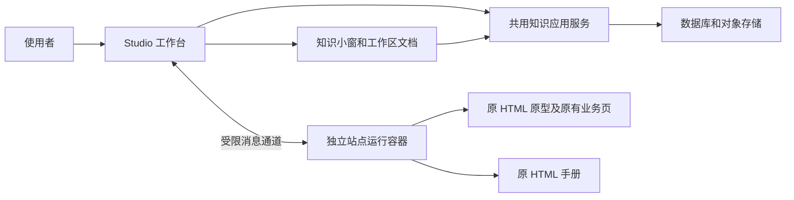

# VKS 3.0 交互工作台重构开发方案

设计稿 D2 · 2026-11-11  
实现基线为 `codex/vks-3.0@5800ded18766378226ffcac3302f52fcb57c629f`。本文定义下一阶段开发目标。

VKS 的主要工作界面由可实际操作的原 HTML、独立文档阅读器和知识小窗组成。使用者在原型中打开页面、输入内容、切换页签和操作弹窗，同时查看或维护与当前操作相关的知识。文档可以单独阅读，可以关联其他文档，也可以跳转到原型的准确页面和控件。

本方案落实用户在 2026-11-11 对交互效果的重新确认，接替 D1 中原型运行、文档展示和关联维护的相关设计。当前截图导览及其验证记录仍用于历史版本读取和迁移参考。D2 的功能完成情况按本文的实际交互验收任务记录。

## 产品决策

在现有仓库中新建 `apps/studio`，实现新的交互工作台。原 HTML 的界面和交互由隔离的浏览器运行环境承载，Studio 提供项目、版本、知识小窗和关联操作。后端继续使用现有 API、数据库和对象存储，新增支持交互定位的应用服务。

| 用户要求 | 首发交付 |
| --- | --- |
| 原型能像原 HTML 一样操作 | 打开用户提供的原型包，保留原菜单、页面、表单、弹窗、页签和本地演示行为 |
| 文档能独立显示 | 文档入口保留目录、搜索、完整正文和章节定位，支持完整阅读及原手册视图 |
| 在 UI 中建立关联 | 选原型控件或文档段落，选择已有知识或新建说明，直接保存 |
| 在交互页面用小窗查看知识 | 默认通过可浮动的小窗读取当前页面或操作的说明，也可固定到右侧 |
| 在小窗管理知识 | 新建和编辑业务说明、选择原文、维护关联、移除及恢复关联 |
| 原型和文档互相跳转 | 原型打开准确章节，章节打开准确原型目标，返回恢复先前位置 |
| 文档之间可以关联 | 从章节或选中文本建立引用，在阅读位置查看并打开关联目标 |
| 更新后仍能使用已有知识 | 保存准确的资料、定位和知识修订，对变化或多义位置提示重新定位 |

### 工作台布局

原型占据工作区主体。顶部仅保留项目、原型、文档、关联管理、版本和知识窗口入口。原型已有的业务菜单继续由原 HTML 呈现。资料接入、版本管理和项目设置从相应入口按需打开。

知识小窗默认浮动。打开小窗时保留原型的视口、布局和业务状态。用户需要较长时间维护知识时，可将小窗固定到右侧或切换并排阅读。

### 复用范围

| 部分 | 处理方式 | 实施落点 |
| --- | --- | --- |
| 核心工作台界面 | 新建页面结构、路由和状态管理 | `apps/studio` |
| 原 HTML 运行和适配 | 新建独立运行入口及格式适配器 | `apps/runtime`、`packages/interactive_bridge` |
| 原型控件选择和高亮 | 新建 DOM 定位与跨 frame 选择能力 | `packages/interactive_bridge` |
| 文档阅读和知识窗口 | 新建交互组件，复用现有 Markdown、图表和公式渲染能力 | `apps/studio`、现有渲染模块 |
| 原始资料、上传和导入 | 复用存储、摘要、任务、取消和来源身份，增加运行包清单 | `knowledge.py`、`prototype_import.py` |
| 文档和章节 | 复用稳定身份、准确修订、人工锁和读写服务 | `documents.py` |
| 业务点、关系和证据 | 复用实体和关系，扩展 DOM 锚点及文档引用语义 | `prototype_edit.py`、`relationships.py` 的共用逻辑 |
| 权限、快照和 MCP | 复用鉴权和版本模型，增加交互目标的引用校验 | `reading.py`、`service.py`、`mcp_gateway.py` |
| 现有 Web 与截图入口 | 作为旧版本访问和迁移入口 | `apps/web` |

业务点保存服务目前接收截图页面修订、状态及动作。新交互入口将抽取其业务点、出处和事务部分，交由新的 `InteractiveKnowledgeService` 调用。DOM 绑定使用明确的交互定位模型。

## 典型使用过程

### 从原型查看知识

1. 打开云收费项目，原 HTML 显示收费项管理列表。
2. 点击原页面的“新增收费项”，原型自身打开新增弹窗。
3. Studio 在小窗显示该操作已有的说明、适用条件及原文引用。
4. 点击“查看原文”，在小窗预览准确章节，或切换到完整文档。
5. 返回原型，继续操作刚才的新增弹窗，保留原有输入和滚动位置。

原型控件的事件按原包逻辑执行。Studio 在事件发生时记录触发位置，用该位置查询知识。弹窗出现后，小窗仍显示触发它的操作说明。

### 从原型建立关联

1. 先在原型中打开需要维护的页面或弹窗。
2. 点击“关联知识”，进入控件选择状态。
3. 点击“违约金设置”，显示选中框、所属页面和弹窗范围。
4. 在小窗中选择已有业务点，或新建标题、说明、适用条件和结果。
5. 搜索并选择准确的原文章节，检查引用内容。
6. 保存后退出选择状态，原型恢复普通操作。再次选择该操作时可查看刚保存的知识。

控件选择采用一次选择后结束的方式。用户可以随时取消，继续用原型打开更深一层的弹窗，再重新选择。保存关联时只提交维护表单中明确选择的对象。

### 从文档跳回原型

1. 单独打开文档，使用目录或搜索定位章节。
2. 在章节旁点击“关联操作”，查看有权读取的页面、状态和操作。
3. 选择目标后，Studio 打开相同知识版本下的原型。
4. 适配器切换到准确页面，并在已支持的状态路径中打开目标弹窗或页签。
5. 控件可准确定位时高亮。需要补充操作时，显示具体下一步，保留当前文档的返回入口。

### 从文档建立引用

使用者可以选中章节或一段文字，通过小型工具条选择“关联原型”“关联文档”或“添加知识说明”。关联原型时保留已选文档位置，再切到原型选择目标。关联文档时可搜索另一篇文档的章节。保存后，引用标记出现在当前文档位置，也能在目标侧反查。

### 在知识小窗中维护说明

小窗中的“编辑”打开当前业务点的表单。修改说明、调整适用范围、替换出处和移除关联都在当前草稿中直接保存。复用业务点时，界面展示它影响的可见关联范围。只修改当前操作的引用或排序时，保存范围保持在当前关联。

## 页面和交互规格

### 原型工作台

```text
┌──────────────────────────────────────────────────────────────────────┐
│ 云收费项目    原型   文档   关联管理    当前草稿    关联知识    知识     │
├──────────────────────────────────────────────────────────────────────┤
│                                                                      │
│                原 HTML 的顶部导航和业务菜单                           │
│                                                                      │
│                原页面、输入框、表格和弹窗                              │
│                                                                      │
│                                  ┌───────────────────────────────┐   │
│                                  │ 新增收费项       固定  收起  × │   │
│                                  │ 规则、条件及说明               │   │
│                                  │ 原文章节及关联对象             │   │
│                                  │ 查看全文  编辑  管理关联       │   │
│                                  └───────────────────────────────┘   │
└──────────────────────────────────────────────────────────────────────┘
```

原型运行实例保持挂载，开合知识窗口和读取文档引用使用独立状态。切换“原型”和“文档”入口时，在资源预算内保留运行实例。用户主动选择“重新打开原型”或切换资料版本时创建新的运行实例。

原型默认使用当前可用空间。另提供记录原始尺寸的视口模式，用于布局对照。适应宽度模式对整个运行视口等比缩放，控件位置和选择框使用同一坐标变换。知识小窗的浮动状态不改变运行视口尺寸。

### 独立文档阅读

```text
┌──────────────────────────────────────────────────────────────────────┐
│ 云收费项目    原型   文档   关联管理    当前草稿             知识      │
├─────────────────┬────────────────────────────────────────────────────┤
│ 搜索文档        │ 文档标题、所属版本、查看原始资料                     │
│ 分类与文档目录  │                                                    │
│                 │ 完整正文、标题、表格、图表和原文附件                │
│ 当前文章目录    │                                                    │
│                 │ 选中文本 → 关联原型 / 关联文档 / 添加知识说明        │
│                 │                                                    │
│                 │ 引用标记与关联操作，可在知识小窗展开                  │
└─────────────────┴────────────────────────────────────────────────────┘
```

文档入口提供目录、全文搜索、当前文章目录、正文和原文附件。当前文章的关联标记可展开知识小窗。全文阅读保留原手册的分类、目录、搜索和章节跳转习惯。

用户提供的原手册可通过独立运行视图完整打开。原手册的 `article`、标题和原文索引通过适配器对应到数据库中的文档及章节。对于工作区编辑产生的新修订，完整阅读器显示该修订正文及原文来源。打开原始手册时标明其资料版本，回到当前修订时恢复当前文档位置。

### 并排阅读

用户可以把文档拖放或打开到右侧阅读区，左侧继续运行原型。并排布局可调整比例，并提供原型全屏和文档全屏。切换到浮动小窗时保留文档位置。

布局比例是个人阅读偏好。业务关联记录保存页面、控件和章节身份，窗口宽度与屏幕坐标保存在个人视图偏好中。

### 关联管理

关联管理按当前页面、文档、业务点、来源有效性和用户移除状态筛选。每一项显示源位置、目标知识或章节、适用状态和准确版本。

支持定位源对象、打开目标、修改范围、替换出处、调整排序、移除和恢复。待重新定位项可在原型运行中重新选控件，也可在文档中改选章节。重复保存使用原关联身份。

### 资料和版本

资料入口显示原型包、文档包、来源版本、适配器和支持的操作。版本入口提供保存快照、创建草稿、比较变化和设置默认版本。主界面随时显示当前草稿或准确快照。

## 知识小窗

### 展示内容

| 内容 | 阅读和维护行为 |
| --- | --- |
| 当前上下文 | 页面、状态、控件或文档章节，可返回准确位置 |
| 业务说明 | 标题、摘要、适用条件、结果和例外，可新建、编辑和复用 |
| 原文引用 | 展示文档名、章节及引用片段，可在窗内读或打开全文 |
| 关联对象 | 显示其他原型位置、文档章节和业务点，可双向打开 |
| 来源状态 | 有效、待定位、原文变化等文字状态，与用户移除选择分别保存 |
| 维护操作 | 添加关联、替换目标、排序、移除和恢复；按当前权限显示 |

小窗内的引用可以先展开上下文段落，再打开完整文章。多条知识按准确状态匹配及人工排序展示。缺少原文的人工说明显示“维护说明”，可后续补充出处。

### 窗口行为

桌面默认尺寸约为 420 × 520 CSS 像素，可拖动、调整大小、收起和固定到右侧。最小尺寸以正文和操作按钮可读为准，初始目标为 360 × 280。位置超出视区时恢复到当前屏幕内。

“固定当前知识”保持正在阅读或编辑的条目。普通跟随状态下，点击另一个原型操作会更新当前上下文。表单有未保存输入时，窗口保持原表单，并提示新的操作已发生，允许保存后切换或继续编辑。

窗口内切换引用使用局部返回栈。关闭后再次打开，恢复当前版本内仍有效的位置。个人偏好按账号、项目和版本隔离。

### 焦点和窄屏

小窗默认使用非模态阅读区域，原型仍可接收鼠标和键盘操作。键盘用户可从“知识”按钮进入小窗，再返回先前控件。原型内部的 Esc 保留原页面语义，控件选择状态下 Esc 取消选择，小窗拥有焦点时 Esc 关闭小窗并返回触发位置。

中等宽度使用可收起的侧边窗口，小屏使用底部抽屉和顺序阅读。选择模式、加载、保存中、保存成功和冲突都提供可读状态。原型全屏时仍可呼出知识入口。

## 三种操作状态

| 状态 | 原型中的点击 | 知识窗口 |
| --- | --- | --- |
| 普通操作 | 执行原页面行为，桥接器读取触发位置 | 显示关联说明，或保持用户固定的知识 |
| 选择关联目标 | 选择一个可定位控件或页面区域，显示目标范围 | 暂存候选目标，选择知识或原文章节 |
| 编辑知识 | 原型可继续运行，维护表单保持自己的编辑上下文 | 显式保存、取消或切换，冲突时保留输入 |

选择原型目标时拦截本次选择事件。选中后立即结束一次选择，用户可继续原页面操作。选择器、弹窗名和文本摘要用于帮助确认目标。

在弹窗中的“编辑”“删除”“确定”等重名控件，根据原型包、路由、frame、状态范围和稳定属性定位。多个候选同时存在时，先选择准确候选。普通点击与小窗开合都保留原页面已有输入。

## 原 HTML 运行架构

### 服务分工



导入服务读取包结构、摘要和索引。使用者在 Studio 打开已选资料后，独立运行容器在浏览器中加载资料及其原有脚本。Studio 与 API 负责知识、身份和保存，运行容器负责原始页面呈现及控件定位事件。导入、解析及后台任务继续只处理资料数据，不执行材料脚本或材料中的指令。

### 站点和凭据

Studio 与运行容器使用不同站点。开发环境可采用 `127.0.0.1` 与 `localhost` 的独立主机名，生产使用独立运行站点。仅更换端口不能形成 Cookie 隔离，部署配置须同时检查主机名、Cookie 作用域和运行站点的服务内容。

运行站点提供静态启动页和桥接代码。Studio 通过当前登录会话从 API 读取获授权的资料字节，再通过专用消息通道将所选运行包交给运行容器。运行容器使用本地 Blob 和包内资源加载原 HTML，避免依赖第三方 Cookie。API 会话和项目令牌保留在 Studio 的鉴权边界内。

运行容器保留一个外层启动页和消息通道，原 HTML 装载到其内部文档。原包更换文档时，外层容器继续处理通道和生命周期。原型与手册的运行实例分配不同 origin，开发时使用不同的 `*.localhost` 子域，部署时使用独立运行域的实例子域，隔离各自的 DOM 和浏览器存储。

运行框架采用跨站 iframe。首发适配器按实际需要启用脚本、运行站点自身来源、局部模态及本地下载能力。运行窗口中的原包可以使用自己的嵌套 frame 和 Blob 资源。框架的沙箱能力和页面行为须在真实浏览器中联合验证。[HTML iframe 标准](https://html.spec.whatwg.org/multipage/iframe-embed-object.html#attr-iframe-sandbox)

### 运行包和资源

每个运行包固定原始 HTML、资源清单、入口、摘要、适配器版本和派生适配记录。原始字节存入现有对象目录。桥接代码作为独立版本维护，适配输出引用原始资料及桥接版本。

首发运行包支持包内脚本、样式、字体、图片、Blob、数据 URI 及已声明的局部导航。运行响应通过 HTTP 头配置 CSP，并由适配器限定原型导航范围。离线原型和手册的知识阅读首先使用本地资源。原手册中的外部模型功能通过 Studio 的模型能力另行接入。[CSP sandbox 文档](https://developer.mozilla.org/en-US/docs/Web/HTTP/Reference/Headers/Content-Security-Policy/sandbox)

导入保留当前路径、大小、解压和资源引用约束。格式适配报告说明原包能运行的功能，以及需要补充资源或适配的入口。资料更新生成新的包修订。

### 运行基础验证

2026-11-11 使用用户提供的两份 HTML，在独立主机名和跨站沙箱 iframe 中进行了浏览器可行性检查。浏览器为 Chromium `156.0.8078.4`，运行响应设置 `connect-src 'none'`。

| 检查 | 结果及适用范围 |
| --- | --- |
| 原型原有加载及嵌套业务页 | 收费项管理加载成功，点击原按钮打开原“新增收费项”弹窗 |
| 原手册加载 | 原手册完成解压，显示 204 篇文档及 204 个目录条目 |
| 浏览器环境 | 运行环境中 `isSecureContext` 和 `crypto.subtle` 可用 |
| 跨站隔离 | 宿主页面无法直接读取运行 iframe 的 DOM |
| 外部网络 | 本次加载和新增操作期间，记录到的外部 HTTP 请求为 0 |

这项检查验证了原 HTML 在跨站沙箱中的基本运行。正式的外层启动页、资料字节传递、完整 frame 生命周期和策略继承在 P0 联合验证。桥接、关联保存、文档跳转、其他业务动作及浏览器的覆盖在后续各阶段逐项完成。

## 首发适配器

### 云收费原型包

原型包包含 `prototypePackPayload`，解包后的目录含 `routeMap`、`pages`、`resources` 和 `repoAssets`。现有包使用 `window.__prototypePack` 切换页面，并通过 `actualPage` 内嵌业务页，`dataset.packUrl` 记录目标。业务页带有自己的页面路径和查询信息。

适配器负责读取当前路由、监听业务页生命周期、为当前文档安装选择和观察桥接，以及处理已声明的原型内部跳转。页面切换后注册新的 frame，销毁旧文档的事件处理。原有的新增、编辑、设置展开和确认弹窗继续由原包控制。

初次试点重点覆盖收费项管理，再扩展收费标准、房间收费设置和计费出账。102 条路由作为目录和页面加载覆盖分母，交互动作使用逐项登记的独立分母。

### 云收费手册包

手册外层包含 `fh-pack-meta` 和 `fh-pack-data`，解压后得到完整手册。内层有 `source-data` 原文索引、`article.document`、目录 `data-doc` 标识，以及基于 hash 的文章和标题导航。

适配器将原文章节映射到现有文档、章节身份和准确修订。原包的 `document.open/write` 会更换文档，桥接安装必须在最终阅读文档就绪后进行，并在后续文档替换时重新注册。已存在的懒加载入口也纳入定位生命周期。

文档定位先选择原文身份及资料摘要，再确定章节，最后解析当前 HTML 标题或文本范围。相同标题的章节使用文档内路径及准确引用片段区分。

### 适配能力清单

每个适配器返回能力清单，包含页面导航、frame 发现、控件选择、状态识别、局部状态打开、章节定位和文本选择。Studio 根据能力显示操作。

| 格式 | 首发目标 | 能力验证 |
| --- | --- | --- |
| 用户提供的云收费原型 HTML | 完整原包运行、已登记状态定位和双向知识关联 | 原文件与 Studio 容器中逐任务对照 |
| 用户提供的云收费手册 HTML | 原手册独立显示、目录和章节定位、关联选择 | 204 篇文档映射及代表性标题、正文、图表检查 |
| Markdown 文档 | 独立阅读、段落选择、编辑和引用 | 现有准确章节服务及新前端回归 |
| 本地静态 HTML 及资源目录 | 通过格式检查后运行，使用通用选择桥接 | 资源闭包、局部导航及定位专项 |
| 其他原型工具和在线系统 | 按适配器增量接入 | 分别登记导航、状态和外部环境依赖 |

## 消息桥接和生命周期

### 通道建立

Studio 为每个运行实例建立独立消息通道，固定项目、资料修订、知识范围和宿主窗口。初始握手核对发送窗口、预期来源及协议结构，随后使用 `MessageChannel` 交换受限消息。frame 更换、项目切换、版本切换和退出登录时更新实例代次并断开旧通道。

桥接收到的控件标签、候选定位和事件均作为来自资料运行环境的数据处理。Studio 校验消息类型、长度、顺序和当前上下文，后端重新鉴权并核对准确引用。消息传递采用标准跨文档机制。[HTML 消息标准](https://html.spec.whatwg.org/multipage/web-messaging.html#channel-messaging)

### 协议范围

| 方向 | 消息 | 用途 |
| --- | --- | --- |
| 容器到 Studio | `runtime.ready` | 协议、适配器、当前页面及支持能力 |
| 容器到 Studio | `context.changed` | 路由、frame、弹窗或页签状态变化 |
| 容器到 Studio | `action.activated` | 普通点击的触发目标，供知识查询 |
| 容器到 Studio | `target.selected` | 选择模式下的控件或文本候选 |
| 容器到 Studio | `locator.resolved` | 定位完成、缺失或多候选结果 |
| Studio 到容器 | `picker.start`、`picker.cancel` | 一次目标选择及取消 |
| Studio 到容器 | `target.reveal` | 打开已声明的原型位置或章节 |
| Studio 到容器 | `highlight.clear` | 清除临时定位提示 |
| 双向 | `command.result`、`runtime.error` | 返回准确请求的完成或失败状态 |

消息公共字段包含 `protocol_version`、`runtime_instance_id`、`epoch`、`request_id`、`sequence`、`type` 和 `payload`。导航命令应答返回原请求 ID。过期代次及重复消息丢弃，知识写入由 Studio 中的显式保存发起。

### 嵌套 frame

运行容器在自己的站点内处理原 HTML 及其嵌套业务 frame，再向 Studio 汇总。frame 以适配器登记的逻辑路径标识。Blob URL、浏览器 frame 序号和屏幕坐标仅用于本次运行定位。

控件选择框使用目标元素的边界矩形，逐层换算 frame 偏移、内部滚动及宿主缩放。页面 resize、滚动、弹窗布局变化时更新提示层。动态列表和频繁 DOM 更新只处理当前页面及当前目标。

### 原页面事件顺序

普通操作在事件捕获阶段读取触发位置，再允许原事件继续处理。原型打开弹窗或更换页面时，Studio 已持有触发时的路由及状态，可以继续显示对应说明。

选择模式在运行容器中处理本次选择事件，并将焦点和候选返回 Studio。原型输入值、密码、运行 Cookie、表单内容和任意 DOM 正文均不属于控件定位消息的公共字段。必要的定位文本使用有界标签和明确的选中文本。

## 定位和关联模型

### 原型定位

一个可关联位置由原型包修订、页面身份、frame 路径、状态范围和控件定位共同确定。

定位优先使用原包已有稳定 key、唯一 ID、明确名称或可访问角色，再使用相对于稳定容器的选择器。文本、结构和 DOM 路径作为校验信息。位置或标签变化时，保持原来的业务动作身份，通过新锚点修订更新定位。

```json
{
  "package_revision_id": "package-revision-id",
  "page_key": "charge.items",
  "frame_path": ["actualPage"],
  "route": "/chargeItemMgnt",
  "state": {
    "key": "edit",
    "container": {"role": "dialog", "name": "编辑收费项"}
  },
  "action_key": "charge.penalty-settings",
  "locator": {
    "strategy": "relative",
    "container_key": "charge-item-editor",
    "candidates": [
      {"kind": "source_key", "value": "penalty-settings"},
      {"kind": "role_name", "role": "button", "name": "违约金设置"}
    ]
  }
}
```

该 JSON 表示目标模型示例，实际 key 和定位值由适配器与用户选择产生。定位返回唯一目标、缺失、多义或状态尚未打开四种主要结果。多义定位进入重新选择流程。

表格的通用“编辑”可以关联操作规则，实例数据行以当前演示上下文展示。需要区分行时使用原包声明的稳定行 key，并在关联界面明确适用范围。

### 文档定位

文档关联固定 `document_id`、`document_revision_id`、`section_id` 和 `section_revision_id`。段落引用另存 `exact`、`prefix`、`suffix` 及该修订的文本投影摘要。可选位置偏移携带明确的字符单位，由适配器转换。

读取时先核对准确章节修订，再校验引用片段。章节移动和正文修改分别处理。无法唯一恢复的片段在 UI 中要求重选，历史版本保留原引用。

### 关系方向

| 关联用途 | 数据关系 |
| --- | --- |
| 操作直接关联章节 | `Action → documents → Section` |
| 操作关联业务说明 | `Action → has_business_point → BusinessPoint` |
| 说明引用原文 | `BusinessPoint → supported_by_section → Section` |
| 文档间交叉引用 | `Section → references → Section` |
| 文档关联人工说明 | `Section → references → BusinessPoint` |

直接章节关联用于快速引用，业务点用于需要独立维护和复用的说明。反查通过同一关系查询完成，显示方向根据当前阅读位置决定。

新增 `references` 时同步扩展关系端点校验、权限投影、搜索、图谱、导出、MCP Schema 和契约测试。关联采用人工声明的来源和因果语义。原型演示中的点击事件保存为交互上下文。

## 数据存储和版本

### 对象分工

| 对象 | 主要内容 | 实施方式 |
| --- | --- | --- |
| 原始资料 | 用户 HTML、Markdown 和资源的原始字节 | 复用 `Artifact` 和对象目录 |
| 运行包修订 | 原始制品、入口、资源清单、摘要、格式和适配器版本 | 新增不可变 `InteractivePackageRevision` |
| 页面和动作 | 稳定页面及业务动作身份 | 复用 `Entity`、`Revision`，增加交互呈现元数据 |
| DOM 锚点 | 页面、frame、状态条件、定位器及校验摘要 | 增加 `ui_anchor` 实体类型及不可变修订 |
| 文档和章节 | 正文、原文路径、有序章节修订及准确定位 | 复用 `DocumentService` |
| 文档展示映射 | 原手册 article、标题或文本与章节的准确对应 | 纳入文档修订或运行包映射制品 |
| 业务点和关联 | 说明、范围、排序、引用、移除及有效性 | 复用业务点修订及关系 |
| 运行会话 | 当前资料、代次、消息通道和临时定位状态 | 短期实例状态，绑定当前登录及项目范围 |
| 用户视图偏好 | 小窗位置、固定状态和最近阅读位置 | 账号、项目及版本范围内的个人偏好 |

`InteractivePackageRevision` 至少包含项目、来源快照、原始制品、资料种类、资源清单、入口、包摘要、适配器版本和创建时间。页面修订显式引用运行包修订，动作修订引用锚点修订。引用归属由应用服务统一校验。

### 保存事务

创建动作、锚点、业务点及引用时，后端在同一事务核对当前草稿选择版本、相关对象版本、资料归属、章节修订和权限，再写入新修订并推进选择版本。客户端提供幂等键。并发冲突返回准确对象及当前版本，表单保留仍有权查看的输入。

关系维护只修改明确指向的关联。复用业务点时显示影响范围。来源限制由服务端从实际资料输入继承，编辑标题或移除显式引用后继续保存相应来源要求。

### 快照内容

新快照冻结运行包、入口、页面、动作、锚点、文档及章节、业务点、关联、证据和适配器版本。原始和派生运行资源均进入可达对象校验。

旧快照按原格式读取，新字段缺省为空。冻结版中可以正常使用原型的本地交互，知识维护通过从该快照创建草稿进行。使用者设置默认版本和保存新快照是独立操作。

### 更新资料

原型更新后，先按稳定 key 和已登记的页面映射保留身份。唯一定位仍成立时更新锚点修订。原控件消失、状态范围变化或多个目标冲突时，提示重新定位。动作标签变化需结合原包身份和适用范围检查。

手册更新按原文逻辑来源、文件摘要和章节身份处理。未修改文档及章节复用准确修订，正文变化的关联进入待核对。用户已移除的关联保留相应选择。

## 文档和原型的导航

### 统一导航描述

```json
{
  "project_id": "project-id",
  "scope": {"release_id": "release-id"},
  "target": {
    "kind": "prototype_anchor",
    "package_revision_id": "package-revision-id",
    "page_entity_id": "page-entity-id",
    "action_entity_id": "action-entity-id",
    "anchor_revision_id": "anchor-revision-id"
  }
}
```

文档导航使用 `kind: document_section` 及准确章节修订。导航参数保存稳定身份及版本，运行地址和 Blob URL 在打开时重新生成。

示意地址采用 `#/projects/{pid}/prototype?release=…&page=…&anchor=…` 和 `#/projects/{pid}/documents?analysis=…&section=…`。打开链接后重新鉴权和解析目标。

### 打开弹窗和页签

反向跳转先打开页面，再使用适配器声明的局部状态步骤定位目标。步骤限定为已登记的打开弹窗、展开区域和选择页签操作，每一步都有目标校验和完成应答。

资料格式只能定位页面时，显示“已打开页面，请先打开编辑弹窗”等具体提示。用户完成操作后，桥接器重新匹配当前锚点。原文返回入口持续可用。

### 位置恢复

Studio 保存原型的当前路由、运行实例、受支持状态标识、滚动和焦点，以及文档的章节及滚动位置。切换阅读入口优先复用现有实例。

浏览器前进后退按用户导航恢复位置。小窗引用的局部返回使用窗口内历史。输入框内容和临时演示状态由原包维持；原包能够导出状态时再登记相应恢复能力。

## HTTP 和 MCP 契约

以下为新增设计端点，统一使用 `/api/v3/projects/{pid}/interactive`。读取明确选择 `analysis_set_id` 或 `release_id`。现有文档和业务点服务保持共用。

| 方法和路径 | 功能 | 主要约束 |
| --- | --- | --- |
| `GET /packages` | 当前版本可读的原型和手册包 | 权限过滤后分页，返回实际能力 |
| `POST /runtime-sessions` | 为所选包创建浏览器运行上下文 | 固定项目、包修订、版本及实例代次 |
| `DELETE /runtime-sessions/{sid}` | 结束运行上下文 | 当前用户及项目范围 |
| `GET /runtime-sessions/{sid}/resources/{resourceKey}` | 由 Studio 获取运行资源 | 逐次校验资料闭包及准确摘要 |
| `GET /context` | 查询当前页面、状态或控件的知识 | 当前版本、准确锚点和可见关联 |
| `POST /anchors` | 保存页面或控件锚点 | 草稿 ETag、包和页面修订、幂等键 |
| `POST /bindings` | 创建或修改原型、文档和业务点关联 | 准确端点、关联行版本、范围和证据 |
| `POST /bindings/{bid}/exclude` | 移除或恢复关联 | 保存独立移除选择并检查恢复目标 |
| `GET /references` | 从章节、动作或业务点反查关联 | 统一语义、分页和权限过滤 |
| `POST /navigation-targets/resolve` | 解析导航描述和适配器步骤 | 固定版本，返回准确目标或待用户操作提示 |
| `GET /changes` | 查询资料和定位变化 | 绑定比较版本，过滤不可见对象 |

端点响应携带实际项目和版本、选择版本、对象修订及可用能力。定位和上下文错误分别显示在原型、文档或小窗中，支持局部重试。授权、引用及格式错误采用统一领域错误，无法读取的对象使用统一不可见结果。

Web 与 MCP 共用 `InteractiveKnowledgeService`。MCP 增量工具拟为 `get_interactive_context`、`save_interactive_binding` 和 `get_related_targets`。保存工具使用同样的直接保存、版本冲突和幂等语义，输出统一导航描述。工具的精确定义随 OpenAPI 和 Schema 冻结。

## 权限和运行数据

项目读取、知识维护、导入、来源读取和观察记录读取沿用现有能力。名称、数量、正文、引用、图谱、导出和 MCP 响应均从当前可见集合生成。

原 HTML 包可能同时包含多篇文档或多个资源。发送原始包前，检查完整内容闭包的当前权限。具有部分文档权限的用户使用对应的工作区文档及可见知识，原包入口显示其实际可读状态。

退出、切换账号或撤权时，Studio 立即清理旧内容、停止后续请求并销毁相关运行实例。API 在每次读取和保存时核对当前授权。已授权传入浏览器的资料按已发生的读取处理，客户端清理和服务端后续拒绝分别验证。

运行容器的消息只能描述当前资料中的导航和定位。业务知识和关联写入由 Studio 发起，API 重新检查身份、权限和版本。运行日志记录实例、资料摘要、适配器、事件类型及失败原因，认证材料保留在原有凭据管理中。

## 规模和运行性能

原型包约 11.5 MB，手册包约 28.5 MB。当前手册解压后约 60.1 MB。开发时分别记录压缩包传输、解压、DOM 构建、首屏和桥接就绪耗时，按需挂载原型及手册，并复用已打开的运行实例。

资料字节传递使用可转移缓冲区，避免重复复制大对象。桥接只发送当前上下文和有界候选。全文检索、引用反查和知识保存使用数据库接口。上下文请求随项目、版本、动作及代次变化取消或丢弃迟到结果。

首发性能目标如下，数值在 P0 建立基线后复核。

| 项目 | 目标与测量方式 |
| --- | --- |
| 关联知识读取 | 本机预热 HTTP p95 ≤ 300 ms，按实际 204 份文档和独立压力集分别测量 |
| 小窗呼出 | 已加载知识下，点击到可读内容目标 ≤ 100 ms |
| 开合知识窗口 | 原型实例重载次数为 0，原型布局与已输入内容保持可核对状态 |
| 切换原型和文档 | 已挂载实例优先恢复，记录桥接重新连接次数和位置恢复结果 |
| 原包运行开销 | 同浏览器、设备及视口对比独立打开原包与 Studio 内打开，记录时长及内存增量 |
| 桥接事件 | 有界事件队列、候选数及更新频率，滚动和 DOM 变化使用合并更新 |

## 目录和工程任务

```text
apps/
  studio/                         新交互工作台
  runtime/                        独立站点运行页
packages/
  interactive_bridge/             消息协议和运行端桥接
  interactive_adapters/
    charge_prototype/             云收费原型适配
    charge_handbook/              云收费手册适配
    static_html/                  本地 HTML 通用适配
  contracts/                      增量运行契约
services/api/vks_api/
  interactive.py                  新端点安装
  interactive_service.py          共用关联及导航服务
  interactive_packages.py         包修订和资源校验
  interactive_contracts.py        请求和响应模型
deploy/migrations/versions/        增量数据迁移
tests/interactive/                包、定位、权限、版本及契约
tests/ui/                         原 HTML 与 Studio 真实浏览器任务
```

模块名称是开发落点建议。具体实现先提取现有共用能力，保持知识保存和权限入口统一。新增实体类型、关系类型和快照字段须同时补齐白名单、读取、导出及备份校验。

### 技术栈

Studio 继续使用仓库锁定的 React、TypeScript 和 Vite。API 继续使用 FastAPI、Pydantic 和 SQLAlchemy。个人实例使用 SQLite 和本机对象目录，服务化实例通过 Alembic 使用 PostgreSQL。原型及手册在浏览器自己的隔离文档中运行。

Studio 的布局使用简洁顶部导航和知识窗口，控件遵循现有可访问样式。VKS 的字体和样式作用于工作台，原 HTML 保留自己的视觉资源。原型全屏、文档全屏和并排阅读使用同一运行及版本上下文。

## 开发批次

| 批次 | 主要交付 | 完成条件 | 依赖 |
| --- | --- | --- | --- |
| P0 原始交互与关联试点 | 新 Studio 和 Runtime 最小入口，两份原 HTML，控件及章节选择，保存一条关联 | 原新增及编辑弹窗可操作，UI 保存后刷新可查，从章节回到原操作 | 现有对象、文档和身份服务 |
| P1 阅读与知识窗口 | 原型、文档、并排阅读，浮动及固定小窗，位置和焦点恢复 | 阅读引用、编辑说明和普通原型操作连续完成 | P0 的运行及桥接 |
| P2 完整关联维护 | 页面、控件、段落、文档互引，业务点复用，关联管理 | 多状态及重名控件准确区分，移除和恢复可追溯 | P1 和共用关联服务 |
| P3 资料更新与版本 | 包修订、定位变化、快照、旧数据迁移和备份恢复 | 新草稿重新定位，旧快照回读准确原包及章节 | P2 的定位与关系模型 |
| P4 跨页及契约 | 四页业务链、全部路由加载记录、MCP 增量、服务化部署 | 官方 SDK 同版读写，跨页跳转和权限范围一致 | P3 和适配器能力 |
| P5 交付验证 | 真实任务、浏览器兼容、性能、安装升级与回退说明 | 下表验收逐项有证据，运行包和应用版本可复现 | P4 |

P0 即交付可直接操作的实际页面及可保存的知识关联。每批提交可运行预览、操作步骤、已验证范围和剩余问题，并根据用户试用及时调整后续界面。

### 首个可体验闭环

首个闭环使用“收费项管理”列表及原新增、编辑弹窗，接入三个目标。

| 原型操作 | 关联文档 |
| --- | --- |
| 新增收费项 | 《收费配置到批量出账流程》的“4. 主流程” |
| 同步月卡套餐 | 《manage 管理中心业务说明》的“17.3 停车月卡配置” |
| 编辑弹窗中的违约金设置 | 《账单违约金计算豁免与调整操作手册》的“1. 先问客户想改什么，再找对应入口” |

试点先让原操作正常完成其已有演示行为，再验证知识查询和关联。与原包自身能力有关的差异，记录原文件和容器内的实际结果。

## 迁移与启动

新前端在开发阶段使用独立入口和数据实例，端口由配置指定。启动命令统一启动 API、Studio 和 Runtime，并检查工作台站点与运行站点配置。用户打开项目即可进入原型或文档。

迁移先导入原始包和文档，复用现有来源、文档、章节和业务点身份，再对截图动作提供人工重选 DOM 控件的入口。准确映射完成后保存新的锚点及关联修订。历史快照继续使用其原有呈现方式。

迁移报告分别统计原型包、页面、文档、准确章节、业务点、已迁移关联、待定位项和缺少原始资料项。原图可作为位置对照材料。

备份包含数据库、被引用原始及派生对象、运行包修订和适配器版本清单。恢复到独立空实例后，验证典型原操作、准确章节、关联和凭据撤销。回退使用相应应用版本与同次一致备份。

## 验收任务

下表为 D2 的产品验收任务，工程检查覆盖对应数据和行为。每项记录应用提交、资料摘要、适配器版本、浏览器、视口、操作和实际结果。

| 编号 | 任务 | 验收结果 |
| --- | --- | --- |
| D2 AT01 | 在独立原文件和 Studio 中打开原型 | 原菜单、布局及页面可对照，显示对应原包修订 |
| D2 AT02 | 操作新增、编辑及嵌套设置 | 原包弹窗、输入、页签及校验按原行为运行 |
| D2 AT03 | 普通点击时查看知识 | 原事件正常处理，小窗显示准确触发操作的知识 |
| D2 AT04 | 开合、拖动、固定知识小窗 | 原型实例连续运行，原有输入、弹窗和视口可核对 |
| D2 AT05 | 先打开编辑弹窗，再选择控件 | 选中当前弹窗内的准确目标，取消后继续原操作 |
| D2 AT06 | 在小窗新建及保存说明 | 业务点及其引用持久化，刷新和重新登录后可读 |
| D2 AT07 | 复用业务点并修改当前关联范围 | 说明复用范围和当前关联修改范围清晰，未选关系可核对 |
| D2 AT08 | 从原型打开章节并返回 | 项目、版本、原型目标和文档位置正确恢复 |
| D2 AT09 | 文档独立阅读和搜索 | 目录、全文、章节、表格及图表可读，原手册入口可用 |
| D2 AT10 | 从章节打开原型 | 进入准确页面和受支持状态，高亮目标，保留文档返回位置 |
| D2 AT11 | 选段落关联另一篇文档 | 保存准确引用，源和目标侧均可查询并跳转 |
| D2 AT12 | 同名控件及多 frame 定位 | 多候选可区分，重名目标有明确所属页面和状态 |
| D2 AT13 | 保存中断、超时及并发冲突 | 表单输入可恢复，幂等重试后可见关联数量正确 |
| D2 AT14 | 快速切换页面、项目和版本 | 迟到说明和导航应答退出当前上下文 |
| D2 AT15 | 修改原型布局或文档正文 | 可保留身份的项继续可用，缺失及多义项要求重新定位 |
| D2 AT16 | 冻结后更新，再读旧快照 | 原包、定位、说明和引用均对应准确旧修订 |
| D2 AT17 | 移除关联后重导，再恢复 | 用户移除状态持续生效，恢复时核对当前目标 |
| D2 AT18 | 用不同读取权限及撤销令牌测试 | 小窗、文档、目录、反查、搜索、导出和 MCP 范围一致 |
| D2 AT19 | 原运行包的授权闭包及隔离 | 原包传输符合完整读取范围，消息无法直接写知识或跨项目读取 |
| D2 AT20 | 原包的意外请求和跳转 | 已支持包的本地功能可运行，网络和导航符合登记的运行策略 |
| D2 AT21 | 键盘、窄屏、滚动及高 DPR | 原操作和小窗焦点可追踪，控件选择框位置正确 |
| D2 AT22 | MCP 官方 HTTP 和 stdio SDK | 准确版本的读取、写入、冲突、幂等及撤权均通过 |
| D2 AT23 | 升级、备份恢复和回退 | 旧章节及快照保持准确，新运行包和关联可复原 |
| D2 AT24 | 用户自行完成真实定位任务 | 至少 5 人次，成功率目标 ≥ 80%，记录耗时、误选及失败原因 |

工程门禁继续运行 `make check`。开发中将新 Studio、Runtime 和桥接模块纳入测试与构建。契约变化同步运行 `make contracts` 及真实 MCP SDK，PostgreSQL 使用独立数据库验证迁移、并发保存和恢复。

功能验收以完整原 HTML 交互和知识任务的实际完成情况为依据。UI 原型检查、自动回归、独立试用和发行分别记录结果。

## 风险和处理顺序

| 具体问题 | 处理方式 | 首次验证阶段 |
| --- | --- | --- |
| 原型依赖 Blob 脚本和嵌套 `srcdoc` | 联合验证运行响应策略、沙箱和原包生命周期 | P0 |
| 字节传递后形成新的 Blob 或 `srcdoc` 文档 | 实测完整加载链上的响应策略继承及本地资源行为 | P0 |
| 手册调用 `document.open/write` | 在最终文档就绪后注册桥接，并处理后续替换 | P0 |
| 原运行域和主工作台跨站 | 使用专用消息通道，资料由已鉴权宿主传递 | P0 |
| 弹窗和表格中出现重名控件 | 定位包含状态容器及稳定属性，显示多候选选择 | P0、P2 |
| 部分状态缺少可复现的打开路径 | 先定位页面并提示具体用户操作，逐项补充适配器状态能力 | P0、P4 |
| 原手册与工作区正文修订分离 | 显示资料版本和当前修订，导航核对准确章节 | P1、P3 |
| 大手册启动和反复解压 | 分阶段测量、按需挂载、保留运行实例及可转移数据 | P0、P1 |
| 历史截图没有可靠 DOM 映射 | 通过 UI 重新选控件，保留原业务点和文档引用 | P3 |
| 旧读取和导出假设只有截图动作 | 增量扩展类型、策略及快照闭包，运行旧接口回归 | P2、P3 |

## 开发交付物

开发完成时交付可运行的 Studio、Runtime、两份实际资料的适配器、知识小窗及关联管理；同时交付 HTTP 和 MCP 契约、增量迁移、演示步骤、版本与恢复说明，以及 D2 验收记录。

每个交付版本都带有原型包摘要、手册摘要、运行适配器版本和知识快照，便于重开相同页面和准确引用。私有资料与浏览器验收文件保存在忽略目录或独立对象卷，仓库提交代码、契约和可分享的合成测试资料。

## 相关实现依据

- [当前共用服务和数据约定](../../IMPLEMENTATION.md)
- [直接保存知识的项目约定](../../PERSONAL_WORKFLOW.md)
- [当前运行契约](../../../packages/contracts/README.md)
- [离线包数据适配器](../../../packages/analyzers/offline_prototype.py)
- [现有文档读写及章节修订](../../../services/api/vks_api/documents.py)
- [现有业务点和关联保存](../../../services/api/vks_api/prototype_edit.py)
- [D1 历史设计](VKS_3.0_完整产品与技术方案.md)
- [当前实现的历史验证记录](VERIFICATION.md)
