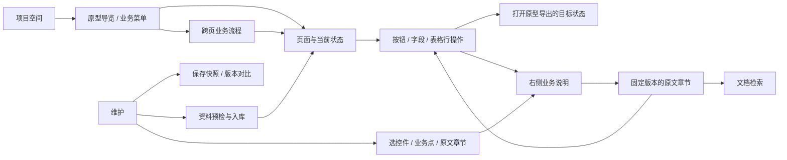
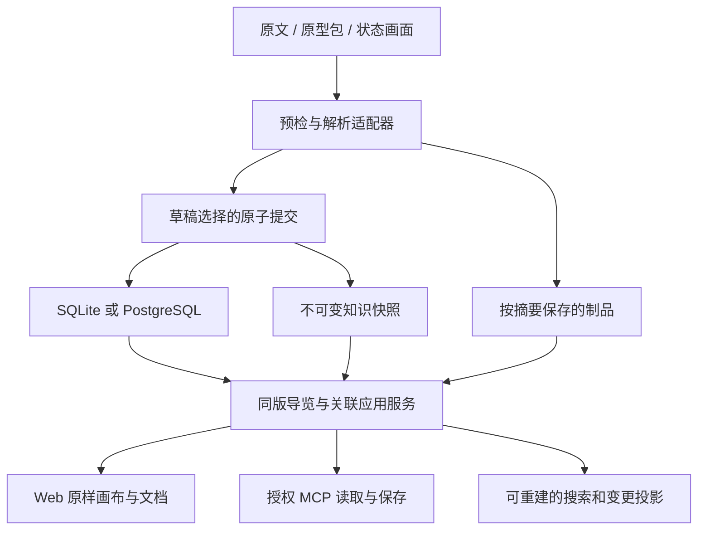

# 知境 VKS 3.0 产品、交互与技术方案

> 设计稿 D1 · 2026-11-10  
> 源码基线 `main@2ec30d95399ae003384b1dad2a717a18750f4f02`  
> 交付阶段为产品设计和静态原型。本文中的接口、性能指标及验收项是开发目标。

| 查阅内容 | 对应章节 |
| --- | --- |
| 产品范围与现状 | [产品定义](#1-产品定义) · [迁移决策](#2-源码基线与迁移决策) · [信息架构](#3-信息架构与默认动线) |
| 原型与界面 | [八个页面](#4-八个页面和交互规格) · [原型保真与交互](#5-原型保真与交互) |
| 数据与工程 | [架构和版本](#6-架构数据和版本语义) · [导入与更新](#7-导入匹配与更新) · [接口与 MCP](#8-webhttp-与-mcp-契约) |
| 上线准备 | [权限及运维](#9-权限资料保护和运维) · [兼容与回退](#10-兼容升级与回退) · [试点和开发](#11-云收费试点和开发拆解) · [验收标准](#12-验收标准和测量) |

## 1. 产品定义

VKS 3.0 给已有原型加业务文档。进入项目后，原型按自己的菜单、布局、表格和控件呈现。VKS 将热区和动作关联放在独立覆盖层，把说明放在画布外。点击已有按钮时显示对应业务点。有原型导出的目标状态时，可继续打开对应画面。说明围绕「这一步做什么、何时适用、会影响什么」展开，每项可追到原文。文档也能反查到同一版本的页面、状态和操作。

两份离线 HTML 用作本次资料迁移。原型包及已取得的原始画面是视觉依据。项目数据库维护页面与画面的索引、动作定位、文档、业务点和关联，图片、附件、原始导入包保存在对象目录。产品按页面状态和章节加载资料。个人自用沿用现有 SQLite 与本机对象目录。服务化实例可使用 PostgreSQL 和现有对象卷。

### 1.1 使用者和典型任务

| 使用者 | 任务 | 完成的表现 |
| --- | --- | --- |
| 接手项目的人 | 在原型里点「新增收费项」，弄清新增规则和后续出账步骤 | 在熟悉的原型画面旁看到说明，打开依据后回到同一操作 |
| 维护人 | 在编辑抽屉的「违约金设置」旁绑定规则 | 选控件、选择原文章节、写说明并保存，立即可读 |
| 查问题的人 | 从手册中的停车月卡章节找到功能入口 | 选中章节后看到对应操作，打开准确页面和状态 |
| 更新资料的人 | 导入新版原型和手册，核对影响 | 知道哪些页面及章节变化、哪些关联要重新定位，仍能阅读旧快照 |
| 授权的 MCP 客户端 | 查询准确动作的业务说明或补写关联 | 使用与 Web 一致的版本、权限、来源和保存语义 |

### 1.2 版本范围

| 首发范围 | 试点完成后扩展 |
| --- | --- |
| 原样导览、同页业务说明、双向深链接、原型状态快照与截图热区、通过保真验证的静态导出视图 | 原环境伴读、更多原型格式和多项目模板 |
| Markdown、原型资料包和本次云收费样例适配、预检及增量导入 | 基于已证实覆盖分母的目录同步及批量匹配 |
| 控件、业务点与章节绑定，更新后的变更定位、快照、备份恢复 | 候选匹配的语义检索和可选模型 |
| 有来源的跨页业务流程，已有搜索、技术详情和 MCP 兼容 | 更细的运行证据对照和更多流程 |
| 桌面端首发，窄屏阅读适配 | 根据使用频率扩展窄屏维护能力 |

源码、OpenAPI 和观察记录作为可选增强资料。只导入文档和原型即可完成核心用户任务。项目成员、资料访问、用户移除、证据和因果语义沿用现有自用工作流，维护者直接保存知识和快照。原型里的审批业务术语可如实引用，它们属于被讲解的业务系统。参见[当前自用工作流](../../PERSONAL_WORKFLOW.md)。

## 2. 源码基线与迁移决策

| 能力 | 当前源码及实测边界 | 3.0 决策 |
| --- | --- | --- |
| 导入 | 独立文档入口接收 Markdown 和 OpenAPI，HTML、截图、ZIP 有原型入口 | 增加受支持资料包的识别、解包、预检和映射报告，复用制品、任务和普通导入 |
| 页面与热点 | 现有讲解工作台能在静态预览上选动作、打开关联章节 | 复用热点能力，增加原样画布及固定状态切换。解释层与原型资源独立 |
| 文档与身份 | 已有章节解析、准确有序修订映射、显式 key 及无法唯一解析时的错误 | 复用章节稳定身份和快照解析，增加从引用到原型状态的反查 |
| 业务流程 | Journey 已有阅读、编辑、分支、同版动作与来源引用 | 复用流程存储、可达性和语义校验，导览节点带用户能理解的前置条件和结果 |
| 关联与快照 | 已有关系纠错、移除、证据有效性、不可变快照和影响报告 | 新增业务点实体及两类关系，扩展影响检查与快照选择。旧关系仍按旧语义可读 |
| 搜索、MCP、权限 | 现有共用应用服务、能力鉴权和精确版本读取 | 新增导览投影和动作解释。后台缓存事实，读取时重算可见性 |

在前序分析中对两份样本做了静态读取。手册内含 204 份原始 Markdown，204 份原文摘要一致。原型包含 102 条路由记录，另有页面、组件和字段资料。现有静态解析器对外层原型包返回 `VKS_UI_DISCOVERY_GAP`，没有发现包内动作。路由条数是输入规模。迁移成功率以预检去重后实际可读的页、识别的动作和已具来源的关联分别计量。

基线依据：[实施记录](../../IMPLEMENTATION.md)、[2.0 实施记录](../v2/IMPLEMENTATION.md)、[验证记录](../../VERIFICATION.md)、[导入格式代码](../../../apps/web/src/imports.ts)、[讲解工作台](../../../apps/web/src/pages.tsx)、[运行契约](../../../packages/contracts/README.md)。

## 3. 信息架构与默认动线

项目空间负责打开、创建、切换项目。打开有原型的项目时进入最近一次仍有效的导览页面，其次是项目设置的入口页，再次是首个可见页面。无可见原型时显示项目空状态。仅有文档的项目可从空状态直接读文档，具维护权限时同时显示「导入资料」。项目切换器和搜索入口常驻。

| 主入口 | 默认落点 | 二级内容 |
| --- | --- | --- |
| 原型导览 | 原有业务菜单与页面、画布外业务说明 | 原型状态画面、相关业务点、原文定位、技术详情 |
| 业务流程 | 已声明的流程列表及最近阅读位置 | 步骤、前置条件、分支、状态对照、打开原型 |
| 文档 | 文档目录及阅读区 | 全文搜索、章节目录、证据与动作反查 |
| 维护 | 当前项目的待处理资料和快速入口 | 资料接入、页面与动作、业务点、文档编辑、版本与变更、项目设置 |

顶部展示项目和「当前草稿」或准确的快照名称。切版本是显式操作。进入旧地址、书签、搜索结果、MCP 返回链接时保留准确的原项目、版本和目标。旧项目缺少新原型定义时，进入旧版静态预览或截图讲解。只在有效入口存在且当前用户有权读取时使用 3.0 默认入口。



### 3.1 三条首发用户故事

1. 从项目空间打开「云收费示例」。在原有菜单上选择「收费设置 → 收费项管理」，点击画面上的「新增收费项」。右栏解释原文记载的校验与后续步骤。若已接入该原型的新增弹窗状态，画布打开其原始画面。打开出处后定位到「4. 主流程」，返回时恢复当前画面和已选动作。
2. 在「维护 → 页面与动作」打开编辑状态。选「违约金设置」，创建或复用业务点。选中具体章节、预览关联的条件和出处，点「保存关联」。在同一草稿刷新，导览与文档反查都能查到刚保存的内容。
3. 导入修改了一个按钮位置和一段规则的新版资料。按钮语义一致时保留动作身份，正文变化的证据进入待核对区。维护者重新定位证据并保存。旧快照继续指向旧页面、旧规则与旧章节。

## 4. 八个页面和交互规格

原型图使用「云收费示例」和示意统计。原型导览图中的内嵌画面用于说明原样画布与业务说明的边界。开发时的像素对照以实际导入的原型画面为准。主界面统一使用「知境 VKS」、项目切换器、原型导览、业务流程、文档、维护和版本指示。图号与下面的页面一一对应。

### P01 原型导览

[打开 P01 原型导览图](prototype/01-prototype-explorer.png)

- 原型自带顶部导航、左菜单、页签和页脚时，将它们作为画布一部分保留。VKS 可按需展开独立的快速定位菜单。原型没有菜单时，快速定位菜单提供页级导航。搜索只返回当前可见条目，重名时带所属路径。
- 中部为原样画布。画布外工具栏显示来源模式、原尺寸、适应宽度、热点开关。原尺寸模式以已记录的视口显示。空间不足时滚动或整幅等比例缩放。说明栏开合不触发原页面重新布局。
- 右列默认显示页级摘要。选择动作后显示标题、适用条件、核心规则、影响或下一步、来源。多业务点按匹配状态和人工排序展示，常用规则在上。文档、接口、源码和证据详情按需展开。
- 「查看原文」在相同项目和版本中打开准确章节。原型原位置可通过返回链接及浏览器返回恢复。地址包含页面、状态和动作的稳定身份，滚动位置及缩放作为当前会话状态恢复。
- 一次热区激活更新动作解释，并在目标画面已接入时切换到对应状态。只有列表画面时继续显示原列表并提示「该状态画面待补充」。纯选中时焦点留在热区。切换原型画面时，焦点定位新状态标题或动作列表。

| 收费项管理样例操作 | 中列反馈 | 右列与来源 |
| --- | --- | --- |
| 新增收费项 | 选择原画面上的按钮。已接入新增弹窗时切到原型导出的表单画面 | 解释费项新增校验及后续配置，来源《收费配置到批量出账流程》「4. 主流程」 |
| 同步月卡套餐 | 选择原按钮。已接入同步状态时打开原有画面，否则留在列表 | 解释套餐同步与房间关联等阶段，来源《manage 管理中心业务说明》「17.3 停车月卡配置」 |
| 编辑 → 违约金设置 | 从原列表行的「编辑」热区打开对应编辑画面，在原设置位置选择对应控件。适用和不适用状态按原型导出 | 解释适用范围、计算方式与单位，说明来源对历史账单的边界，来源《账单违约金计算豁免与调整操作手册》「1. 先问客户想改什么，再找对应入口」 |
| 导出 | 显示本页样例导出动作的选中状态 | 演示「当前可见范围内暂无关联说明」。维护者有「添加业务说明」入口 |

画面来源区分原型导出、手工声明和观察记录。原型导出的演示数据属于原型自身。VKS 的状态连线代表讲解跳转。业务说明引用准确的资料段落，真实运行事实使用另外采集的观察依据。

### P02 项目空间

[打开 P02 项目空间图](prototype/02-projects.png)

- 顶部支持项目搜索和「新建项目」。项目卡展示名称、简介、最近阅读位置和入口「进入导览」。工作区已有项目以原有项目 ID 打开。
- 有资料未配置入口时提供「设置导览入口」，只列当前有权访问的页。空项目卡提供「导入资料」。只有文档的项目显示「打开文档」。
- 创建表单收集项目名称、简介和可选标识，保存后进入空项目工作区。维护者可稍后设置默认入口。
- 最近位置以当前账号、项目和版本隔离。访问失效时回到仍可见的入口，显示可继续操作的提示。列表统计在权限过滤后计算。

### P03 资料导入

[打开 P03 资料导入图](prototype/03-import.png)

- 入口列明 Markdown、VKS 资料包、支持的原型包、截图及云收费样例包。可以同批加入文档与原型，也可分别导入后补关联。
- 步骤显示「选择资料 → 预检 → 入库 → 导入结果」。预检视图列出识别结果、重复项、页和章节的映射、阻断问题以及可继续的独立资料。点击问题定位对应文件和导入项。
- 结果区分「新增」「更新」「复用」「跳过」「需处理」。明确自动保留的关联和有待定位的项。按钮「打开首个页面」「查看导入报告」「继续导入」对应具体结果。
- 图中的「98 个页面」「4 个页面」是演示计数。实际报告独立统计路由、可见页面、已有画面和待补画面，路由条数可以大于或小于不同分组的状态数。
- 处理中可取消、刷新查看进度。失败后从原任务查看原因和可重试范围，使用新尝试而保留原报告。重复提交不会产生重复页面或章节。

### P04 页面、动作和业务点维护

[打开 P04 页面与动作维护图](prototype/04-binding-editor.png)

- 左列是原型页面和状态树。页面有「列表」「新增抽屉」「编辑抽屉」等状态。中列在原样画布上选择已存在的节点锚点或绘制热区，选中区域在编辑覆盖层显示定位框。
- 右列「动作绑定」显示动作名、适用状态、已关联业务点和来源。主操作为「添加业务点」「选择原文」「保存关联」。同名按钮用所属页面、状态、控件位置和动作 key 区分。
- 业务点可用已有条目或新建，填写标题、说明、适用条件、结果、例外和出处。最少可先存标题、说明和适用范围。缺少来源的内容按「维护说明」显示。
- 可调整优先级、替换出处、移除或恢复关联。保存前在右栏预览阅读效果。保存失败时保留用户尚有权查看的表单输入和冲突信息。
- 页面维护支持调整 VKS 菜单分组、补录原型画面、整理状态和关联动作。原型界面本身由原型工具维护，改版后导入新修订。热区编辑支持拖画、键盘微调和冲突提示。重复行可复用一个动作，重叠或多义定位需拆分适用状态或指定控件。

### P05 文档与原文定位

[打开 P05 文档与检索图](prototype/05-knowledge-reader.png)

- 左列为文档目录和文档内搜索。中列保留完整文档正文和标题结构，命中时定位章节，并对引用片段作可访问高亮。附件按当前版本和权限加载。
- 右列为「关联操作」。单项展示页面、状态、动作和关联类型。点击「在原型中打开」恢复准确的上下文，有多处关联时由用户选择。
- 全局搜索覆盖页面、动作、业务点、文档和章节。结果标明类型、项目内路径和版本。打开结果后能够通过浏览器返回还原搜索词和筛选。
- 章节有同名标题时使用稳定章节身份，标题路径和行号用于展示。来源修订无法恢复时提示「无法定位原文章节」，引导查看历史版本或维护关联。

### P06 业务流程

[打开 P06 业务流程图](prototype/06-business-flow.png)

- 默认展示已保存的流程目标和步骤，选中步骤在右侧显示前置条件、业务说明、结果、声明来源及原型入口。
- 样例主线为「收费项管理 → 收费标准管理 → 房间收费设置 → 计费出账」。以手册所述配置链为依据。各步点击后进入对应页面或准确状态，主线旁可选择「条件满足」「缺少收费标准」等已接入的演示状态。只录有条件说明时，界面直接展示文字和出处。
- 图中前置条件针对演示的普通收费配置链。合同、公摊、月卡和临时出账按对应章节及适用范围分别建步骤。
- 区分业务先后、演示跳转、证据导航和已观察顺序。菜单顺序只用于导航。观察记录展示当时捕获的状态和来源，业务流程规则仍需自己的依据。
- 维护者可以连接步骤、编辑分支条件、保存新修订。复用 Journey 的结构约束。每条正式业务分支能追到依据，无依据的演示分支保留模拟标签。

### P07 版本与变更

[打开 P07 版本与变更图](prototype/07-versions.png)

- 顶部明确「对比来源」与「对比目标」，摘要按页面布局、动作含义、文档内容、业务点和关联分类。
- 可点开差异，看到原版本、新版本和受影响的操作。示例展示「章节内容变化」和「动作位置变化」两种不同结果。
- 对比图中的新旧校验说明是虚构版本内容，用于演示同一出处变化后的定位。
- 「在草稿中定位」打开准确对象。「重新定位出处」「改选动作」完成后直接保存。列表仅显示仍存在、仍有权读取且确实需要处理的项。
- 「保存快照」将本次选中的对象、关系、证据和来源冻结。历史阅读显示快照名称和来源，继续修改时从对应快照创建草稿。设置默认快照与保存动作分开。

### P08 项目设置

[打开 P08 项目设置图](prototype/08-project-settings.png)

- 「项目资料」维护名称、简介、默认导览入口、菜单分组和可见范围。「来源与存储」显示已接入来源、最近同步、数据库模式和对象存储状态。
- 「权限与 MCP」展示成员能力与可撤销的项目令牌入口。个人使用保持简洁，项目管理、知识维护、资料读取按实际能力拆分。
- 「备份与恢复」复用现有一致备份。界面展示最近一次备份时间、校验状态和恢复范围。恢复演练以隔离目标记录结果。
- 管理类配置按权限展示。访问路径和日志避免显示凭据，数据归属以项目范围为准。

### 4.1 通用界面行为

| 状态 | 界面表现和下一步 |
| --- | --- |
| 加载项目或页面 | 显示结构占位。保持当前项目和明确的目标版本，迟到旧响应不能回写新位置 |
| 同一项目换动作 | 旧说明即时退出选中位。当前动作名称先出现，读取失败可只重试右栏 |
| 可见范围无对应说明 | 显示通用缺口文案，维护权限允许时给出添加入口 |
| 来源有变动 | 显示「出处待核对」。打开历史引用需进入准确快照，当前阅读结果分开显示 |
| 截图或组件资源缺失 | 显示页面名和仍可用的动作列表。明确缺失资源并提供定位维护入口 |
| 多目标或热区重叠 | 在维护页展示候选和位置，选择准确目标后才更新绑定 |
| 草稿冲突 | 提示受影响对象、当前修订和保存草稿时的修订，允许查看差异或复制自己的输入 |
| 权限收回 | 退出不可见页面与缓存，按统一的无可见结果文案回到可用入口 |
| 冻结快照 | 版本标签明确，编辑按钮引导到克隆草稿，原记录按当前权限读取 |

桌面目标宽度 1440，说明栏约 344，快速定位栏可折叠。小于 1100 时说明栏改为抽屉，小于 760 时菜单、原型、说明采用顺序阅读。原画布使用独立视口。说明栏重新打开时保留当前动作。维持语义化按钮、可见焦点、键盘激活、Esc 关闭与焦点返回。状态由文字和图标共同表达。

## 5. 原型保真与交互

### 5.1 支持矩阵

| 输入 | 3.0 展示方式 | 可以验收的保真范围 | 点击方式 |
| --- | --- | --- | --- |
| 原型工具导出的页面与状态截图 | 按原始摘要读取图片，外加独立热点层 | 原图字节一致。同视口和比例可逐像素对照。适应宽度时保持整幅比例 | 点原控件位置查看说明。已导出的目标状态可切换 |
| 具备样式、字体和图片的静态导出 | 通过资源和固定视口检查后，在隔离画布渲染 | 在记录的浏览器、视口、字体、比例条件下和对照图比较。布局差异回退原始截图 | 使用静态锚点或独立热点。支持已声明的状态链接 |
| Vue、Axure、单文件离线合集等依赖脚本的导出 | 登记原始包，解析可验证的目录和字面数据，导入原型工具或原环境导出的画面 | 原始包字节可核对。已取得画面的状态可以逐像素对照。只有元数据的状态显示待补画面 | 根据已接入状态导览。原环境完整交互由伴读覆盖 |
| 原型链接或其他工具 | 登记来源，接入工具提供的静态视图或截图 | 对照导出时所记录的状态及尺寸 | 用户可打开原链接。原环境伴读按独立适配器实现 |

「已对照」需要原环境的参考画面和参数。只做字节校验时显示「原图已校验」。每个页面状态分别记录可展示、待补画面、待核对或无法定位。菜单可列出已识别的路由，视觉验收以实际取得的状态画面为分母。

3.0 首发的「原样导览」是在截图或静态视图上做知识联动。动态原包作为资料保存。原型控件的视觉反馈取决于是否已取得该状态的原始画面。需要实时输入、原始校验和脚本弹窗时，使用独立的「原环境伴读」验收。页面支持何种方式由预检决定，并随原型版本保存。

### 5.2 固定视口和热点

1. 状态记录原视口宽高、设备像素比、图片尺寸、来源修订及可选滚动位置。截图直接使用原始文件。「原尺寸」按记录的 CSS 视口显示。「适应宽度」对基底与热点使用同一缩放和偏移。
2. 说明栏、导航和版本切换位于画布外。画布宽度不足时滚动或等比缩放，原型自身的列宽、字体、间距及折行由原视口决定。VKS 的样式作用域止于画布边界。
3. 热点记录 `x/y/w/h` 为相对同一画面的归一化值，范围在 0 到 1。渲染时用 `displayX = viewportLeft + x * displayedWidth`，宽高和 Y 轴同理。滚动、缩放及高 DPI 共用一套坐标换算。页面内滚动可录为独立状态或一张完整可滚动画面。
4. 键盘用户可使用覆盖按钮或同序动作列表。重复行用状态资料里声明的行 key 或通用操作。多义热点在维护页提示调整位置或状态范围，读态只对确定的区域激活。
5. 基底修订独立于知识和覆盖层。改说明只改变关联或业务点修订。关闭热点可逐像素对照底图。点击热点时使用来源状态计算关联，再切到有依据的目标画面，因此弹窗出现后仍保留触发动作的解释。

### 5.3 静态导出和脚本边界

静态 HTML 由内建解析器构建资源闭包，校验本地路径、媒体类型、字体和相对引用。画布使用独立隔离文档及固定视口，脚本、表单提交、顶层导航和网络通道关闭。允许的样式与媒体由权限内的资源读取器提供。外联、CSS `@import`、未闭合引用和不可解析结构进入预检报告。缺字体、样式不匹配或结构由脚本生成时采用原型导出图。

动态包只解析结构化数据和已知位置的纯字面数据。材料中的代码片段可作为文本证据和定位来源。函数调用、执行入口、模板求值和脚本依赖不参与画面生成。截图可由用户在原环境操作并导出，也可由已有授权采集路径取得准确状态。现有测试 Runner 与上传原型包分开。

### 5.4 原环境伴读

后续由用户在原环境打开原型。项目自有集成或受信浏览器伴读组件发送明确的动作标识，VKS 在旁边显示同一版本的业务说明。原型自身窗口负责真实界面和交互。当前作为 3.0.x 独立增量。

- 用户主动将标签与项目及知识版本配对。配对绑定已登记来源、当前标签和有效期，支持撤销。
- 事件只含页面、状态、动作 key、序号及配对标识。发端来源和动作映射校验通过才显示。接受事件的权限只包含读取说明。
- 采集画面另走资料采集范围检查。普通伴读事件只使用定位所需字段。
- 跨页、嵌套 frame 和本地文件分别验证。定位断开时显示当前状态，并可打开已保存画面。依赖脚本的任意导出格式需要单独确认事件接入条件。

## 6. 架构、数据和版本语义

### 6.1 服务分工



导入器生成标准材料和预检报告。应用服务负责项目范围、准确修订、引用闭包、权限及事务。前端维护视口、焦点和临时过渡状态。MCP 使用同一应用服务。搜索、反查和覆盖统计是可重建投影，事实来自实体、制品和关系。

### 6.2 数据模型

| 对象 | 主要字段 | 保存方式 |
| --- | --- | --- |
| 项目与菜单 | 项目 ID、默认页 key、可见模块、快速菜单路径 | 复用项目与模块配置。原型自身菜单随原始画面保留 |
| 原始制品 | 制品 ID、来源、相对路径、媒体类型、SHA-256、大小、对象 key | 复用 `artifact` 和对象目录。派生资料独立保存 |
| 原型页面 | `page_key`、来源路由或别名、页面修订、状态清单 | 复用 `entity(page)`。不可变修订引用规范化原型清单 |
| 原型状态 | 页内 `state_key`、来源类型、画面制品、视口、热区和目标状态 | 页面清单中的有版本条目。区分原型导出、手工声明和实际观察。观察绑定准确采集 ID |
| 动作 | `action_key`、所属页、显示名、操作语义、语义摘要 | 复用 `entity(action)`。位置与原始样式由页面状态提供 |
| 业务点 | `point_key`、标题、说明、适用条件、影响、例外、来源限制 | 增加 `entity(business_point)` 及不可变修订，可供多个动作复用 |
| 文档和章节 | 文档与章节 key、准确有序章节修订映射、原文位置 | 复用 `entity(document/section)`、Markdown AST 与现有身份规则 |
| 关联 | 精确端点修订、适用状态、排序、证据、用户移除及来源有效性 | 扩展既有 `relation` 类型，保留行版本、锁和因果语义 |
| 证据 | 精确制品摘要、章节身份、当前修订位置、来源类型 | 复用 `evidence`。读取和快照均检查端点与材料可见性 |
| 版本与流程 | 草稿选择、快照清单、来源向量、流程步骤、准确页和状态 | 复用 `analysis_set_entity`、`knowledge_release` 和 Journey |

关联方向固定为 `Action → has_business_point → BusinessPoint → supported_by_section → Section`。同一动作与业务点用一个有序范围集合表达适用状态，以兼容现有关系唯一性。按起始状态精确匹配，再查显式「全部适用状态」。页级概要独立展示。查询和反查只走定义好的两层关系，同一章节不会把其他动作的说明带到当前按钮。

每个业务点可以有多个出处，按主要证据排序。手工说明可直接保存，缺原文时显示「维护说明 · 暂无原文」，统计为有说明、无可追溯出处。来自受限资料的派生说明继承实际使用资料的访问要求。修改标题或去掉显式链接仍保留实际来源约束。

### 6.3 原型清单示例

示例文件和摘要用于说明数据形状。正式导入要求两张图均有独立制品记录，并核验摘要、类型、页归属及状态引用。

```json
{
  "schemaVersion": "1.0",
  "sourceKey": "billing.prototype",
  "pages": [
    {
      "pageKey": "billing.charge-item",
      "routeAliases": ["/chargeItemMgnt"],
      "defaultStateKey": "list",
      "states": [
        {
          "stateKey": "list",
          "origin": "prototype_export",
          "viewport": {"width": 1440, "height": 900, "devicePixelRatio": 1},
          "surface": {
            "kind": "raster",
            "artifactPath": "views/charge-item/list.png",
            "sha256": "aaaaaaaaaaaaaaaaaaaaaaaaaaaaaaaaaaaaaaaaaaaaaaaaaaaaaaaaaaaaaaaa"
          },
          "anchors": [
            {
              "anchorKey": "toolbar.add",
              "actionKey": "billing.charge-item.add",
              "rect": [0.72, 0.18, 0.11, 0.04],
              "targetStateKey": "create-drawer"
            }
          ]
        },
        {
          "stateKey": "create-drawer",
          "origin": "prototype_export",
          "viewport": {"width": 1440, "height": 900, "devicePixelRatio": 1},
          "surface": {
            "kind": "raster",
            "artifactPath": "views/charge-item/create-drawer.png",
            "sha256": "bbbbbbbbbbbbbbbbbbbbbbbbbbbbbbbbbbbbbbbbbbbbbbbbbbbbbbbbbbbbbbbb"
          },
          "anchors": []
        }
      ]
    }
  ]
}
```

应用层用制品 ID 与修订 ID 解析清单。快照保存校验通过的准确引用。清单禁止额外属性并限制条目数和深度。每个页、状态、动作、资源均检查项目归属。Schema 升级读旧写新，历史清单版本随快照保存。

### 6.4 变更对照

| 输入变化 | 3.0 结果 |
| --- | --- |
| 同样文件与范围再次导入 | 复用制品、逻辑身份和已有修订。选择及关联不重复 |
| 按钮改字或移动，动作身份明确 | 保留动作 key。需要时生成页面或显示修订。新画面定位通过校验后继续挂接 |
| 同名控件跨页或跨状态含义不同 | 按所属页、状态、来源和动作 key 区分。歧义生成待定位项 |
| 页面路径改名 | 有明确原型 key、旧别名或可证明的迁移时沿用身份。旧地址保留可验证映射 |
| 章节仅移动 | 正文和身份可校验时更新当前定位。原定位留在历史快照 |
| 章节正文或动作含义变化 | 受影响关联待核对。当前有效说明和历史出处分开读 |
| 部分导入或解析不完整 | 报告缺失。当前选择只由准确完整来源变化或用户操作改变 |
| 用户移除关联 | 保存移除状态及历史。重导、候选和缓存均尊重该状态 |

「待核对」表示定位或证据有效性问题。手册、原型和人工说明属于声明资料。实际观察和运行因果继续按既有证据语义处理。

### 6.5 并发及快照

- 每个编辑携带草稿选择版本和相关对象行版本。多对象绑定在一个事务校验、提交并推进选择版本。旧写入返回当前版本与冲突位置。
- 幂等键绑定项目、主体、请求摘要和草稿范围。同键同请求重放前检查当前权限。不同内容返回冲突。
- 导入在事务外解析。提交前再次检查任务租约、取消、权限及目标选择版本。引用闭包完备后一次切换当前选择，重复投递和迟到结果只保留一个可见提交。
- 快照冻结页面及状态清单、动作、业务点、准确章节和流程修订、关系、证据、来源向量及引用对象。原图和静态样式资源属于快照可达集合。
- 回读采用快照准确修订，每次按当前授权过滤。草稿地址指向该草稿最新选择。需要长期复现的链接使用快照地址。

## 7. 导入、匹配与更新

### 7.1 流程与本次资料适配

| 阶段 | 处理和产物 |
| --- | --- |
| 选择资料 | 确定来源、目标项目、草稿及资料类型 |
| 解包 | 固定原始摘要，检查路径、编码、压缩、资源和引用闭包 |
| 映射 | 生成文档、页面、状态及动作候选，对照已有身份和可用画面 |
| 预检 | 展示新增、更新、复用、冲突、缺少画面和可继续的独立资料 |
| 入库 | 用户确定本次导入范围，提交时复核预检摘要、租约和草稿版本，原子写入完整依赖集合 |
| 导入结果 | 分别统计文档、页、状态、动作和关系，可进入准确对象及诊断 |
| 后续更新 | 保存成功来源范围和摘要，按可验证的差异局部重解析并计算影响 |

云收费手册适配器识别已知包签名，校验 gzip 和包内摘要，读出原始 Markdown 与路径。原型适配器读取路由、页面、资源及可严格解析的字面元数据。已有状态图片直接入库。脚本决定画面的页面列入「待补原始画面」。补录时关联准确页面、状态、版本与视口。全量导入优先保存原始资料及可验证目录，分批补齐有使用价值的页面。

原始输入和解包均有总量、单项、条目和层深限制。试验以现有 128 MiB 入口上限和归档约束为起点，记录真实样例开销后冻结适配器限额。路径归一化后拒绝越界、链接、重复和大小写歧义。取消和失败产生的未引用临时对象可清理，草稿及快照仍引用的对象继续可读。

### 7.2 匹配、检索及覆盖

首发使用准确显式 key、原型路由与状态标识、章节稳定身份及人工绑定。自动候选带触发理由和可见出处。只有文字相似时展示备选。多个可行目标需要选择准确项，默认读态只消费有效关联。手工改选、锁及移除优先保留。

模型是可选增强，只对当前可见资料给出候选、摘要和准确来源位置。保存时验证输入范围和修订。未配置模型时，导入、绑定、阅读、更新和快照均可使用。

导览只加载当前可见菜单范围和当前画面。右栏按动作与起始状态查询，列表与反查分页。缓存不可变投影，键包含项目、准确版本、页面与关联修订，响应前重查可见性。关键词检索优先当前页准确动作，其次同模块业务点及章节全文。中文支持规范化和有界字符匹配，重名显示来源和路径。索引可从选中修订重建，重建期间支持直接定位。


## 8. Web、HTTP 与 MCP 契约

以下是设计接口。读接口明确指定 `analysis_set_id` 或 `release_id`，两者互斥。草稿读取和写入使用实际分析集合身份，快照按固定 manifest 读取。所有入口沿用项目能力与可见资料约束。

### 8.1 HTTP 端点

| 方法与路径 | 输入与返回 | 关键约束 |
| --- | --- | --- |
| `GET /api/v3/projects/{pid}/prototype/menu` | 版本和可选菜单范围，返回分页树、入口页和可见画面状态 | 可见性先于计数，按项目和版本独立缓存 |
| `GET /api/v3/projects/{pid}/prototype/pages/{pageKey}` | 版本与状态 key，返回准确页面修订、视口、图层描述、可见热点和目标状态 | 状态归属明确，画面 URL 仍受项目制品读取权限 |
| `GET /api/v3/projects/{pid}/prototype/actions/{actionKey}/context` | 版本、页和触发状态，可选关系策略，返回业务点、来源和导航引用 | 校验原控件与动作准确归属。默认只返回有效关联 |
| `GET /api/v3/projects/{pid}/sections/{sectionKey}/prototype-references` | 版本和分页，返回准确章节及对应页、状态和动作 | 反查使用同一关系语义及源材料过滤 |
| `POST /api/v3/projects/{pid}/prototype/import-previews` | 已上传制品 ID、格式、来源、目标草稿，返回预检任务和摘要 | 受现有上传和导入权限约束。只接受已登记的制品 ID |
| `POST /api/v3/projects/{pid}/prototype/imports` | 预检 ID、摘要、所选范围、目标草稿 ETag，返回入库任务 | 执行与提交分别检查租约、权限、幂等和草稿 |
| `PUT /api/v3/projects/{pid}/prototype/pages/{pageKey}/anchors` | 准确页面修订、状态 key、坐标与映射、草稿 ETag | 校验归属、坐标、可见性和冲突，保存新页面修订 |
| `POST /api/v3/projects/{pid}/prototype/actions/{actionKey}/business-points` | 动作修订、状态范围、新建或复用业务点、章节及证据、草稿 ETag | 同一事务写点、关系和证据。按准确对象行版本修改，保留未授权的既有关系 |
| `POST /api/v2/projects/{pid}/snapshots` | 复用既有保存快照接口 | 将新增业务点与原型清单引用纳入快照闭包 |

写接口复用 `If-Match` 和 `Idempotency-Key`，同时接收被改对象的准确修订或行版本。错误设计使用 409 表达冲突及可核对的新版本，413 表达尺寸超限，422 表达无效坐标和引用，异步任务接受后按现有任务协议查询。无权读取的对象对外使用统一结果。具读取权限而缺少某项写能力时返回相应能力错误。

读响应的示例形状如下。标识为演示值。服务端根据读取到的准确版本计算响应。

```json
{
  "scope": {"kind": "snapshot", "releaseId": "demo-release-1"},
  "pageKey": "billing.charge-item",
  "pageRevisionId": "demo-page-rev-1",
  "triggerStateKey": "list",
  "displayStateKey": "create-drawer",
  "actionKey": "billing.charge-item.add",
  "points": [
    {
      "pointKey": "billing.charge-item.create-check",
      "title": "新增收费项的校验",
      "applicability": "新增收费项",
      "summary": "校验名称、编码、类型及是否重复",
      "sources": [
        {
          "documentTitle": "收费配置到批量出账流程",
          "sectionTitle": "4. 主流程",
          "sectionKey": "billing.guide.charge-flow.main",
          "sectionRevisionId": "demo-section-rev-1",
          "evidenceKind": "document"
        }
      ]
    }
  ],
  "availability": "available"
}
```

### 8.2 导航、加载与缓存

- 正向地址携带项目、版本、页面、显示状态和当前动作。起始状态可通过明确的导航参数还原。地址结构可采用 `#/prototype?project=…&release=…&page=…&state=…&action=…`，草稿用 `analysis`。读取时核验归属，禁止把 URL 中的显示名当身份。
- 从文档返回使用已校验的项目内目标，恢复准确页、状态和滚动位置。浏览器前进后退优先于自动修正地址。页面失效时显示原因和当前可见入口。
- 切项目、版本、动作时按请求标识取消或丢弃过期响应。权限或可见范围变动时清除对应结果及预取的资源 URL。阅读区、画布和说明分别显示自己的加载与错误状态。
- 图片对象按需读取，预取仅限同一可见范围内的少量相邻已知状态。列表接口按游标分页。缓存允许复用已授权的不可变事实，读取时重新验证权限。

### 8.3 MCP 共用服务

首发保持 `get_project_context`、`get_action_context`、`search_knowledge`、`import_bundle` 和 `save_knowledge_snapshot` 的原有调用。新增工具采用 `get_prototype_action_context` 和 `save_business_point_binding` 两个业务操作。前者返回准确版本、动作、可见说明和可定位来源。后者调用与 Web 相同的校验、直接保存和幂等服务。旧客户端可继续按既有模型读取，新增实体和路径在扩展契约中明确声明。

MCP 只读工具需要 `knowledge:read`。草稿可见性及直接写入复用 `knowledge:edit` 等实际权限。资料导入使用 `source:import`。源码、观察记录分别受 `source:read` 和 `trace:read` 约束。保存时重查被关联的端点和来源。项目管理能力仍由 Web 的既有授权路径管理。

接口落地后更新 OpenAPI、工具输入输出 Schema 和示例。运行实际 MCP SDK 的 HTTP、stdio 读取与写入测试，包含撤权、草稿冲突、重试和快照回读。契约生成和验证按[当前运行契约](../../../packages/contracts/README.md)。

## 9. 权限、资料保护和运维

| 范围 | 执行规则 |
| --- | --- |
| 读取顺序 | 先项目及版本，后对象、资料及派生来源。名称、命中计数、节选、图谱、导出和 MCP 返回都从过滤后的集合计算 |
| 多来源说明 | 记录实际来源输入，按当前分类判断可见性。某个隐藏出处不会通过摘要、未读标记、总量或错误详情被间接推断 |
| 写入 | 维护能力和资料读取能力相交。普通编辑只修改明确指向的对象。保存、重新绑定、快照及授权采集均走现有直接操作语义 |
| 原型隔离 | 源文件按数据处理。预览控制脚本、表单、导航及外部资源，热区只请求 VKS 的读取和已声明的状态切换 |
| 对象读取 | 资源请求验证当前项目、版本可达性和权限。下载使用已授权对象，保持原始字节与媒体类型 |
| 导出 | 以固定快照和当前可见关系为范围。回导重建候选及身份映射，保留原始字节和历史出处的区别 |
| 配置与存储 | `.vks/`、凭据、环境文件及私有验收资料留在忽略目录和外部对象卷。备份单独保管 |
| 日志与任务 | 记录导入任务 ID、阶段、制品数量、耗时、失败代码和版本。诊断查看受项目授权，认证材料不进日志 |

沿用现有内容访问策略。原文、原图和授权截图按字节保存。未引用对象清理只处理可证明无草稿、快照或运行中任务引用的制品，并保留回收统计。快照备份须包含同一时点数据库及可达对象清单。恢复演练验证摘要、可用画面和关联闭包。旧令牌处理沿用恢复流程。

## 10. 兼容、升级与回退

1. **盘点和备份。** 在隔离副本记录数据库迁移号、项目数、选中实体数、快照摘要、对象数量和典型深链接。完成可恢复的一致备份。
2. **增加新表示。** 先接入原型清单读取、业务点实体、两类关系和快照闭包。数据库优先沿用已有修订与关系表，需要新增索引时通过实际查询计划决定。若契约白名单需要变更，覆盖 SQLite 和 PostgreSQL 两个路径。
3. **读旧写新。** 旧文档、页面、场景、流程和原有关联继续可读。旧动作的直接章节关系在 3.0 右栏「相关文档」呈现。维护者可选中准确关系建立业务点，保留原证据与来源。旧快照不改写。
4. **试点后切入口。** 有有效原样画面及入口页的项目可以默认导览。旧项目和缺少画面的项目沿用现有入口。旧链接和收藏恢复到准确项目与版本。
5. **恢复和失败处理。** 先以数据副本演练。升级失败时恢复同次备份和匹配的程序版本。记录本次升级后新增的草稿、导入及快照，回退前可导出有权资料。旧程序回读新格式必须有明确兼容证明。

迁移校验包括升级前后旧快照摘要一致、旧章节和原型能打开、对象引用无孤立、权限无扩大。真实项目仅在独立备份和通过副本演练后进入升级安排。

## 11. 云收费试点和开发拆解

### 11.1 最小试点资料

- 一份手册来源，先选与收费项配置、停车月卡和违约金设置直接相关的三组章节。保留各文件路径与摘要，使用可回溯的业务点说明。
- 一份原型来源。先收「收费项管理」列表、新增弹窗和编辑弹窗的原环境视口图。另取违约金设置在对应原型状态中的画面。同步动作有独立画面时一并加入。每张图记录原环境、视口、页及状态。
- 三条有证据的关联与一条可点击但没有说明的导出动作。预先记录应看到的内容和正确来源。用同名动作、不同原型版本、缺失状态各准备一个负例。
- 初次验收只在隔离项目导入。包内 204 份 Markdown 与 102 条路由记录作为迁移规模对照。试点达成后再扩到收费标准、房间收费设置和计费出账。

### 11.2 开发批次

| 批次 | 交付内容 | 对应验收和依赖 |
| --- | --- | --- |
| M0 定口径 | 固定一页三动作的真实原图、原文章节、视口与版本。定原样展示及伴读的交互边界 | 可逐个说清按钮会看到的原画面和说明。缺失原始状态明确列出 |
| M1 原样导览 | 原型清单、原图画布、独立热点、单动作说明、章节往返和深链接 | 一页三动作可查、未关联提示、截图像素对照、刷新恢复 |
| M2 资料入库 | 原始包预检、适配器、幂等与重导、状态补录、结果报告 | 两份资料可在隔离实例解析。证明脚本未执行，失败与取消不产生部分选择 |
| M3 维护与版本 | 热点编辑、业务点复用、证据绑定、章节反查、快照与影响定位 | 改说明立即可见、移动按钮可安全重绑、旧快照一致 |
| M4 跨页与契约 | 四页流程、文档搜索、兼容路由、MCP、备份恢复和性能验证 | 用实际 SDK 和浏览器走完整链，覆盖权限与回滚负例 |
| M5 发行验证 | 冻结代码和素材范围，完成实测报告、安装升级说明及样例验收 | 区分工程验证、原样视觉对照、真实业务试用和正式发行 |
| M6 伴读增量 | 原环境配对、动作事件映射、状态同步、撤销及独立验收 | 只对已支持的原环境声明完整交互联动。可在原型试点验收之外单独进行 |

M1 先用最小稳定清单验证用户动线。M2 再批量接入资料。首个可评审 PR 交付可持久化的一页三动作闭环。后续独立提交适配器、维护与版本、流程和契约，便于在隔离库分步对照。

### 11.3 源码落点

| 工作 | 建议复用和扩展 |
| --- | --- |
| 项目进入、版本与深链 | `apps/web/src/App.tsx`、`navigation.ts`、`route-sync.ts`、`workspace-baseline.ts` |
| 原样画布、状态及热点 | `apps/web/src/pages.tsx`、`HotspotEditor.tsx`、`SnapshotImage.tsx`、`ArtifactImage.tsx`，增加独立的原样画布和动作说明组件 |
| 导入与结果 | `ImportCenter.tsx`、`services/api/vks_api/knowledge.py`、`packages/analyzers/vks_ingest.py`、现有对象与任务服务 |
| 业务点及反查 | `relationships.py`、`reading.py`、`documents.py`、`workbench_v2.py`、`BusinessReferences.tsx` |
| 流程、历史和影响 | `JourneyReader.tsx`、`journeys.py`、`versions.py`、`Versions.tsx` |
| 权限与契约 | `service.py`、`mcp_gateway.py`、`packages/contracts/` 和既有授权、生成及契约测试 |

## 12. 验收标准和测量

| 编号 | 验收任务 | 必须观察到的结果 |
| --- | --- | --- |
| AT-01 | 在相同视口和比例打开导入的原始列表及弹窗 | 关闭热点后对照原画面。截图原始 SHA-256 一致，原尺寸基底像素对照一致。说明栏开合时表格、字号和按钮位置一致 |
| AT-02 | 在 100%、适应宽度和滚动后点击原控件 | 热点跟随原画布，正确命中「新增」「同步」和嵌套设置。无错位和兄弟动作串线 |
| AT-03 | 点击新增后打开业务说明和原文 | 一次点击出现对应规则，再一次定位准确章节。返回和刷新保持同一页、状态和动作 |
| AT-04 | 只导入一个依赖脚本的原型包 | 识别可用目录。缺失画面可补录。进程、浏览器和网络记录证明材料脚本、外联和业务提交未触发 |
| AT-05 | 同名动作、未绑定及缺失状态 | 说明按精确动作隔离。未绑定有通用提示。原始目标画面缺失时保留原画面及可用说明 |
| AT-06 | 选控件、绑定原文并保存 | 当前草稿立即读到准确业务点，文档可反查。原型底图摘要一致。冲突重试不会覆盖他人较新的关联 |
| AT-07 | 重复导入、取消和故障后再试 | 复用正确身份和制品。事务状态一致。重复任务仅提交一次，旧关联与已保存版本继续可读 |
| AT-08 | 移动控件、修改章节、回读旧快照 | 保留可核对的稳定动作。变更关系提示出处待核对。旧快照的图、说明和原文保持原修订 |
| AT-09 | 用只读账号、受限来源账号和撤销令牌测试 | 搜索、文档、菜单、说明、附件、图谱、导出和 MCP 返回一致的可见范围 |
| AT-10 | 用现有旧版链接、协议及备份恢复 | 旧入口仍可用。隔离目标恢复后准确回读原图、关系与版本 |
| AT-11 | 键盘、窄屏、网络中断与快速切换 | 焦点可追踪。原画布不重排，说明可顺序读。迟到结果不覆盖当前操作 |
| AT-12 | 四页试点、真实 SDK 和独立试用 | 流程步骤进入正确页或状态，SDK 读写与 Web 同版。用户自行完成规定任务并留下证据 |

AT-01 的像素对照使用同一原始参考图、相同浏览器及设备像素比，比较画布本身并排除外层控件。PNG 原图在原尺寸的目标是零像素差异。静态 HTML 的比较另记录浏览器、字体和参考图。存在可见偏差时报告差异，产品回到原始截图。动态 UI 的可执行行为在伴读验收中另外对照。

| 指标 | 首发目标 | 测量口径 |
| --- | --- | --- |
| 核心动作路径 | 三条样例 3/3 找到正确原文 | 冻结样例按新增、同步、违约金设置分别记录 |
| 有出处说明可追溯率 | 100% | 分母为试点保存的有出处说明，逐条校验准确章节修订及权限 |
| 已录入原图完整率 | 100% | 分母为有可比原始截图且声明支持的页面状态。另报缺画面数 |
| 重导保留率 | 准确可迁移项 100% | 单列被移除、变化、歧义和缺失项，统计重复实体数为零 |
| 动作说明服务时延 | 本机热缓存 p95 ≤ 300ms | 记录硬件、数据量和 API 分布。204 份文档样例及压力集合分别测 |
| 用户定位任务 | 至少 5 人次任务，成功率 ≥ 80% | 区分维护人自测和未参与设计者的独立尝试。记录错误动作、版本与耗时 |

这些是目标阈值。性能记录区分冷、热、HTTP、渲染与导入耗时。工程验收执行 `make check`。MCP 或 Schema 变更同步运行契约冻结和实际 SDK。PostgreSQL 专项通过 `VKS_TEST_POSTGRES_URL` 在独立数据库执行。浏览器使用独立测试会话。验证报告记录提交摘要、数据分母、样例版本、实际结果、失败、跳过和未完成项。

## 13. 发行交付物

- Web 和服务端实现，向后兼容的运行契约，原型清单 Schema 及合成样例。
- 真实资料的隔离接入报告，逐状态保真证据，三条动作与原文的核对记录，四页流程的试用反馈。
- 版本迁移和回退说明，独立恢复证据，已知格式的支持范围和伴读边界。
- 原型导览、文档回看、维护关联、更新资料的短使用说明，以及可追溯的验证记录。

3.0 的工程完成、合成回归、真实资料试用和生产发行分别记录。本文交付的是设计稿及图稿。


## 14. 原型图生成记录

原型图由内置 ImageGen 生成，保存在 [prototype](prototype/) 中。P02 与 P03 复用前期 VKS 外框参考，P04 至 P08 复用 P01 的外框。图片用于静态评审，交互规格与文案见各页面的正文。

<details>
<summary>展开 ImageGen 提示词</summary>

每张图由下方共同提示与对应页面提示拼接。采用普通背景。原样画布的内部为合成示例。

### 共同视觉约束

```text
Use case: ui-mockup
Asset type: High-fidelity Chinese desktop web product design screenshot for the “知境 VKS” project knowledge base version 3.0. Draw one complete app screen, wide 16:10 or 3:2 landscape, edge-to-edge, flat and orthographic like a crisp screenshot. UI only, no device, browser chrome, poster heading, annotations, watermark, or logos other than the small product wordmark.
Visual language: accessible cool-white and light slate workspace, fine blue-gray divider lines, calm cobalt #2458CD primary actions, pale blue selected rows, dark ink #17253D, teal for source links, amber only for an actual missing or changed state. Compact enterprise density with comfortable whitespace, restrained 6–8px radii and almost no shadow. Neutral sans-serif with sharp large Simplified Chinese. Use real table rows, panel headers, and restrained line icons. Keep all critical labels legible. Top bar roughly 60px tall. Fixed shell: left wordmark “知境 VKS” and project “云收费示例”, navigation “原型导览”, “业务流程”, “文档”, “维护”, right a search icon and compact “当前草稿” control. Use a slim second-level left sidebar when specified. Demo data is fictional. Do not add marketing or lorem ipsum. Exact quoted Chinese labels below matter more than ornamental details.
```

### P01

```text
Final screen P01 — original prototype with documentation. Show a Chinese VKS app workspace, using a thin white header above two panes. Left 73% is one embedded fixed-size view of an existing legacy cloud billing prototype, with its own royal-blue header “云收费示例” and “业务工作台”, light gray navigation expanded at “收费设置” and selected “收费项管理”, a white classic admin table titled “收费项管理”, a toolbar with existing “新增收费项”, “同步月卡套餐” and “导出”, and 4 simple rows with example codes DEMO-1001 etc. Use compact solid legacy colors, not redesign aesthetics, for this inner prototype. Above the embedded image, separate VKS controls “原样视图”, “原尺寸” and “热点”. A slim teal hotspot outline sits just outside the original blue “新增收费项” control. Right 27% is the separate VKS “业务说明” panel, selected action “新增收费项”, rule “校验名称、编码、类型及是否重复”, “适用条件”, “下一步”, original source card “收费配置到批量出账流程”, “4. 主流程”, and “查看原文”. The visual priority is the recognizable original list view inside an outer documentation app. No duplicate mockup, no added form, no promotional text, exact Chinese labels.
```

### P02

```text
Use the supplied image as the edit target for the VKS top-bar design and design-system continuity. Keep its product wordmark, cool white background, typography, restrained cobalt controls, project shell and flat perspective. Replace the body with the specific screen below. The actual imported prototype is shown as a distinct original viewport inside VKS wherever present, with its own cobalt header, compact legacy menus and dense table. Put VKS-only controls and documentation outside this inner viewport. Preserve all exact quoted labels.

Screen 02, “项目空间”. Use the same top bar identity and colors. Because no project is currently open, replace project dropdown and module tabs with “项目空间”. Main content headline “我的项目”, a search input “搜索项目” and blue “新建项目”. Use three balanced product cards with modest icons: prominent “云收费示例” with recent location “收费项管理” and blue “进入导览”; “设备巡检示例” with “打开文档”; “空白项目” with “导入资料”. Below a tidy row labeled “最近打开” with “云收费示例 / 收费项管理”. Restrained spacing, no dashboard charts, no decorative imagery. Show a usable project launcher.
```

### P03

```text
Use the supplied image as the edit target for the VKS top-bar design and design-system continuity. Keep its product wordmark, cool white background, typography, restrained cobalt controls, project shell and flat perspective. Replace the body with the specific screen below. The actual imported prototype is shown as a distinct original viewport inside VKS wherever present, with its own cobalt header, compact legacy menus and dense table. Put VKS-only controls and documentation outside this inner viewport. Preserve all exact quoted labels.

Screen 03, “维护” active. Slim maintenance sidebar with “资料接入” selected, and “页面与动作”, “业务点”, “版本与变更”, “项目设置”. Center titled “资料导入”. Horizontal stepper “选择资料”, “预检”, “入库”, “导入结果”, second step active. Show two file rows “项目知识手册” and “页面原型包” in a plain grid, with clear facts “204 份文档” and “102 条路由记录”. A narrow evidence-side region titled “预检报告”, rows “原文可读取”, “已识别页面”, amber “待补原始画面”. Small line “保留原型与文档来源”. Buttons “返回选资料” and primary “导入选中资料”. Use clean practical preview columns, select boxes and readable labels.
```

### P04

```text
The supplied image is an edit target for visual continuity. Preserve its top shell, typography, functional layout, flat perspective and color system. Replace the workspace body and active tab with the screen below. Where the original prototype is shown, keep its own blue masthead and table clearly inside its separate viewport, with VKS controls outside. Render quoted Simplified Chinese labels exactly. Treat P0x as a file identifier, not text to display.

Screen P04, “维护” active, page title “页面与动作”. Left panel “原型页面” with “收费项管理” and state tree “列表”, “新增抽屉”, “编辑抽屉”. Center is the original legacy prototype viewport from the reference, with blue “云收费示例” masthead, original narrow gray menu and white “收费项管理” table. Existing “新增收费项” button outlined with a thin teal selection frame and four small corner handles. In a distinct tool strip ABOVE the embedded original, show “选择热区” and “预览”. Right sidebar “动作绑定”, fields “动作” value “新增收费项”, “适用状态” value “列表”, “业务点” value “新增校验”, source “收费配置到批量出账流程”, “4. 主流程”, buttons “选择原文”, “保存关联”. Keep all editing outside the original viewport. Use consistent compact and legible enterprise layout.
```

### P05

```text
The supplied image is an edit target for visual continuity. Preserve its top shell, typography, functional layout, flat perspective and color system. Replace the workspace body and active tab with the screen below. Where the original prototype is shown, keep its own blue masthead and table clearly inside its separate viewport, with VKS controls outside. Render quoted Simplified Chinese labels exactly. Treat P0x as a file identifier, not text to display.

Screen P05, “文档” active. Three columns. Left “文档目录” with search value “收费配置” and selected “收费配置到批量出账流程”. Center clean reading page title “收费配置到批量出账流程”, small contents row “适用范围”, “前置条件”, “4. 主流程”. Visible large “4. 主流程” with a pale-blue highlight behind the line “新增时校验名称、编码、类型及是否重复”. Under this, a short ordered list “新增收费项”, “设置收费标准”, “配置房间收费”, “计费出账”. Right “关联操作” with “收费项管理 / 新增收费项”, “在原型中打开”, and link “返回上次操作”. Use readable document typography and realistic spacing. The exact Chinese labels are essential.
```

### P06

```text
The supplied image is an edit target for visual continuity. Preserve its top shell, typography, functional layout, flat perspective and color system. Replace the workspace body and active tab with the screen below. Where the original prototype is shown, keep its own blue masthead and table clearly inside its separate viewport, with VKS controls outside. Render quoted Simplified Chinese labels exactly. Treat P0x as a file identifier, not text to display.

Screen P06, “业务流程” active. Left “流程目录”, selected “收费配置到批量出账”. Main heading “收费配置到批量出账”, small tag “手册依据”. Horizontally connect four clear step cards with arrows “收费项管理”, “收费标准管理”, “房间收费设置”, “计费出账”, with the last step selected. Below, group “演示状态” with two rows “条件满足” and “缺少收费标准”. Right “步骤说明”, “前置条件”, “结果”, source “收费配置到批量出账流程”, blue button “打开原型”. Realistic light workflow UI, generous room for exact legible labels and unambiguous progression.
```

### P07

```text
The supplied image is an edit target for visual continuity. Preserve its top shell, typography, functional layout, flat perspective and color system. Replace the workspace body and active tab with the screen below. Where the original prototype is shown, keep its own blue masthead and table clearly inside its separate viewport, with VKS controls outside. Render quoted Simplified Chinese labels exactly. Treat P0x as a file identifier, not text to display.

Screen P07, “维护” active. Left maintenance navigation “资料接入”, “页面与动作”, “业务点”, selected “版本与变更”, “项目设置”. Main title “版本与变更”. Two compare selectors “试点快照 v1” and “当前草稿” and primary button “保存快照”. Center change list “章节内容变化” with amber tag “出处待核对”, “动作位置变化” with pale-green tag “关联保留”. Balanced old and new text comparison below “旧版章节” and “新版章节”, show short fictional phrases with subtle diff highlights. Right column “影响的操作”, “收费项管理 / 新增收费项”, and buttons “在草稿中定位”, “重新定位出处”. Draw one readable, practical enterprise app screen.
```

### P08

```text
The supplied image is an edit target for visual continuity. Preserve its top shell, typography, functional layout, flat perspective and color system. Replace the workspace body and active tab with the screen below. Where the original prototype is shown, keep its own blue masthead and table clearly inside its separate viewport, with VKS controls outside. Render quoted Simplified Chinese labels exactly. Treat P0x as a file identifier, not text to display.

Screen P08, “维护” active, main title “项目设置”. Left second-level settings navigation “项目资料”, selected “来源与存储”, “权限与 MCP”, “备份与恢复”. Main “来源与存储”, two small summary cards “数据库” with “SQLite”, “对象目录” with “本机存储”. Below a table titled “资料来源”, two rows “项目知识手册” and “页面原型包” with status “已接入” and small “查看来源”. Lower row “最近备份”, tag “已校验”, action “查看备份”. Calm flat workspace with readable type, short sample content and no credentials.
```

### P07 文案修订

最终图以 P07 初稿为参考做文字修订。

```text
Use case: precise-object-edit. Input image is the edit target. Correct a few in-image text lines in this Chinese software screenshot. Preserve the exact design, original composition, size, top bar, left navigation, panel boundaries, buttons, colors, typography and all unrelated text. In the selected first row of “变更列表”, replace its “变更摘要” with exactly “新增编码重复校验”. Replace the second row summary with “新增收费项按钮位置调整”. In the right “影响说明” field put exactly “新增收费项的编码校验规则有变化。”. Under “旧版章节”, keep heading “4. 主流程” and replace the entire body and list with exactly “校验收费项名称和类型。”. Under “新版章节”, keep heading “4. 主流程” and replace the entire body and list with exactly “校验收费项名称、类型，并检查编码是否重复。”. Highlight only “检查编码是否重复” in green. Leave ample blank space below these short exact lines. Remove every occurrence of “审批”, “提交审批” and “审批通过” throughout the image. The difference being illustrated is code duplication validation only. No new interface panels, new text, or decorations.
```


</details>

