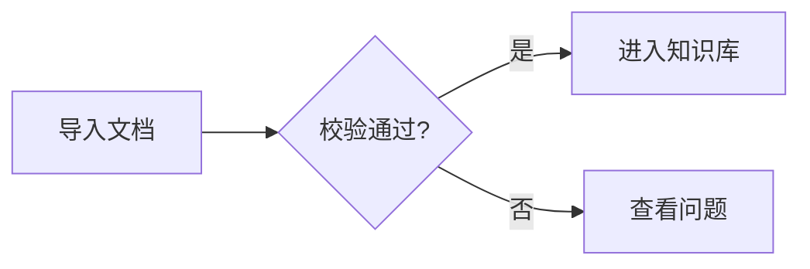
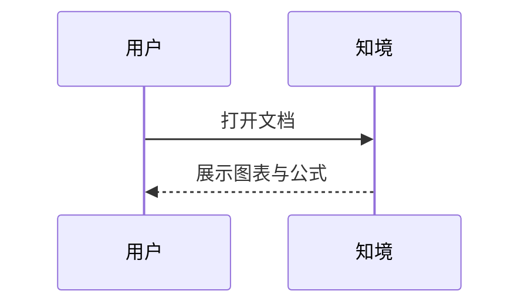
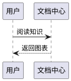
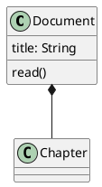

# Markdown 图表与公式验收

本文件只包含合成内容，用于验证本地渲染。图表中的点击不会执行业务操作。

## Mermaid 流程图



## Mermaid 时序图



## PlantUML 时序图



## PlantUML 类图



## 行内与块级公式

行内公式：$E = mc^2$，矩阵、分式和求和使用独立公式块。

$$
\sum_{i=1}^{n} i = \frac{n(n+1)}{2}
$$

```math
\begin{bmatrix} 1 & 2 \\ 3 & 4 \end{bmatrix}
```

## 错误语法也不影响正文

```mermaid
flowchart LR
A[unfinished
```

不合法的数学公式：$\frac{1}{$。

```plantuml
@startuml
Alice -> Bob : Hello
this is definitely not a command {
@enduml
```

这段正文在图表错误之后仍能阅读。
